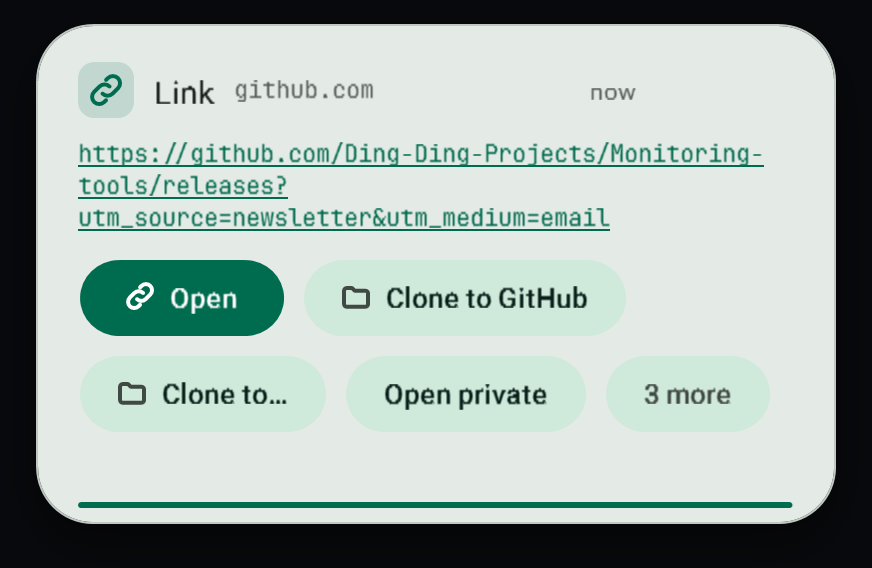
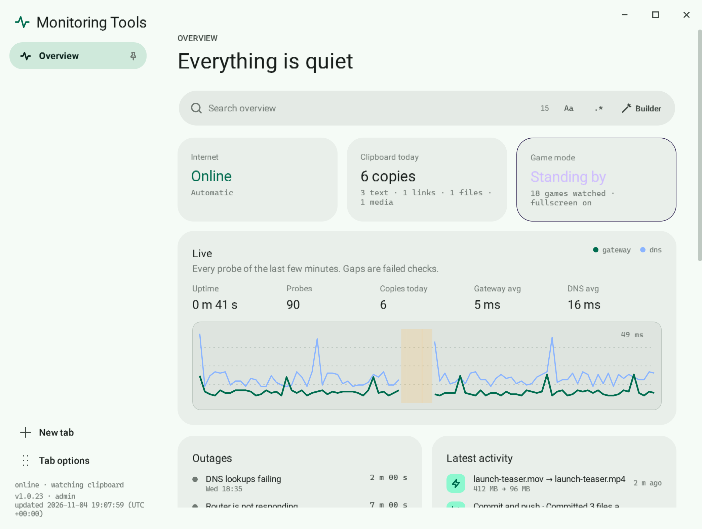
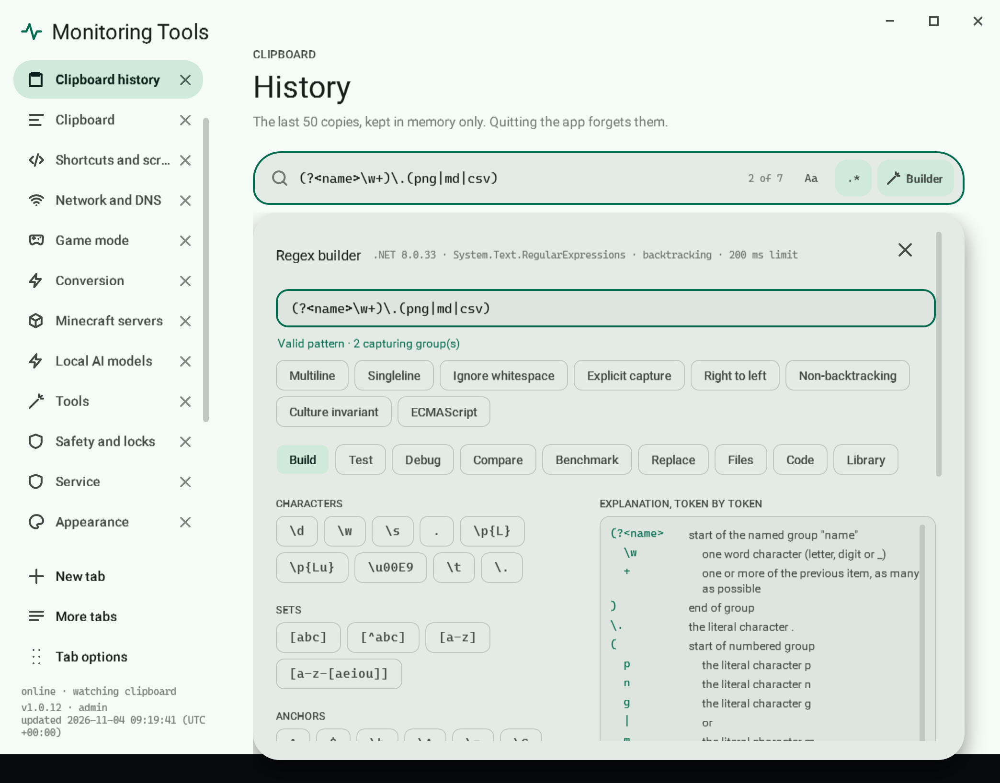
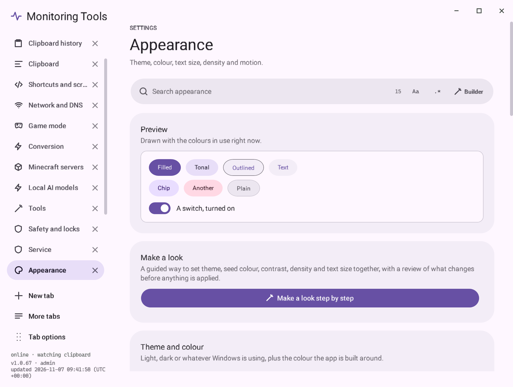
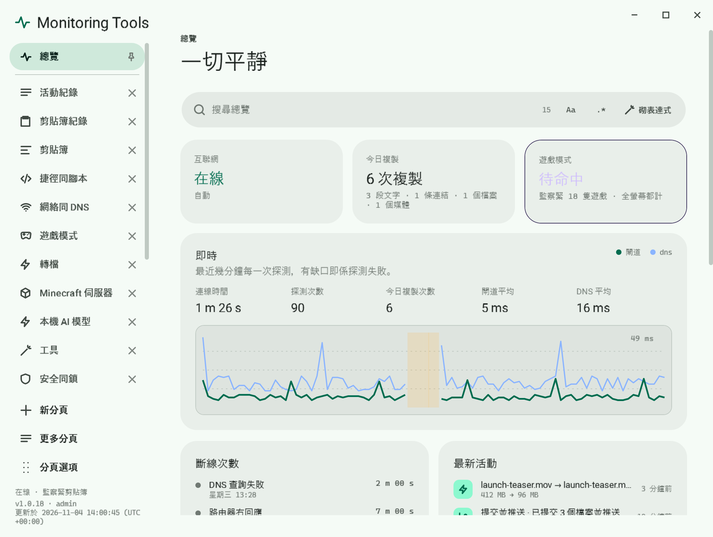
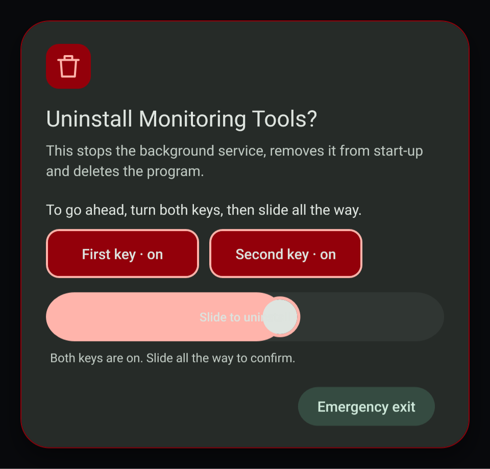
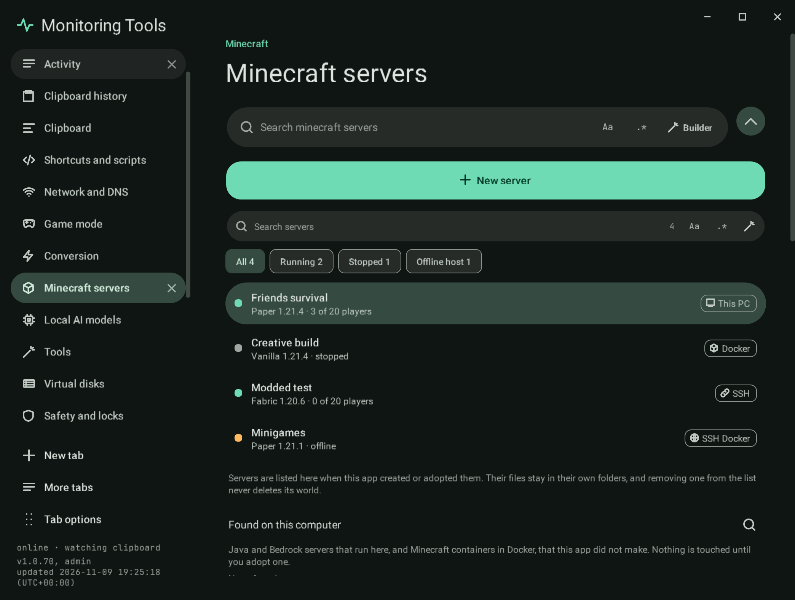
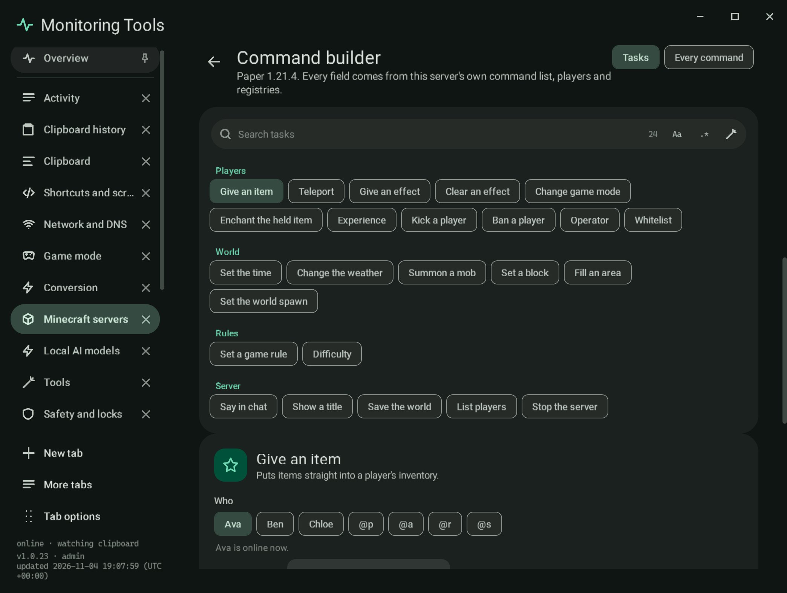

# Monitoring Tools

**[Project site and screenshots](https://ding-ding-projects.github.io/Monitoring-tools/)** · **[Download](https://github.com/Ding-Ding-Projects/Monitoring-tools/releases/latest/download/MonitoringTools-Setup.exe)** · [Latest release notes](https://github.com/Ding-Ding-Projects/Monitoring-tools/releases/latest)

A small Windows background service with a tray icon and a modern, animated UI. It watches your clipboard and your internet connection, and turns copied paths into one-step commands.




**Install in one line:** download `MonitoringTools-Setup.exe` from the latest release and run it. FFmpeg, FFprobe and portable Git are bundled, so nothing else is needed. Details are under Install below.

**Contents** (each section below opens and closes, so you choose what to read):

- Features: clipboard toasts, quick commands, shortcuts, search and regex builder, Material 3 design, language, modes, records, tabs and safety, internet watch, game mode, service and tray
- Install, Control centre, Self-test, Screenshots, Build, Public IP history
- Release figures and how long a human would have taken
- Project records: [ROADMAP](ROADMAP.md), [HANDOFF](HANDOFF.md), [CHANGELOG](CHANGELOG.md), [CLOSEOUT_PROMPT](CLOSEOUT_PROMPT.md), [CONTRIBUTING](CONTRIBUTING.md), [SECURITY](SECURITY.md)
- Licenses of bundled tools

## Install

Every push to `main` builds on Windows and publishes the next release automatically. Download `MonitoringTools-Setup.exe` from the latest release and run it. FFmpeg, FFprobe and portable Git are bundled inside, so nothing else needs installing and conversion works offline. It copies itself to `%LOCALAPPDATA%\Programs\MonitoringTools`, registers start-up and appears in the tray. Settings, logs and scripts live in `%LOCALAPPDATA%\MonitoringTools`.

To remove it, right-click the tray icon and choose **Uninstall service**.

## Features

<details>
<summary><b>Clipboard toasts</b></summary>

- A toast slides into the bottom-right corner for every copy, stays for 3 seconds and holds while you hover. It shows four actions up front and keeps the rest behind **More**.
- Hovering reveals actions tailored to what you copied:
  - **Text and Markdown**: rendered Markdown preview, copy as plain text, case changes, tidy spaces, join lines, search, translate, save as a file.
  - **Links**: open, open in a private window, copy domain, strip tracking parameters, copy as a Markdown link.
  - **Files and folders**: rich previews (video frames, PDF and document thumbnails, album art, the first lines of text and code, rendered Markdown, CSV tables, folder and zip listings, plus duration, resolution and codecs for media). **Open in** the file's default app, **Open with…**, show in folder, copy name, forward slashes, terminal here. Paths copied with quotes (Explorer "Copy as path") offer **Remove quotes**; unquoted ones offer **Add quotes**.
  - **Several files at once**: move to, copy to, delete to the Recycle Bin, and batch conversion chips.
  - **File tools sheet**: one tab each for move and copy, batch Base64 encode and decode (plus copy as Base64 text or a data URI), and password encryption (AES-256-GCM, `.mtenc` files next to the originals).
  - **Base64 text** on the clipboard offers decode; any text offers encode.
  - **Images, video and audio**: save, convert and quick command chips such as `:mp4`, `:gif`, `:mp3`, `:webp`. Drag the preview out of the toast into any drop target.
  - **Docker**: a copied `compose.yaml` / `docker-compose.yml` offers up, down, pull, restart and logs; a `Dockerfile` offers build and build-and-run. Each button explains what it will do.
  - **JSON, colors, email addresses** get their own previews and actions.
- Copies that password managers mark as private are skipped.
- History of the last copies, kept in memory only.

</details>

<details>
<summary><b>Quick commands</b></summary>

Copy a path with a command on the end and it runs as soon as it lands on the clipboard:

```
D:\Footage\clip.mov:mp4        converts next to the original, same name
"C:\Music\take 3.wav":mp3      quotes are fine
C:\Code\my-repo:push            stages, commits with your default message and pushes
D:\Footage:mp4                  converts every compatible file in the folder
```

Formats (39, searchable on the Conversion page): video `mp4 hevc av1 webm mkv mov m4v avi wmv flv mpg ts 3gp`, animation `gif apng`, audio `mp3 m4a aac opus ogg flac alac wav aiff wma ac3 mka`, images `png jpg webp avif jxl bmp tiff tga qoi ppm jp2 ico`. Existing files are never overwritten. Conversion uses FFmpeg; if it is missing, the toast offers to install it with winget.

The first `:push` asks for a default commit message, with snippets such as `{date}`, `{time}`, `{branch}`, `{repo}` and `{files}`.

</details>

<details>
<summary><b>Custom shortcuts</b></summary>

Create your own `:name` commands in the control centre. Each one is a batch or PowerShell script, edited in the built-in script editor, and receives whatever came before the colon as its first argument (also in `MT_INPUT`).

</details>

<details>
<summary><b>Search and regex builder</b></summary>

- Every page, list, the command palette, the tray menu and the Minecraft version picker has its own search bar. Plain text by default; `.*` switches to regular expressions and `Aa` matches case. `Ctrl+F` jumps to the page's search.
- **Builder** opens a regex builder attached to that bar: a token palette, all .NET options, a token-by-token explanation, a backtracking warning, a Test view with matches and capture groups, Replace and Split previews, generated C#, PowerShell and Python, and a saved library. It runs the real .NET engine with a 200 ms limit, locally. Details and the list of what is not built yet: [docs/features/search](docs/features/search/README.md).



</details>

<details>
<summary><b>Material 3 design</b></summary>

- The whole app uses Material 3 colour roles, Roboto, pill buttons with state layers, filled 24-corner cards, a pill navigation indicator and spring motion. Choose Light, Dark or System and one of five seed colours (Mint, Violet, Amber, Ocean, Rose); text size runs from 90 to 150 %, and Reduce motion turns the movement off.



</details>

<details>
<summary><b>Language and voice</b></summary>

- English, Hong Kong Cantonese or both side by side, with separate English and Cantonese humour levels from 1 to 5, an emoji switch for dialogs and an optional narrator that reads toasts aloud with Windows voices.



</details>

<details>
<summary><b>Modes</b></summary>

- School mode (renamable, PIN-protected), five ADHD helpers, an occasional dim sum surprise, and scheduled settings that change language, theme, sounds, toasts or game mode by weekday and time, or follow a settings file.

</details>

<details>
<summary><b>Records, exports and help</b></summary>

- A notification centre, settings history with restore, exports in JSON, CSV, Markdown, HTML and text, a changelog viewer and an offline Help and docs page led by real tasks.
- Clipboard history has a Select mode for copying, saving or removing several copies at once.
- Every element has a right-click menu (also Shift+F10) with its own filter, and destructive actions need two keys and a full slide.



</details>

<details>
<summary><b>Tabs, tools and safety</b></summary>

- The control centre is a tab strip docked on the left (or any edge), with New tab, pinning, groups, overflow and searches across tabs.
- Local AI models: manage Ollama on this computer. Tools: draw on pictures, publish a folder to GitHub, open files in your editor. The Minecraft page is a server manager: a server list beside each server's overview, console, a command builder (task forms with players, items, blocks, effects, bounds and relative positions, and every command of the version, with run, copy, favourites and scheduling), players, settings, worlds and world generator, plugins and mods, backups and schedules, and a six-step create flow. Details: [Minecraft server manager](docs/features/minecraft/README.md).




- Safety and locks: playful element locks with an unlock ladder, a Support Tickets desk and a built-in authenticator for one-time codes.

What is finished and what is not: [docs/features/required-features.md](docs/features/required-features.md).

</details>

<details>
<summary><b>Internet watch</b></summary>

- When the connection drops, an always-on-top dialog explains where it broke (adapter, IP address, gateway, DNS, upstream, captive portal) with live details, and stays until the connection returns or you dismiss it.
- One-press **Release & renew** (`ipconfig /release`, `/renew`, `/flushdns`), DNS flush, sign-in page for captive portals, copyable report.
- **DNS profiles**: switch between Automatic, Google, Cloudflare, Quad9, OpenDNS or your own saved servers from the dialog, the tray menu or the control centre.

</details>

<details>
<summary><b>Game mode</b></summary>

On by default. Popups are held back while Roblox, Minecraft, League of Legends, Valorant, Fortnite, CS2 and other listed games run, or while any app is fullscreen. The list is editable.

</details>

<details>
<summary><b>Service and tray</b></summary>

- Installs itself per user, starts at sign-in and runs under a supervisor that restarts it after a crash.
- Tray icon with a status dot: mint online, amber offline, violet game mode, grey paused.
- Right-click menu: control centre, history, shortcuts, connection test, toggles, snooze, DNS, administrator rights, restart, logs, **uninstall**, quit.
- **Administrator rights** are off by default. Turning them on asks once through UAC, then the service starts elevated at every sign-in until you turn it off.

</details>

<details>
<summary><b>Control centre</b></summary>

Overview with live latency, uptime and outage history; an activity feed of conversions, pushes, shortcuts and file jobs; clipboard history; a command playground that explains what `path:format` will do before it runs; settings for every feature; and an about page with an update check. A welcome tour with **Try it** buttons opens on first run and from the tray menu.

</details>

<details>
<summary><b>Self-test</b></summary>

`MonitoringTools.exe --selftest <folder>` runs 45 checks of search, the regex builder, exports, settings history, language switching, themes, density, locks, the two-key confirmation, the authenticator, QR pairing, the docs and every page inside the built app. It uses its own throwaway data folder, so it never touches your settings, and writes `selftest.json`.

The regex builder also works from a terminal: `MonitoringTools.exe --regex "<pattern>" <file>...` (see [docs/features/search](docs/features/search/regex-builder.md)).

</details>

<details>
<summary><b>Screenshots</b></summary>

Every build renders the real app on a Windows runner (`MonitoringTools.exe --screenshots <folder>`), attaches the images to the release and publishes them on the project site.

</details>

<details>
<summary><b>Build</b></summary>

```
download-dependencies.bat      fetch pinned, digest-verified dependencies into .deps\ (also installs a .NET 8 SDK if missing)
build.bat [version]            build out\MonitoringTools.exe with every dependency bundled
build-installer.bat [version]  build dist\MonitoringTools-Setup.exe and a zip
```

Prefer a window? `MonitoringTools-BuildTool.exe` (in every release, source in `apps/build-tool`) runs the same entrypoints with Build, Build and run, and Build installer, showing each phase, the live log, the real exit code and a cancel button. `MonitoringTools-Site.exe` (source in `apps/site-companion`) is this project's site and documentation as an offline desktop app.

Dependencies are pinned in `deps/manifest.json` with SHA-256 digests. On Linux or macOS, `download-dependencies.sh` fetches the same files for cross-building.

</details>

<details>
<summary><b>Public IP history</b></summary>

When the public IP address changes, a dialog shows the old and new address, and the change is committed to a local git repository (`%LOCALAPPDATA%\MonitoringTools\ip-history`) as `ip-history.md` and `history.json`, with first seen and last seen times for every address. Set a remote in the control centre to push the history automatically. Lookups use ipinfo.io, with api.ipify.org as a fallback.

</details>

<details>
<summary><b>Release figures and how long a human would have taken</b></summary>

Line counts are produced by the release workflow with `node scripts/line-counts.mjs` and published in each release's notes. The block below is refreshed from the latest release by that workflow; until the first release that runs it, it shows no figures rather than invented ones.

<!-- release-figures:start -->
Figures from release v1.0.32 (commit `8268ce26aa50`), refreshed automatically by the release workflow. The release notes are the record; this is a convenience copy.

- Project total: 78,271 lines (71,821 non-blank); grand total with excluded rows: 88,999 lines.
- Source 63,635, tests 4,963, styles and markup 1,363, documentation 6,843, configuration and data 1,467.
- Agent-written surviving lines: 78,271 of 78,271, by `git blame`.
- Human time estimate: about 1,333 to 3,314 working days for one person, an estimate rather than a measurement (method below).
<!-- release-figures:end -->

**How the human-time estimate is made.** It is an estimate, not a measurement, and it is given as a range because a single figure would imply precision it does not have.

- Code days = non-blank hand-written code lines (source, tests, styles and markup) divided by 50 (fast) to 20 (slow) lines per working day.
- Documentation days = non-blank documentation lines divided by 150 (fast) to 75 (slow) lines per working day.
- Total = code days + documentation days, in 8-hour days; months = days / 20. No complexity multiplier is applied.
- Generated files, lockfiles, historical design prototypes and vendored or build-output trees are excluded, exactly as in the line counts.

It is information about scale, never a boast and never an apology.

</details>

<details>
<summary><b>Licenses of bundled tools</b></summary>

FFmpeg (GPL build from BtbN/FFmpeg-Builds, includes libx264) and Git for Windows MinGit (GPL-2.0) ship inside the app unmodified; their sources are available from those projects.

</details>

The design for every surface lives in the project's design canvas; the app implements the same "Graphite Signal" look.
