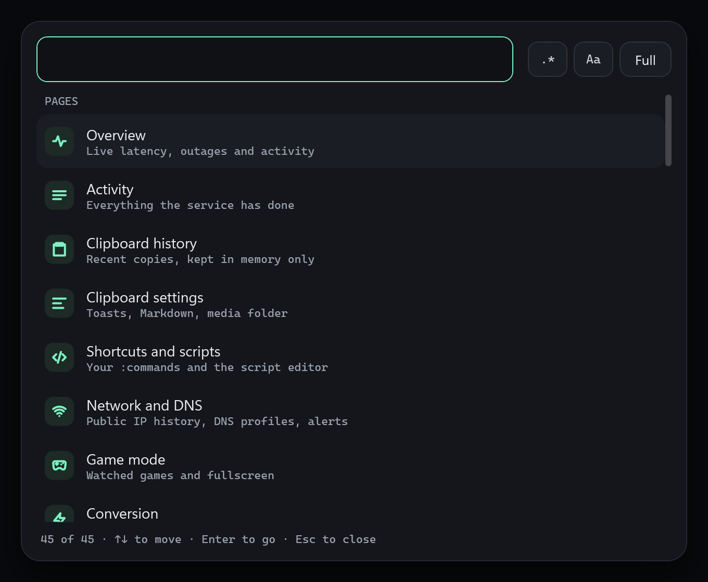

# Command palette

Press `Ctrl+Shift+F` to jump to any page, any setting or any action.

## Use it

1. Press `Ctrl+Shift+F`, or choose Command palette in the tray menu.
2. Type what you want. Plain text is the default and every word must match.
3. Switch to regex with `.*` and open the builder with **Builder**. See [Regex builder](../search/regex-builder.md).
4. Choose a result. Settings show their live control inline, and choosing one takes you to the exact control and highlights it.

## Search every page

When a page search finds nothing it offers **Search every page**, which opens the palette with the same query, mode and options.

## Related

- [Search bars](../search/search-bars.md)
- [Regex builder](../search/regex-builder.md)
