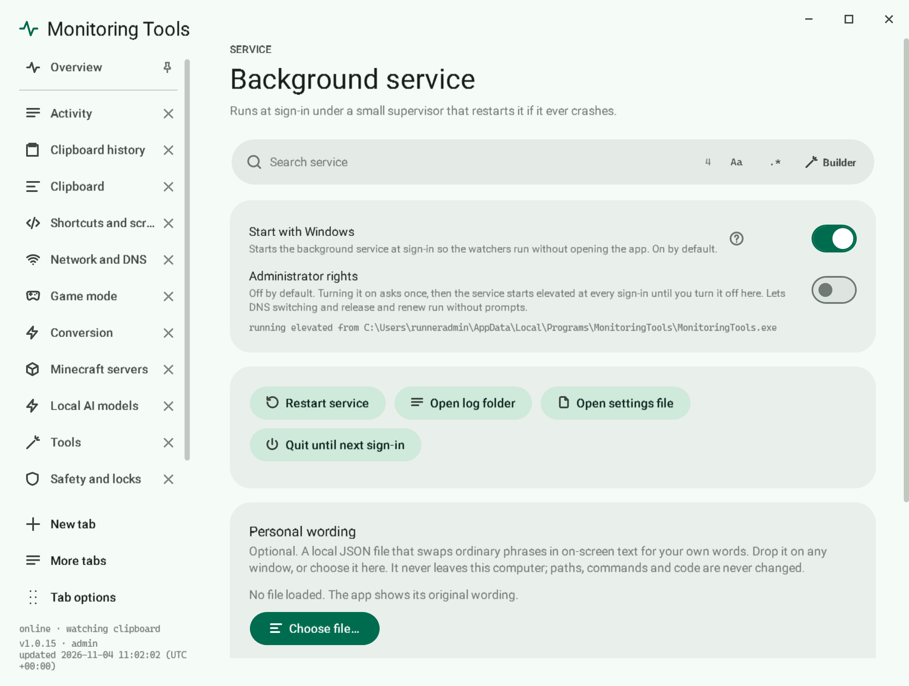
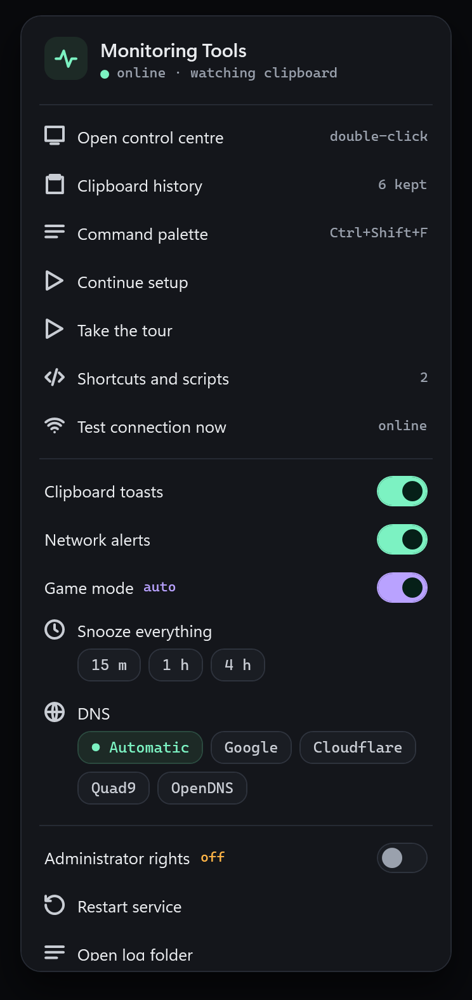

# Service and tray

Monitoring Tools installs per user, starts at sign-in and runs under a supervisor that restarts it after a crash.

## The tray icon

The dot shows the state: mint online, amber offline, violet game mode, grey paused.

Right-click for the control centre, history, shortcuts, connection test, toggles, snooze, DNS, administrator rights, restart, logs, uninstall and quit.

## Administrator rights

Off by default. Turning them on asks once through UAC, then the service starts elevated at every sign-in until you turn it off. Things that need it, such as changing DNS, then run without a prompt.

## Where things live

The program is in `%LOCALAPPDATA%\Programs\MonitoringTools`. Settings, logs and scripts are in `%LOCALAPPDATA%\MonitoringTools`.

## Personal wording

Optional. A local JSON file can swap ordinary phrases in on-screen text for your own words. It never leaves this computer, and paths, commands and code are never changed.

There are three ways to load one, and all three use the same checks and the same celebration:

- **Drop** the file on any window.
- **Choose** it on the Service page.
- **Copy** it: copy the file in Explorer, or copy its full path as text. The app checks the copied file and, if it is a valid wording file, applies it at once with the success sound. A copied JSON file that is not a wording file (a `package.json`, say) is left alone and shows the ordinary clipboard toast. A wording file that fails a check plays the refusal sound and says why. Turn this off with **Apply a copied wording file** on the Service page (default: on).

File format: `{"schemaVersion": 1, "entries": {"ordinary phrase": "your words"}}`, up to 256 KiB. School mode keeps personal wording off, whichever route is used. **Clear and restore original wording** removes it.

## Uninstall

Right-click the tray icon and choose **Uninstall service**. It stops the service, removes start-up and deletes the program.

## Related

- [Command palette](command-palette.md)
- [DNS profiles](../network/dns-profiles.md)
