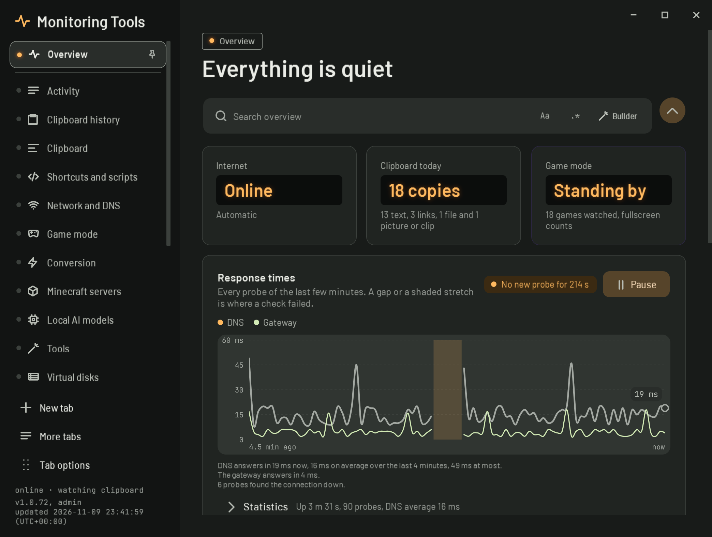

# Looks

A look is the whole style of every window: the typefaces, the shape of every corner, card outlines, shadows, how the side rail marks the open page, the label above each page title and the neutral colours. There are four, and you can switch between them at any time. Your theme, text size, density, motion, language and name stay as they are.

| Look | What it is like | Type | Default colour |
| --- | --- | --- | --- |
| **Graphite** | Soft tonal layers and rounded shapes. The look the app has always had, tidied up. | Roboto, JetBrains Mono for figures | Mint |
| **Instrument** | Like test gear on a bench: molded panels with fine edges, a lit indicator on the open page, big figures in dark readout windows. | Barlow and Barlow Semi Condensed | Amber |
| **Blueprint** | Drawn in fine ink on a faint grid. Square corners, outlined panels, no shadows, and the pages sit on one wire in the side rail. | IBM Plex Sans, Plex Sans Condensed and Plex Mono | Ocean |
| **Pop** | Everything is a sticker: ink outlines, hard offset shadows, bright fills, and each page name printed on label tape. | Bricolage Grotesque | Rose |

## Where to change it

- **Appearance page:** the Look card at the top. Each choice is drawn in its own style, so you can see it before you pick it.
- **Setup:** the second step, Pick a look. It is optional and the app redraws as you click.
- **Make a look:** the guided form on the Appearance page now starts with the look, then theme, colour, contrast, density and text size, and shows what will change before it applies.
- **Command palette (Ctrl+Shift+F):** type "look" and pick one.

Picking a look also picks the colour it was drawn with (Graphite with Mint, Instrument with Amber, Blueprint with Ocean, Pop with Rose). Change the colour under Theme and colour afterwards whenever you like: every look works with every colour.

**Default:** Graphite

**Stored as:** `Look (graphite, instrument, blueprint, pop)` in settings.json. Reset to defaults puts it back to Graphite.

## How it works

- Colours: Graphite keeps the colour seed's own tinted neutrals. The other looks bring their own neutral sets for light and dark and take their accents from the seed; Pop uses the bright tones of three seeds for its sticker fills.
- Type: the typefaces are embedded in the app (all under the SIL Open Font License, listed on the About page), so a look renders the same on every Windows install.
- Corners: every corner is written once for Graphite. When a box first appears, its corner is mapped to the look (molded for Instrument, square for Blueprint, round for Pop). Circles stay circles, and a corner you set yourself in the appearance editor is left alone.
- Depth: Graphite keeps soft shadows on things that float. Instrument uses a tighter shadow, Blueprint none at all, and Pop a hard offset shadow under cards, the open page and floating windows.
- Open windows redraw when the look changes. The pages rebuild in the new look straight away.

The designs for all four looks, each on its own canvas, are kept in `design/looks/` in the repository.
