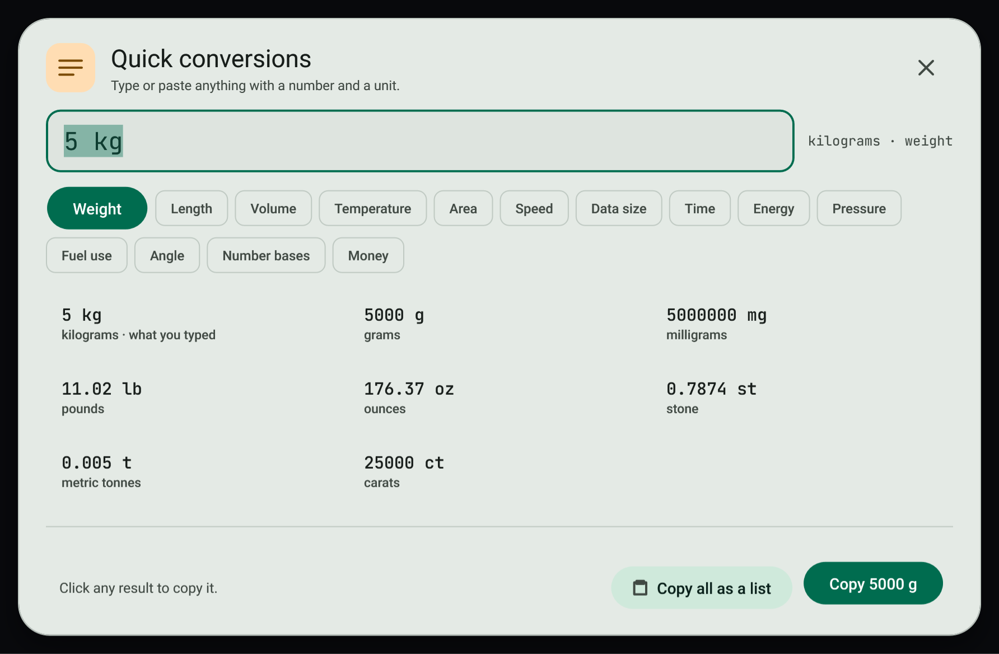

# Quick conversions

Copy an amount and see it in every unit of its kind at once. Click any result to copy it.

## Open it

- Copy an amount such as `5 kg`. The toast already shows the other units; press **All conversions** for the full window.
- Or press `Ctrl+Shift+Alt+U`, or search **Quick conversions** in the command palette (`Ctrl+Shift+F`).

## Use it

1. Type or paste an amount. Any common spelling works: `5 kg`, `5kg`, `5 kilos`, `72°F`, `6'2"`, `100 km/h`, `1.5 GB`, `2 h 15 min`.
2. Every unit of that kind appears as a tile. The tile marked **what you typed** is your own amount.
3. Click a tile to copy it. **Enter** copies the first result, `Ctrl+Shift+C` copies them all as a list.
4. The kind chips show the same number as another kind, for example a plain `30` as weight or as speed.

## Kinds and units

| Kind | Units |
| --- | --- |
| Weight | kilograms, grams, milligrams, pounds, ounces, stone, metric tonnes, carats |
| Length | metres, centimetres, millimetres, kilometres, inches, feet, yards, miles, nautical miles |
| Volume | millilitres, litres, US cups, tablespoons, teaspoons, US fluid ounces, US gallons, UK pints, cubic metres |
| Temperature | Celsius, Fahrenheit, Kelvin |
| Area | square metres, square feet, acres, hectares, square kilometres, square miles |
| Speed | kilometres per hour, miles per hour, metres per second, knots, feet per second |
| Data size | bytes, kilobytes, megabytes, gigabytes, terabytes, kibibytes, mebibytes, gibibytes, bits |
| Time | seconds, minutes, hours, days, weeks, milliseconds |
| Energy | kilocalories, kilojoules, joules, kilowatt hours, BTU |
| Pressure | kilopascals, PSI, bar, atmospheres, millimetres of mercury |
| Fuel use | litres per 100 km, US mpg, UK mpg |
| Angle | degrees, radians, turns |
| Number bases | decimal, hexadecimal, binary, octal |
| Money | US, Canadian, Hong Kong, Australian and New Zealand dollars, euros, pounds, yen, yuan, francs, rupees, pesos, won, Singapore dollars, kronor |

Results have up to two decimals, or four below 1, and no thousands separators, so they paste cleanly into a calculator or a spreadsheet.

## Privacy

Everything except money is worked out on this PC. Money uses the European Central Bank rates from Frankfurter, and only when automatic lookups are on; only the currency code is sent. See [Lookups and the secret guard](lookups-and-secrets.md).

## Related

- [Smart copies](smart-copies.md)
