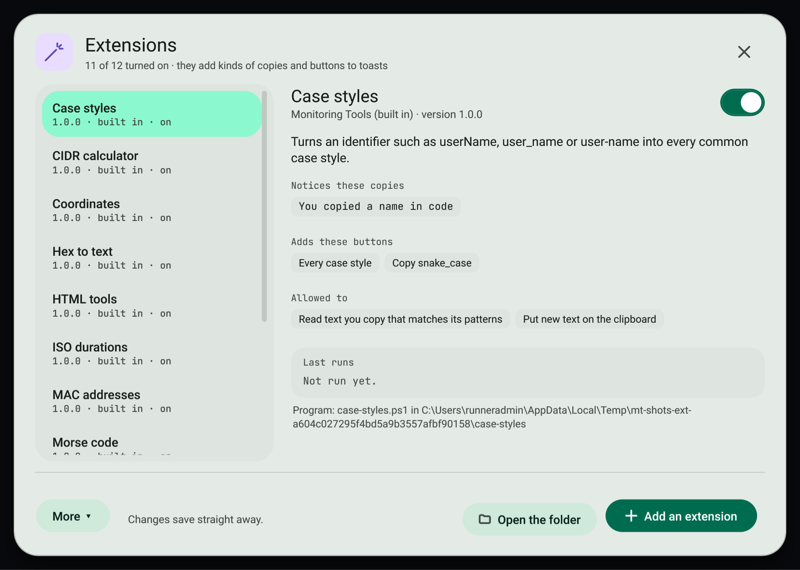
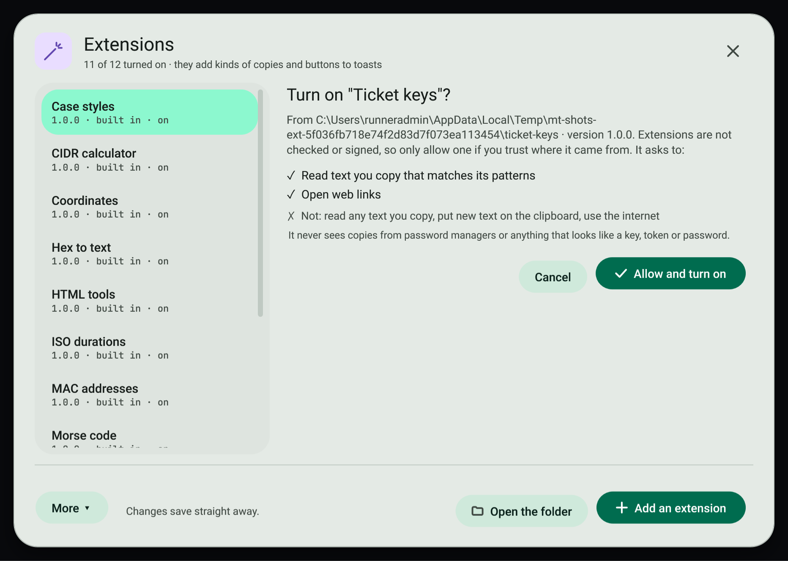

# Extensions

Extensions teach the clipboard new tricks. Each one is a small folder with a description of what to notice and a program to run when you press one of its buttons.



## Manage extensions

1. Open the command palette (`Ctrl+Shift+F`) and choose **Extensions**.
2. The list shows every extension in your extensions folder. Choose one to see what it notices, the buttons it adds, what it may do and its last runs.
3. Use the switch to turn it on or off. Turning one on shows exactly what it asks for; press **Allow and turn on**.
4. **Add an extension** (`Ctrl+N`) copies an extension folder in. **Open the folder** (`Ctrl+O`) opens `%LOCALAPPDATA%\MonitoringTools\Extensions`. **More** has **Reload all** (`F5`), the author guide and **Turn every extension off**.

New extensions start off. If an extension's version or permissions change, it turns off until you allow it again.



## Built-in extensions

The app comes with eleven extensions, written in PowerShell so they run on every Windows PC. They are installed the first time the app starts and start on. Copy what the first column shows, then press the button on the toast.

| Extension | Notices | Button and result |
| --- | --- | --- |
| Case styles | Names in code: `userName`, `user_name`, `user-name`, `UserName` | **Every case style**: camelCase, PascalCase, snake_case, SCREAMING_SNAKE, kebab-case and words |
| HTML tools | Text with entities like `&amp;amp;`, or HTML markup | **Decode entities**, **Keep only the text**, **Escape as text** |
| CIDR calculator | An IPv4 block such as `203.0.113.0/24` | **Range and hosts**: network, mask, broadcast, first and last host, usable hosts |
| Coordinates | `43.6532, -79.3832` or `43°39′11.5″N 79°22′59.5″W` | **Open the map** on OpenStreetMap, **Other formats** |
| Roman numerals | `MMXXVI` | **As a number** |
| ISO durations | `PT1H30M`, `P2DT4H` | **In words**, with seconds and a clock |
| User agents | A browser user-agent string | **What is this**: browser, version, system, device |
| Unix permissions | `-rwxr-x---`, `chmod 644`, `0755` | **Explain**: both forms and who can read, write and run |
| MAC addresses | `00:1A:2B:3C:4D:5E` or `001a.2b3c.4d5e` | **Every format**, unicast or multicast, maker prefix |
| Hex to text | Hex bytes such as `48 65 6C 6C 6F` | **Decode to text** |
| Morse code | `... --- ... / .... ..` | **Decode Morse** |

The manager marks them **built in**. Each app update brings their newest version, but only while the folder is exactly as the app installed it: once you edit an extension it is yours and updates leave it alone. Delete a built-in extension's folder and it stays deleted. Turn any of them off with its switch; updates keep it off. A record of what was installed is kept in `defaults.json` in the extensions folder.

## What an extension can and cannot do

- It only receives text that matches its own patterns, and only when you press its button.
- It never receives copies from password managers or anything the secret guard recognises.
- Its answer is limited to what you allowed: putting text on the clipboard, opening a web link, showing a toast or values to copy.
- It is stopped after 5 seconds.
- It is a program running as you, and nothing checks or signs it, so only add extensions you trust. The **Use the internet** permission is shown so you know about it; the app cannot block a program's own network use.

## Write an extension

An extension is a folder that holds `extension.json` and the program it names. Two working samples are in [`samples/extensions`](../../../samples/extensions): `ticket-keys` (PowerShell) and `morse-python` (Python). The built-in extensions below are also good starting points: copy one, change its `id`, and edit it.

### extension.json

```json
{
  "id": "ticket-keys",
  "name": "Ticket keys",
  "version": "1.0.0",
  "api": 1,
  "description": "Notices ticket numbers like ABC-1234 and opens them in your tracker.",
  "author": "Your name",
  "detect": [
    { "kind": "ticket", "label": "You copied a ticket number", "pattern": "^[A-Z][A-Z0-9]{1,9}-\\d{1,7}$" }
  ],
  "actions": [
    { "id": "open", "label": "Open ticket", "for": ["ticket"], "primary": true },
    { "id": "link", "label": "Copy link", "for": ["ticket"] }
  ],
  "run": "ticket-keys.ps1",
  "permissions": ["read-text", "open-links", "change-clipboard"]
}
```

| Field | Required | Meaning |
| --- | --- | --- |
| `id` | yes | 2 to 64 lower-case letters, digits or dashes. Unique. |
| `name` | yes | Shown in the manager and on toasts. |
| `version` | yes | Changing it asks you to allow the extension again. |
| `api` | yes | Must be `1`. |
| `description`, `author` | no | Shown in the manager. |
| `detect` | no | Patterns to notice. Each has a `kind`, a .NET regular expression `pattern`, an optional `label` (the toast heading) and optional `flags` (`i`, `m`, `s`). Patterns time out after 100 ms. |
| `actions` | yes | Buttons. Each has an `id`, a `label`, optional `for` (the kinds it applies to; all kinds when left out) and optional `primary`. |
| `run` | yes | The program inside the folder. `.exe` starts directly, `.ps1` with Windows PowerShell, `.py` with Python, `.js` with Node, `.cmd` and `.bat` with cmd. |
| `args` | no | Extra arguments for the program. |
| `permissions` | see below | What the extension may do. |

Comments and trailing commas are allowed in `extension.json`.

### Permissions

| Permission | Allows |
| --- | --- |
| `read-text` | Receiving copied text that matches its patterns. Needed for any `detect`. |
| `read-all-text` | Patterns that match any text. Without it, a pattern that matches an ordinary sentence is refused. |
| `change-clipboard` | Answering with `copy`. |
| `open-links` | Answering with `open` (web links only). |
| `internet` | Nothing is enforced; it tells the person the program goes online. |

### The protocol

When a button is pressed, the app starts the program and writes one line of JSON to its standard input:

```json
{"api":1,"action":"open","kind":"ticket","text":"ABC-1234","extension":"ticket-keys"}
```

The program writes one line of JSON to standard output and exits. Every field is optional:

```json
{"open":"https://tracker.example/browse/ABC-1234","copy":"https://tracker.example/browse/ABC-1234","toast":"Opened ABC-1234","values":[{"label":"Key","text":"ABC-1234"}]}
```

| Field | Effect |
| --- | --- |
| `copy` | Puts the text on the clipboard. Needs `change-clipboard`. |
| `open` | Opens an `http` or `https` link. Needs `open-links`. |
| `toast` | Shows a short message (up to 300 characters). |
| `values` | Up to 20 values shown as chips to copy. |
| `error` | Shows your message as a failure. |

The answer must be under 1 MB and arrive within 5 seconds. The environment variable `MONITORING_TOOLS_EXTENSION_API` is set to `1`. Anything written to standard error is ignored.

### Try it

1. Copy your folder into `%LOCALAPPDATA%\MonitoringTools\Extensions`, or use **Add an extension**.
2. Turn it on and allow it.
3. Copy something that matches a pattern. The toast shows your buttons; the last runs appear in the manager.

## Related

- [Smart copies](smart-copies.md)
- [Lookups and the secret guard](lookups-and-secrets.md)
