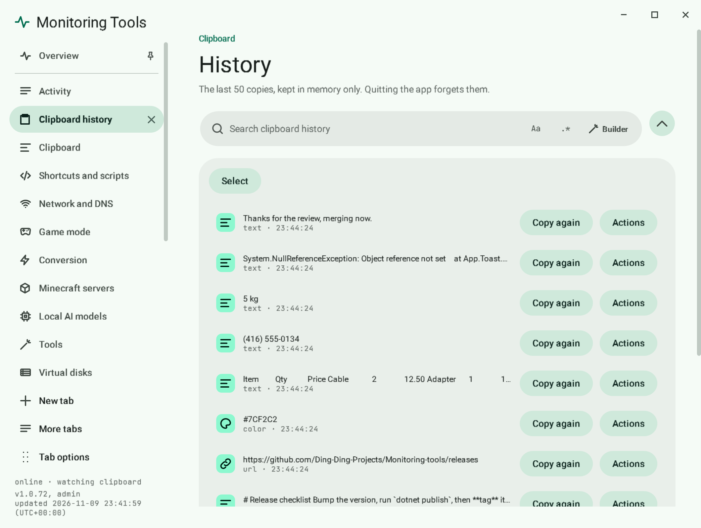

# Clipboard history

The control centre keeps your last copies so you can find something you copied a while ago.

## Find something you copied

1. Open the control centre and choose **History**.
2. Type in the search bar. Plain text is the default and every word you type must appear in the copy or its file names.
3. Switch the bar to regex with `.*` (Alt+R) when you need a pattern, and open **Builder** (Alt+B) to build it. See [Search bars](../search/search-bars.md).
4. Use **Copy again** on a row to put it back on the clipboard.

`Ctrl+F` jumps straight to the page's search.

## How much is kept

The size is a setting. When the limit is reached, the oldest copies drop off.

## Privacy

History lives in memory only. Quitting the app forgets it. Copies that password managers mark as private are never recorded.

## Related

- [Clipboard toasts](toasts.md)
- [Search bars](../search/search-bars.md)
- [Command palette](../app/command-palette.md)
