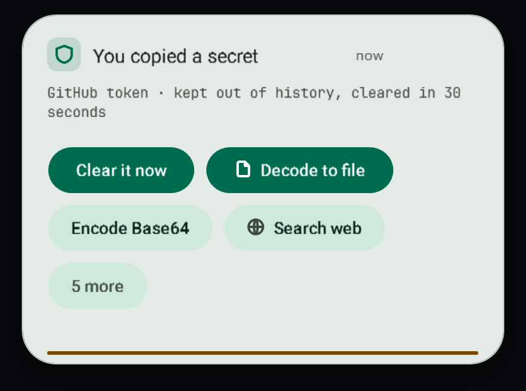

# Lookups and the secret guard

Some toasts can add a detail from the internet, such as today's exchange rate. Secrets you copy are kept out of history and taken off the clipboard after a short while.

## Automatic lookups

Lookups are on by default and you can turn them off, all at once or one kind at a time, in **Clipboard settings**.

| When you copy | What is sent | Sent to |
| --- | --- | --- |
| Money | the currency code | Frankfurter (European Central Bank rates) |
| A book number | the ISBN | Open Library |
| A package name | the package name | npm, NuGet or PyPI |
| A public IP address | the address | RDAP (the internet address registries) |

The rules every lookup follows:

- Only the piece above is sent, never the rest of what you copied.
- Nothing is looked up for secrets, copies from password managers, or text from extensions.
- A lookup gives up after 4 seconds and the toast simply stays as it was.
- Answers are kept in memory for a day, so the same thing is not asked twice.

With lookups off, nothing you copy leaves this PC.

## The secret guard

When you copy something that looks like a secret, the toast turns amber and says so.

It covers GitHub, Slack, AWS and Google keys, API keys that start with `sk-`, private keys, connection strings with a password, sign-in tokens (JWT) and bank account numbers (IBAN).

What happens:

1. The copy is not added to clipboard history.
2. After 30 seconds the clipboard is cleared, unless you have copied something else since.
3. It is never looked up and never sent to an extension.
4. **Clear it now** clears it straight away.

Copies that password managers mark as private are skipped completely, as before.

## Related

- [Smart copies](smart-copies.md)
- [Clipboard history](history.md)
