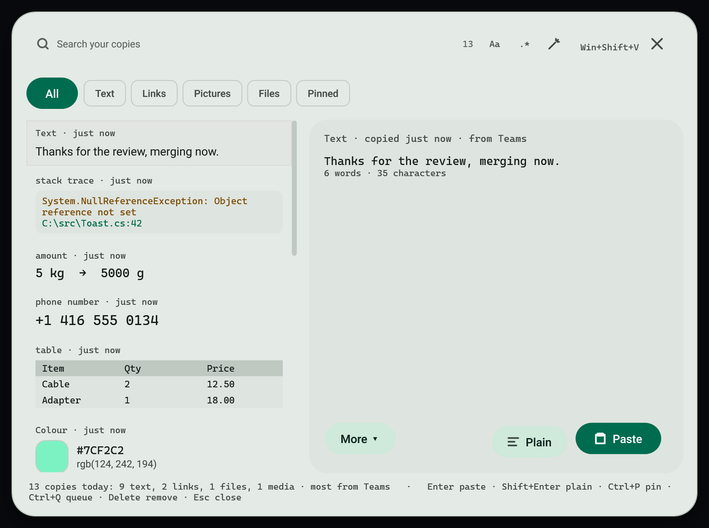
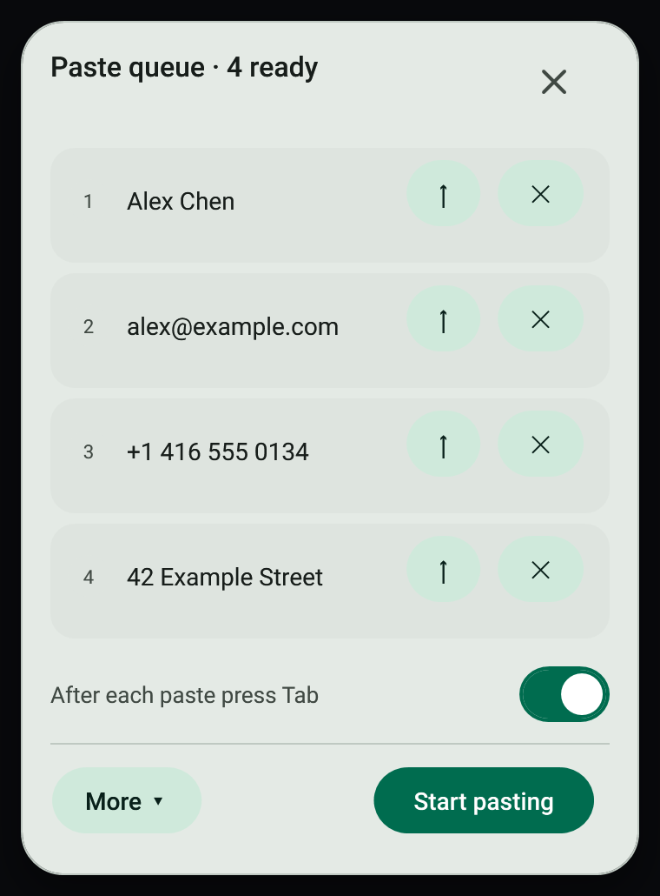
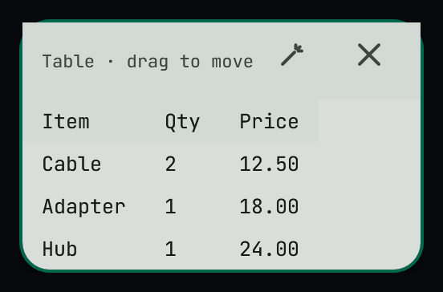
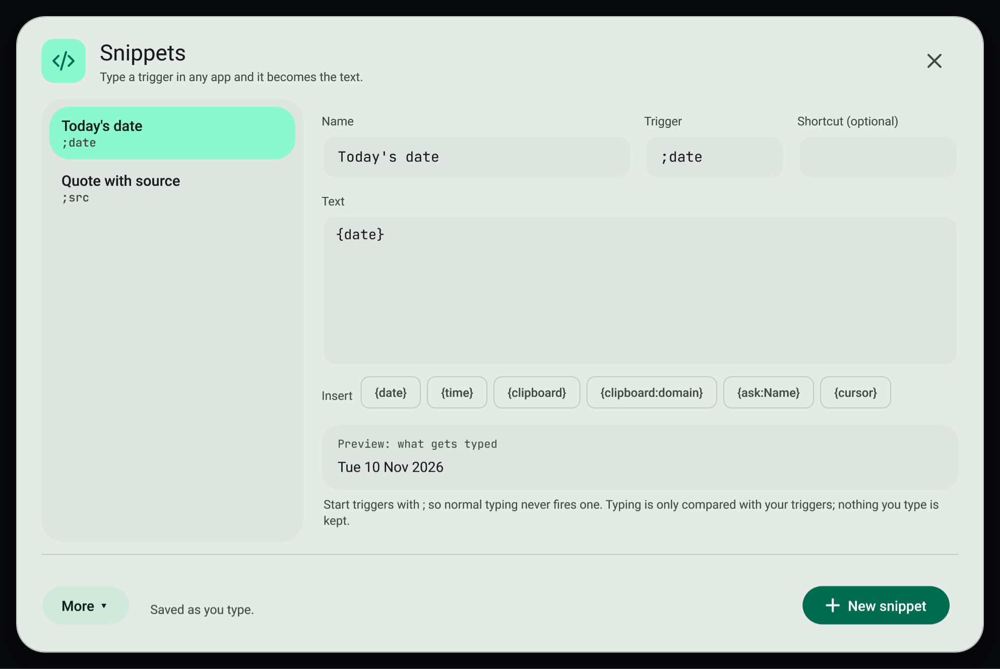
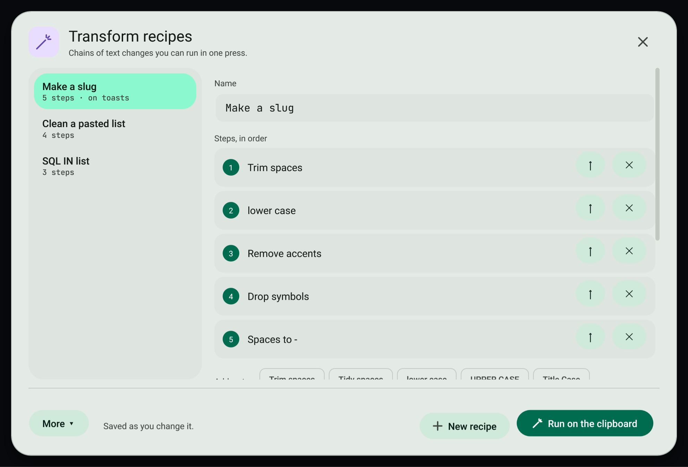
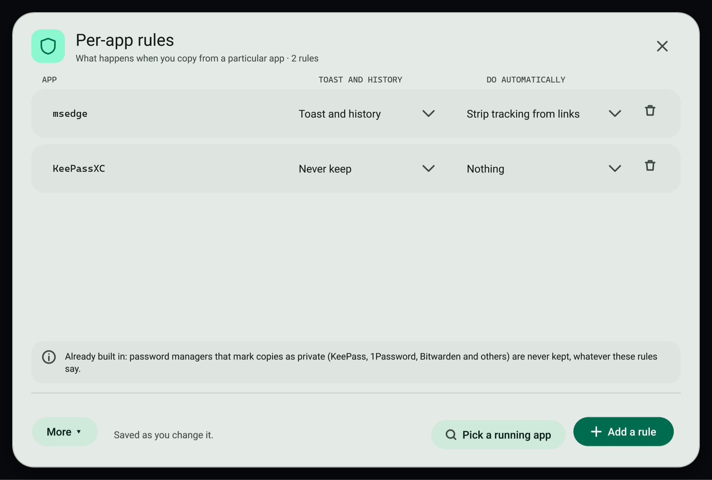
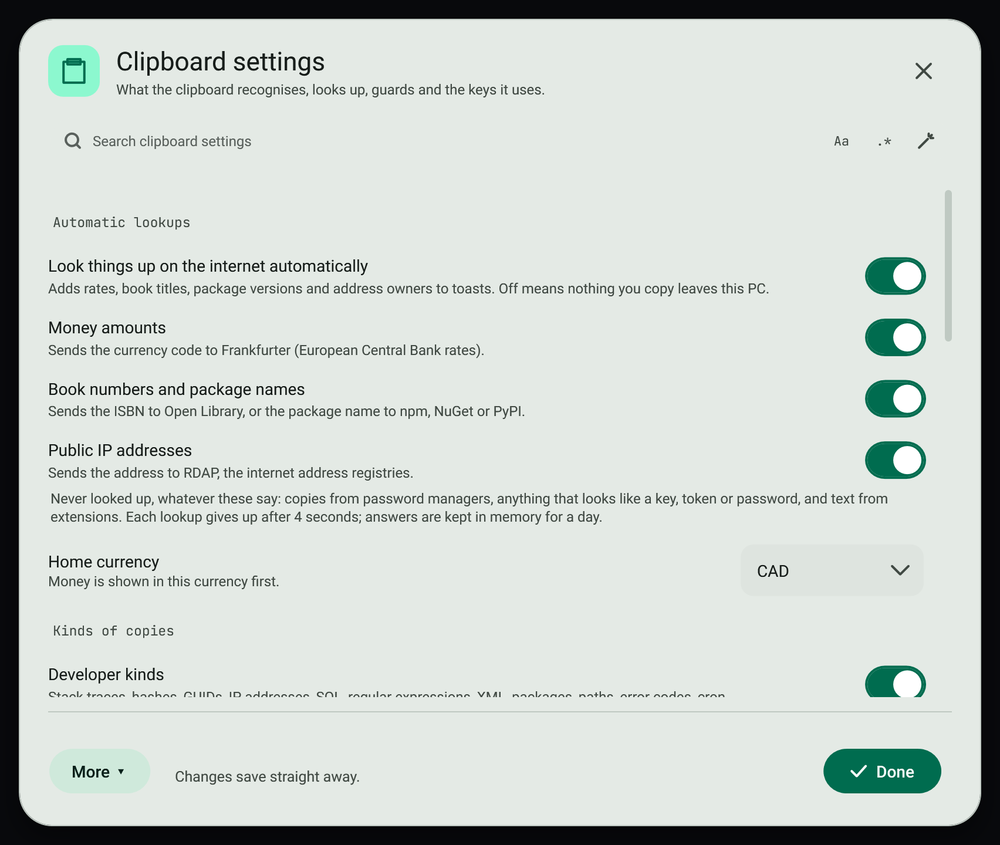

# Clipboard power features

Shortcuts and small windows that make copying and pasting faster: clipboard history with previews, plain text paste, undo, the paste queue, pins, collect mode, typing instead of pasting, snippets, recipes and per-app rules.

## Clipboard history

Press `Win+Shift+V` (Windows keeps `Win+V` for its own history).

- Every row previews what it is: a link card, a picture or file thumbnail with its type and size, a mini table, a colour swatch, a tidy phone number, a stack trace.
- The copy you pick shows large on the right, with its recognised values.
- Type to search, including the kind and the app it came from. `.*` switches to a regular expression and **Builder** builds one; see [Search bars](../search/search-bars.md).
- The kind chips show only text, links, pictures, files or pinned copies.

| Key | Does |
| --- | --- |
| `Enter` | Pastes into the app you were in |
| `Shift+Enter` | Pastes as plain text |
| `Ctrl+P` | Pins the copy to the top of the list |
| `Ctrl+Q` | Adds it to the paste queue |
| `Delete` | Removes it from history |
| `Esc` | Closes |

**More** has the same actions plus **Pin on screen**, **Copy without pasting** and **Open the History page**.

## Paste as plain text

`Ctrl+Shift+Alt+V` pastes what you copied without its fonts, colours or links.

## Undo the clipboard

`Ctrl+Shift+Alt+Z` puts back what was on the clipboard before your last copy: text, files or a picture.

## Paste queue

1. Press `Ctrl+Shift+Alt+Q`, or choose **Paste queue** in the command palette.
2. Copy several things. They join the queue in order instead of showing a toast.
3. Press **Start pasting**. Each `Ctrl+V` now pastes the next one. With **After each paste press Tab** on, the next field is ready straight away.
4. Use ↑ to move an item up and ✕ to remove it. **More** reverses the order, clears the queue or copies everything as one note.

## Pin on screen

**Pin on screen** on a toast, in history, or `Ctrl+Shift+Alt+P` for the newest copy, keeps text, a table or a picture on top of every window.

Drag it by its top bar. The options button sets how see-through it is and lets clicks pass through to the app below. `Ctrl+C` copies it again; `Esc` or ✕ unpins it.

## Collect mode

`Ctrl+Shift+Alt+A` starts collecting: every copy is added to one growing note. Press it again to put the whole note on the clipboard.

## Type it instead of pasting

`Ctrl+Shift+Alt+T` types what you copied as key presses, for sites and apps that block pasting. It types up to 5,000 characters.

## Snippets

Type a snippet's trigger in any app and it is replaced with the snippet's text. Open **Snippets** from the command palette or Clipboard settings.

1. **New snippet** (`Ctrl+N`), then give it a name, a trigger such as `;sig`, and its text. A shortcut is optional.
2. The **Insert** buttons add fill-ins: `{date}`, `{time}`, `{clipboard}`, `{clipboard:domain}`, `{ask:Name}` (asks you when it is used) and `{cursor}` (where the cursor ends up).
3. The preview shows exactly what will be typed. Changes save as you type.

Only your triggers are compared with what you type. Nothing you type is kept, and the keyboard watcher runs only while you have snippets.

## Transform recipes

A recipe is a chain of text changes, such as trim, lower case, remove accents and spaces to dashes, which makes a slug. Add steps from the palette, move them with ↑ and remove them with ✕. The result shows live on what you copied. **Show on text toasts** adds the recipe as a button whenever you copy text; **Run on the clipboard** (`Ctrl+Enter`) changes what is on the clipboard now.

## Per-app rules

Choose what happens to copies from a particular app:

- **Toast and history**, **History only, no toast**, or **Never keep**.
- One automatic action: **Strip tracking from links**, **Keep as plain text**, **Clear after 30 s** or **Open tables as a table**.

**Pick a running app** (`Ctrl+P`) lists the apps that have a window open. Password managers that mark their copies as private are never kept, whatever the rules say.

## Ask your local AI

Text toasts offer **Explain with your local AI**, and for longer text **Summarise** and **Rewrite more simply**. They use the first model installed in Ollama on this PC; see [Ollama](../ollama/README.md). Nothing is sent anywhere else.

## Clipboard settings

Open **Clipboard settings** from the command palette. Search it, then:

- choose what automatic lookups may send, and your home currency
- turn kinds of copies, the secret guard, extensions and snippets on or off
- click a shortcut box and press new keys; Backspace removes the shortcut

A shortcut another app already uses is listed so you can pick another.

## Related

- [Smart copies](smart-copies.md)
- [Quick conversions](conversions.md)
- [Clipboard history page](history.md)
