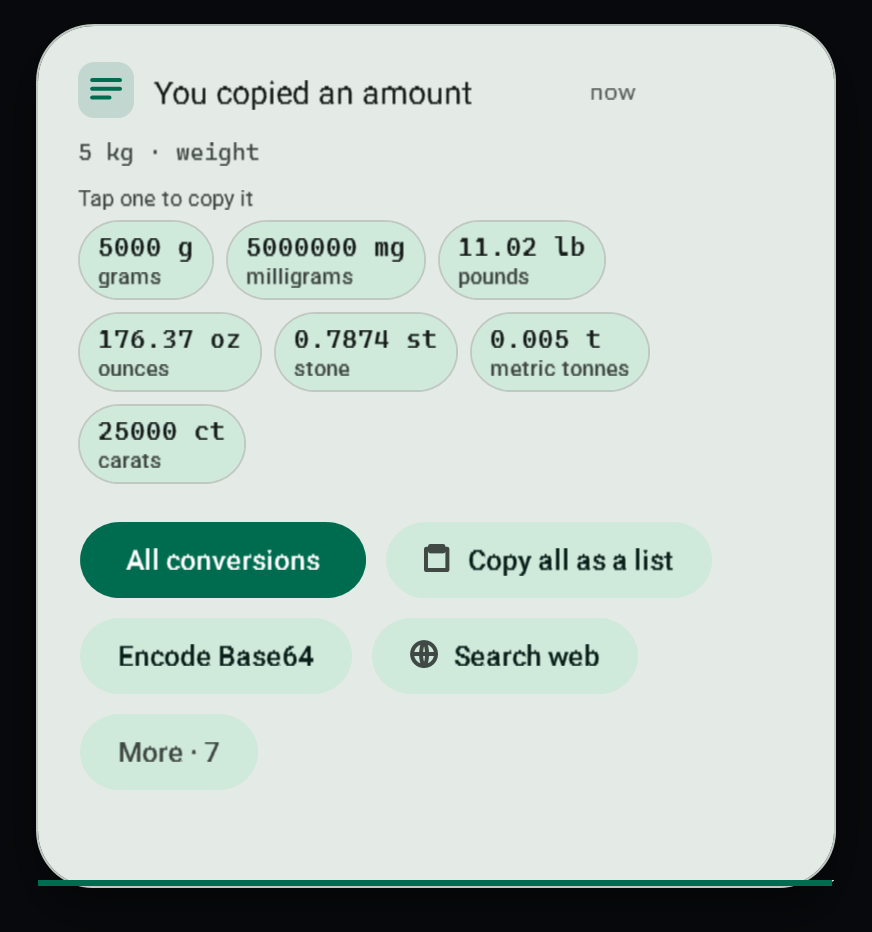

# Smart copies

When you copy text that the app recognises, the toast says what it is, shows the useful versions of it as tiles you tap to copy, and offers the buttons that make sense for that kind.

## What it recognises

| You copy | The toast shows | Main button |
| --- | --- | --- |
| An amount with a unit: `5 kg`, `72°F`, `6'2"`, `3 cups`, `2 h 15 min`, `30 mpg`, `0xFF` | Every other unit of that kind | **All conversions** (see [Quick conversions](conversions.md)) |
| Money: `$40`, `40 USD`, `EUR 12.50` | The amount, then today's rates when lookups are on | |
| A time with a zone: `3 pm PST`, `15:30 UTC` | The time here, in UTC, Toronto, Vancouver, London, Hong Kong and Tokyo | |
| A Unix time: `1793998800` | Local time, UTC, ISO 8601, and seconds or milliseconds | |
| A sum: `(12.5*4)+18`, `200 * 15%` | The result | **Copy** the result |
| A phone number | Tidy, international and digits-only forms | **Call**, **Text** |
| A street address | One line and a label | **Open in Maps**, **Directions** |
| A flight number: `AC 856` | | **Flight status** |
| A book number (ISBN) | ISBN-10 and ISBN-13, then the title when lookups are on | **Open Library** |
| A bank account number (IBAN) | Whether the check digits are right, grouped and plain | |
| A tracking number (UPS, Canada Post, USPS, Royal Mail and other postal services) | | **Track on** the carrier's page |
| A cron schedule: `0 9 * * 1-5` | The schedule in words and the next three runs | |
| One character or emoji | Code point, HTML, C# or JS escape, UTF-8 bytes | |
| Text in another language | | **Translate with your local AI**, **Translate on the web** |
| A stack trace (.NET, Python, JavaScript) | The message and each frame | **Open** the file at that line in VS Code |
| A sign-in token (JWT) | Subject, issuer, expiry, header and payload | |
| A hash (MD5, SHA-1, SHA-256, SHA-384, SHA-512) | Lower and upper case | **Check a file against it** |
| An IP address | Private or public; for a public one, who owns it when lookups are on | **Ping**, **Trace route** |
| A Git SSH link: `git@github.com:owner/repo.git` | SSH, HTTPS and the clone command | **Clone** |
| A Windows error code: `0x80070005` | Hex, decimal, facility and code | **Search Microsoft Learn** |
| A GUID | Standard, upper case, braces, no dashes, C# | **Copy a new GUID** |
| SQL | Formatted and one line | **Copy formatted** |
| A regular expression | The pattern for C# and JavaScript | **Explain and test it** |
| XML | Tidy and one line | **Copy tidy** |
| A package: `npm i react`, `dotnet add package Serilog`, `pip install requests` | The newest version when lookups are on | **Open on** npm, NuGet or PyPI |
| A Windows path that is not on this PC | WSL path, forward slashes, escaped, file link, quoted | |
| Cells from Excel or a CSV | Sums and averages of number columns; Markdown, CSV, JSON and HTML | **Open as a table** |
| A key, token or password | Nothing to copy | **Clear it now** |

Copied JSON also gets **Copy as YAML**, and several lines of text get **SQL IN (…) list**.

## Using the toast

1. Tap a tile to copy that value. The tile says **Copied** and the toast stays a few seconds longer.
2. The filled button is the main action. Two more sit beside it and the rest are behind **More**.
3. **Copy all as a list** copies every tile, one per line.

## Turning kinds off

Open **Clipboard settings** and switch off **Developer kinds**, **Everyday kinds** or **Numbers and tables**. Secrets are always recognised, so the secret guard keeps working.

## Related

- [Quick conversions](conversions.md)
- [Lookups and the secret guard](lookups-and-secrets.md)
- [Extensions](extensions.md)
- [Clipboard toasts](toasts.md)
