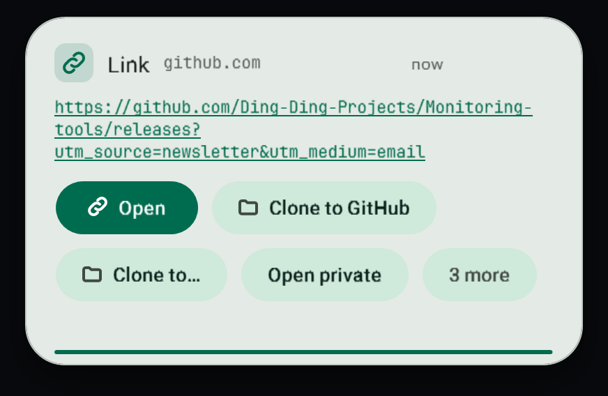
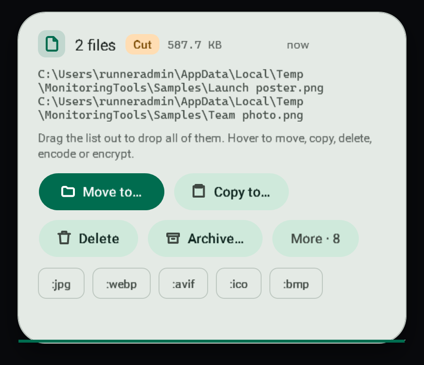
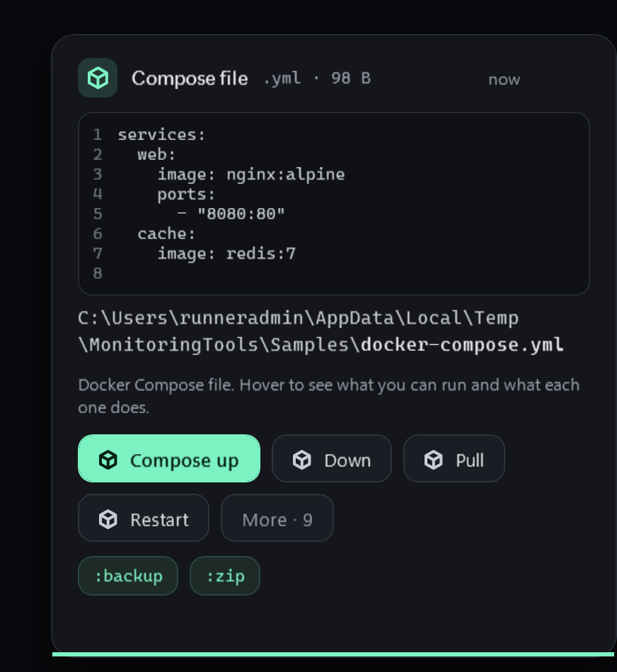

# Clipboard toasts

A small card slides into the bottom-right corner each time the clipboard changes. It stays for 3 seconds and holds while the pointer is over it.

## What you see

The toast shows a preview of what you copied and four actions up front. Everything else is behind **More**. Hovering reveals the full set of actions that make sense for that kind of content.

## Cut or copied

Beside the title a small label says **Cut** (amber) or **Copied** (green), and clipboard history says "cut" or "copied" in the same way.

- **Files**: Explorer and most file managers mark files that were cut. Cut files say "pasting moves these files"; copied files say "pasting makes copies and leaves the originals".
- **Text, pictures and everything else**: the clipboard itself does not record it, so the shortcut you held tells: Ctrl+X or Shift+Delete is a cut, Ctrl+C or Ctrl+Insert (and Ctrl+Shift+C in terminals) is a copy. The keys are read only at the moment the clipboard changes; nothing you type is recorded.
- **Cut or Copy picked from a menu** leaves no trace, so the toast shows no label rather than guessing.

## Actions by kind of content

| You copied | Preview | Actions |
| --- | --- | --- |
| Text or Markdown | Rendered Markdown | Copy as plain text, change case, tidy spaces, join lines, search, translate, save as a file |
| A link | The address | Open, open in a private window, copy domain, strip tracking parameters, copy as a Markdown link |
| A file or folder | Video frames, PDF and document thumbnails, album art, first lines of text or code, CSV tables, folder and zip listings, plus duration, resolution and codecs for media | Open in the default app, Open with, show in folder, copy name, forward slashes, terminal here |
| A Git repository folder | The folder listing | Open in Desktop Material, Open on GitHub (or GitLab, Bitbucket, the server), with a Remote dropdown list box when there are several remotes; see [Git repository folders](../files/repository-folders.md) |
| A quoted path (Explorer "Copy as path") | The path | Remove quotes |
| An unquoted path | The path | Add quotes |
| Several files | A count and names | Move to, copy to, delete to the Recycle Bin, batch conversion chips |
| An image, video or audio file | A preview | Save, convert, quick command chips such as `:mp4`, `:gif`, `:mp3`, `:webp`; drag the preview out of the toast into any drop target |
| Base64 text | The text | Decode |
| Any text | The text | Encode as Base64 |
| JSON, a color, an email address | A tailored preview | Actions for that type |

## Quick commands in a toast

When you copy a file path, the chips for its media type are quick commands. Pressing one does the same as copying the path with that command on the end. See [Quick commands](../commands/quick-commands.md).

## What is skipped

Copies that password managers flag as private are ignored: no toast, no history entry.

## Quiet times

Toasts are held back in game mode and while a presentation or fullscreen app is running. See [Game mode](../game/game-mode.md). The tray menu can also snooze everything for 15 minutes, 1 hour or 4 hours.

## Failure modes

- A preview that cannot be built (an unreadable file, a missing codec) falls back to the name and size; the actions still work.
- Conversion chips need FFmpeg. If it is missing, the toast offers to install it with winget.

## Related

- [Clipboard history](history.md)
- [Quick commands](../commands/quick-commands.md)
- [File tools](../files/file-tools.md)
- [Docker actions](../files/docker-actions.md)

## Editable text and install commands

Plain copied text is edited in place in its toast, and a copied choco or winget install command gets a strict, opt-in install card. See [install commands and editable text toasts](install-commands.md).
