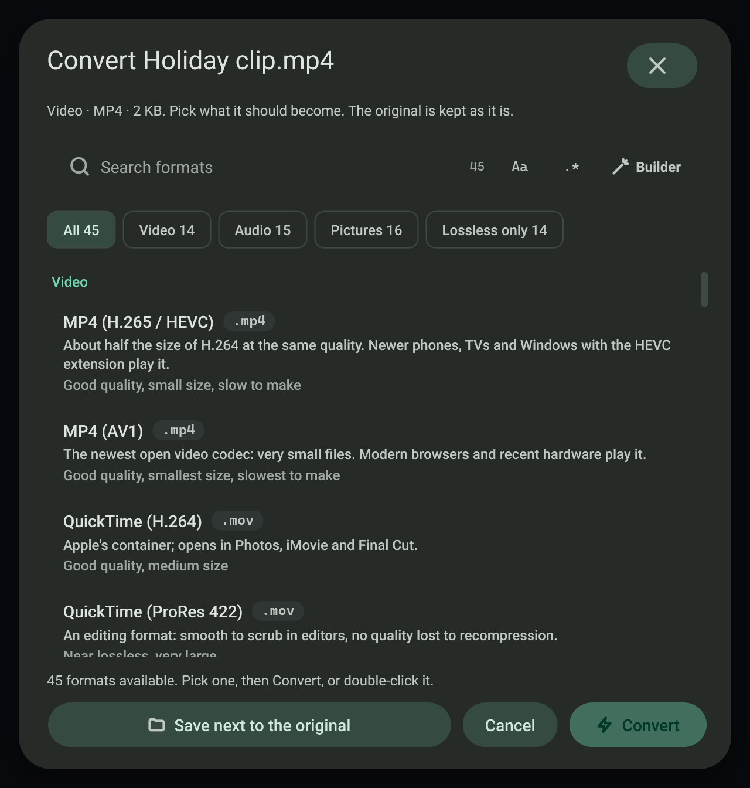

# Convert media

Copy a file path, add `:format` on the end, and the converted file appears next to the original with the same name.

## Convert a video

1. Copy the file's path, for example `D:\Footage\clip.mov`.
2. Make the copied text end in `:mp4`, for example `D:\Footage\clip.mov:mp4`, and copy that.
3. A toast reports progress and then the result.

You can also press a format chip on the toast of a copied media file; that does the same in one click.

## Choose from the full list

Press **Convert…** on the toast of a copied video, audio or picture file (or a folder, or several files), or
**Choose a file to convert…** on the Conversion page. A dialog lists every format the file can become:

- Formats are grouped into Video, Audio, and Pictures and animations, with chips to show one group or only lossless formats.
- Each row says what the format is for, what it keeps or loses (for example "Lossless, large" or "Good quality, small size,
  slow to make"), and a note for this source, such as "Takes the first frame of the video" or "Keeps only the sound".
- A search field with the regex builder filters the list.
- For a folder or a selection, each format says how many of the files it can take; the rest are skipped.
- **Save next to the original** can be changed to another folder. The line above the buttons names the exact file that will
  be written; an existing file is never overwritten, a number is added instead.
- Enter or a double-click converts; Escape closes.

## Formats

48 formats, all made by the bundled FFmpeg (a self-test converts a test video, a tone and a picture to every one of them and
reads each result back with FFprobe):

| Group | Commands |
| --- | --- |
| Video | `mp4` (H.264), `mp4-h265`, `mp4-av1`, `mov`, `mov-prores`, `mkv` (stream copy), `webm`, `avi`, `m4v`, `ts`, `mpg`, `wmv`, `flv`, `3gp`, `ogv` |
| Audio | `mp3`, `wav`, `flac`, `m4a`, `alac`, `aac`, `ogg`, `opus`, `aiff`, `wma`, `ac3`, `wv`, `mka` (stream copy), `mp2`, `amr` |
| Pictures and animations | `gif`, `apng`, `webp-anim`, `png`, `jpg`, `webp`, `avif`, `jxl`, `bmp`, `tiff`, `jp2`, `tga`, `qoi`, `pcx`, `ppm`, `ico` |

Audio formats also take video (the sound is kept). Picture formats also take video (the first frame), and `gif`, `apng` and
`webp-anim` turn a video into an animation. `mp4` also takes audio and adds a black picture.

## A whole folder

`D:\Footage:mp4` converts every compatible file in the folder.

## FFmpeg

Conversion uses FFmpeg. FFmpeg, FFprobe and portable Git are bundled with the installer, so it works offline. If FFmpeg is missing, the toast offers to install it with winget, or you can point to your own copy on the Conversion page.

## Failure modes

- A file that already exists with the target name is left alone; nothing is overwritten.
- The original is never deleted or changed, wherever it is, including files in the temp folder such as mail attachments.
- If FFmpeg reports an error, the Activity page keeps its message.

## Related

- [Quick commands](quick-commands.md)
- [Clipboard toasts](../clipboard/toasts.md)
