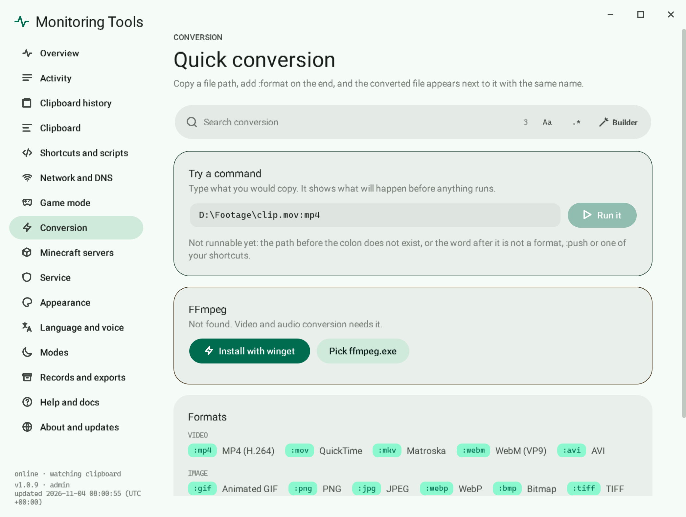

# Convert media

Copy a file path, add `:format` on the end, and the converted file appears next to the original with the same name.

## Convert a video

1. Copy the file's path, for example `D:\Footage\clip.mov`.
2. Make the copied text end in `:mp4`, for example `D:\Footage\clip.mov:mp4`, and copy that.
3. A toast reports progress and then the result.

You can also press a format chip on the toast of a copied media file; that does the same in one click.

## Formats

- Video and animation: `mp4 mov mkv webm avi gif`
- Audio: `mp3 wav flac m4a ogg opus`
- Images: `png jpg webp bmp tiff avif ico`

## A whole folder

`D:\Footage:mp4` converts every compatible file in the folder.

## FFmpeg

Conversion uses FFmpeg. FFmpeg, FFprobe and portable Git are bundled with the installer, so it works offline. If FFmpeg is missing, the toast offers to install it with winget, or you can point to your own copy on the Conversion page.

## Failure modes

- A file that already exists with the target name is left alone; nothing is overwritten.
- If FFmpeg reports an error, the Activity page keeps its message.

## Related

- [Quick commands](quick-commands.md)
- [Clipboard toasts](../clipboard/toasts.md)
