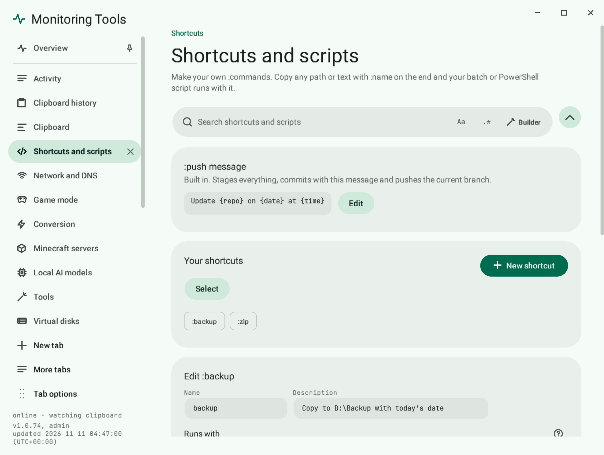

# Custom shortcuts and scripts

Make your own `:name` command. Each one is a batch or PowerShell script.



## Make your own command

1. Open **Shortcuts and scripts** in the control centre and add a shortcut.
2. Give it a name: a letter first, then letters, digits, `_` or `-`, 2 to 32 characters. `push` is reserved for the built-in command.
3. Choose Batch or PowerShell, and write the script in the built-in editor.
4. Save. Now copying `anything:name` runs the script.

## What the script receives

Whatever came before the colon is the first argument and also the `MT_INPUT` environment variable.

```powershell
param([string]$Target = $env:MT_INPUT)
Write-Output "Running on: $Target"
```

In a batch script use `%~1` or `%MT_INPUT%`.

## Options

- **Show window**: run visibly instead of hidden.
- **Run elevated**: ask for administrator rights through UAC. Environment variables do not pass through that hop, so the argument is the reliable way to read the input.
- **Description**: shown in the list and searched by the page search.

## Where scripts live

In `%LOCALAPPDATA%\MonitoringTools\scripts`, one `.bat` or `.ps1` file per shortcut.

## Failure modes

The exit code and output are recorded in Activity. A non-zero exit shows as failed.

## Related

- [Quick commands](quick-commands.md)
- [Push a repo from the clipboard](push-a-repo.md)
