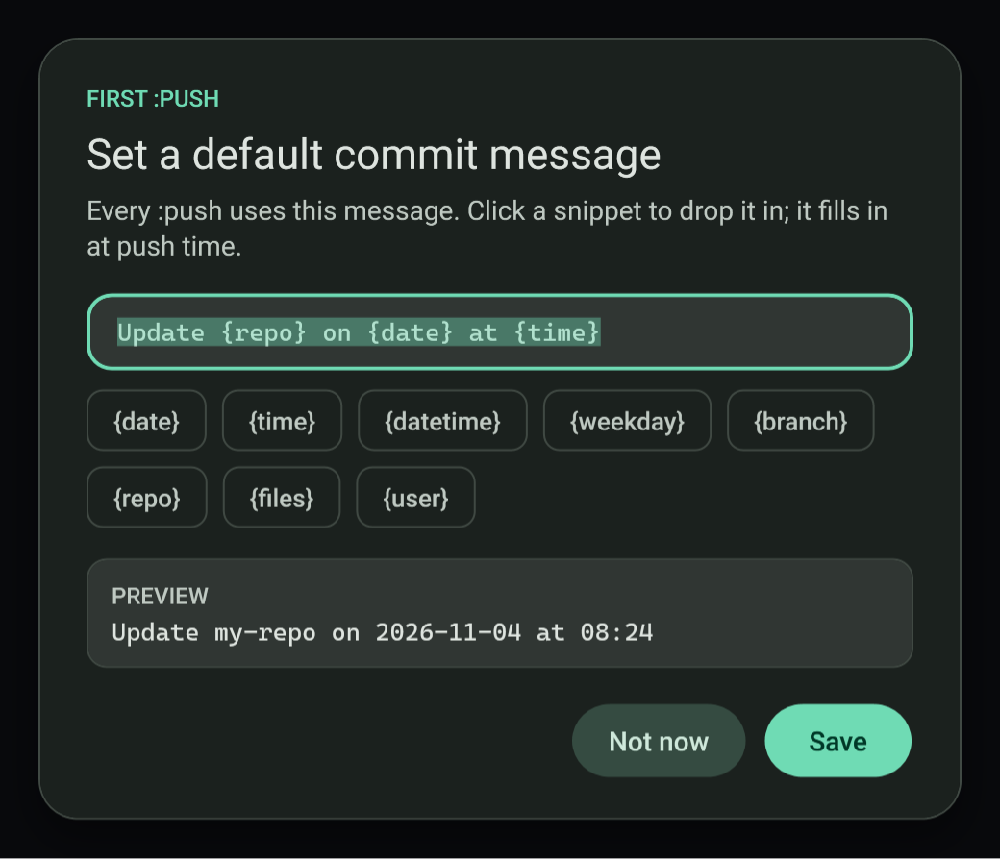

# Push a repo from the clipboard

Copy a repository folder with `:push` on the end and the app stages everything, commits and pushes the current branch.

```
C:\Code\my-repo:push
```

## What it does

1. Stages every change in the repository.
2. Commits with your default commit message.
3. Pushes the current branch to its remote.

## The default commit message

The first `:push` asks for a default commit message. Snippets are filled in at commit time:

| Snippet | Becomes |
| --- | --- |
| `{date}` | Today's date |
| `{time}` | The current time |
| `{branch}` | The current branch |
| `{repo}` | The repository name |
| `{files}` | The changed files |



## Requirements

Portable Git is bundled, so nothing needs installing. Your credentials for the remote must already work from the command line, for example through a credential manager.

## Failure modes

- A folder that is not a repository, or that has no remote, reports an error.
- A rejected push is recorded in the Activity page with git's own message.

## Related

- [Quick commands](quick-commands.md)
- [Custom shortcuts and scripts](custom-shortcuts.md)
- [Public IP history](../network/public-ip-history.md)
