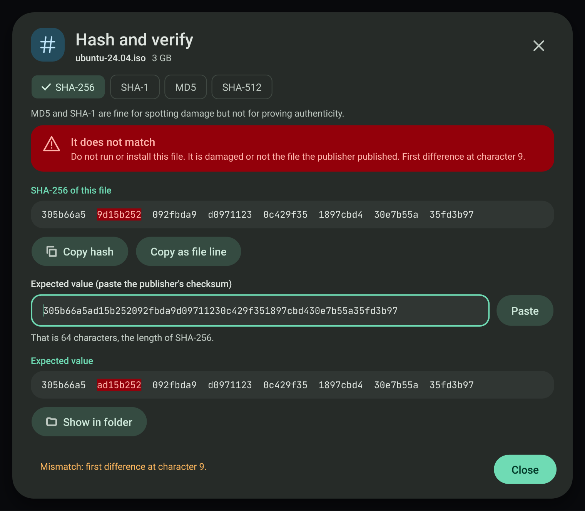
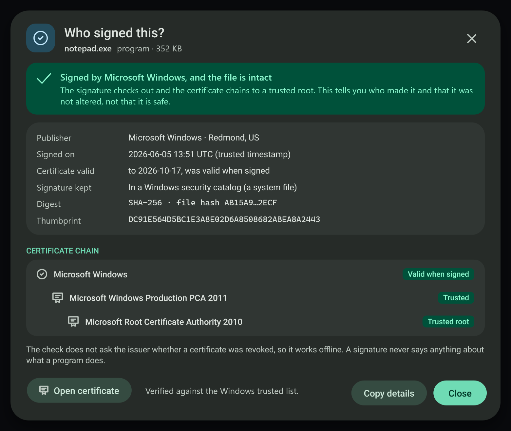
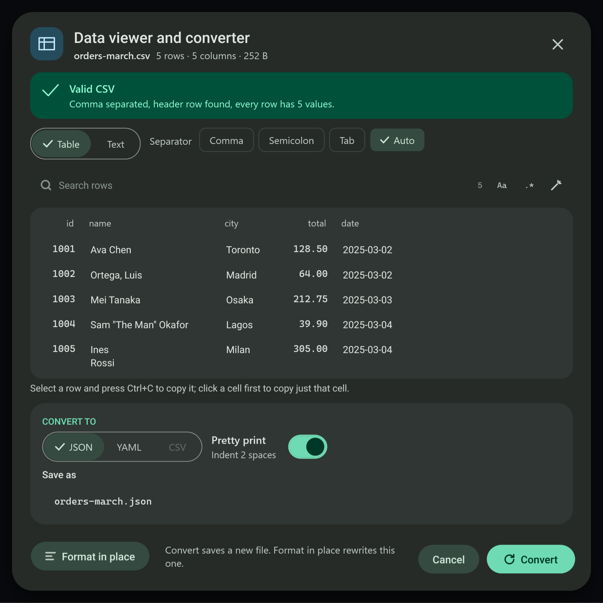
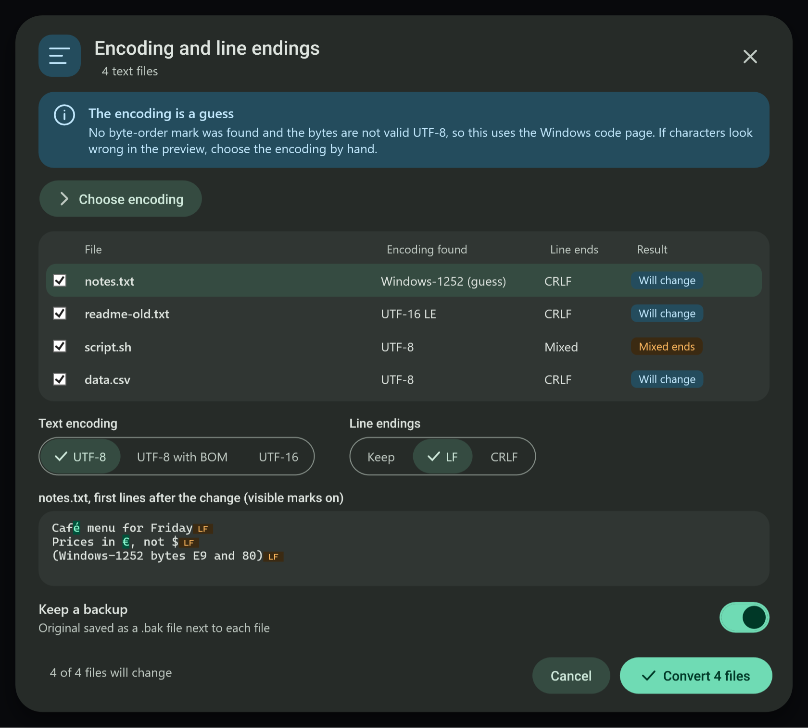

# Data and security tools

Five dialogs, each its own window, open from the clipboard notice when the copied file is of the right kind. They never run, open or move the file they inspect, and they never change it unless the dialog says so in plain words and keeps a backup.

| Copied file | Notice button | Dialog |
| --- | --- | --- |
| any single file | Hash and verify | SHA-256, SHA-1, MD5 and SHA-512, checked against a pasted checksum |
| `.exe .msi .dll .sys .cab .msix .ocx .scr` | Who signed this? | Authenticode verdict, publisher, chain, timestamp |
| `.cer .crt .pem .pfx .p12 .der` | Inspect certificate | Details, expiry countdown, conversion |
| `.csv .tsv .json .yaml .yml` | View data | Table, validity check, conversion |
| text files (one or many) | Encoding and line endings | Detect and convert, with backups |

The buttons are placed right after **Show in folder**. Several copied text files offer only the encoding dialog.

## Hash and verify

The file is read once, 1 MB at a time, off the UI thread, with a percentage, a rate and a time left. **Cancel** stops reading and keeps nothing. The hash is shown in groups of eight characters; **Copy hash** copies it alone and **Copy as file line** copies `hash *name`.

Paste the publisher's checksum into **Expected value**: spaces, dashes, colons and capitals are ignored, and a whole `hash  name` line (or the matching line of a checksum file) works. A length that belongs to another algorithm says so (for example "40 characters, which is SHA-1") and Verify uses that algorithm. A match shows a success banner; a mismatch says "Do not run or install this file" and marks the first differing group and character number.

MD5 and SHA-1 are offered for spotting damage; the dialog says they do not prove authenticity.

## Who signed this?

`WinVerifyTrust` (generic verify, no revocation check so it never waits for the network) gives the verdict, including files whose signature lives in a Windows security catalog. The signer certificate, its chain and the timestamp are read from the signature itself. States: signed and valid, **not signed**, **broken signature** (content changed after signing), and **untrusted issuer**. A valid signature says who made the file and that it was not altered, never that it is safe. **Open certificate** opens the certificate inspector on the selected chain link.

## Certificate inspector

Shows subject, issuer, alternative names, key, serial, SHA-256 and SHA-1 fingerprints, allowed uses and a validity bar with a countdown. Under 30 days the banner turns to a warning; after expiry it is an error. A PKCS#12 file asks for its password once; the password is cleared right after the file is read and is never stored or logged, and the private key is never shown.

**Convert** writes PEM, DER or PKCS#12 next to the original (a name that exists gets a number, never an overwrite). A copy that holds a private key is written only with the switch on and a new password of at least 6 characters; a public-only copy is safe to share. DER cannot hold a key.

## Data viewer and converter

CSV (an own RFC 4180 reader: quotes, embedded commas and newlines, byte-order mark, separator detection), JSON (`System.Text.Json`) and YAML ([YamlDotNet](https://github.com/aaubry/YamlDotNet), MIT licence, version pinned in `packages.lock.json`). The table shows the first 500 rows; conversion uses the whole file, and CSV to JSON streams the rows. An invalid file shows the line and column of the first error with three lines of context, turns **Convert** off, and **Go to the error** selects the line in the text view.

Conversion rules: CSV values become numbers only in columns where every filled value is a plain number without leading zeros and the header does not look like an identifier (`id`, `code`, `zip`, `phone` and similar); everything else stays text. Text that would turn into another type in YAML (such as `007`) is quoted. JSON or YAML to CSV needs a list of records or a list of rows; any other shape is refused in plain words and nothing is written. YAML comments are not carried over. **Format in place** rewrites the same file tidied after saving a `.bak` copy.

## Encoding and line endings

Detection order: byte-order mark, strict UTF-8, UTF-16 by its NUL pattern, then the system ANSI code page, which is said to be a guess. Line endings are counted as CRLF, LF and CR separately. Conversion decodes strictly: a byte that is not valid in the detected encoding stops that file and nothing is written; **Choose encoding** picks the source by hand. Binary files (by name, NUL bytes or control characters) are never touched. Each converted file keeps a `.bak` copy unless the backup switch is off, and **Undo from backups** puts every original back.

## Verification

`MonitoringTools.exe --selftest <folder>` (group `MT_ONLY=datasec`) drives every dialog on files it creates: a self-signed certificate made in code, a signed system file, an unsigned copy, a copy signed with a throwaway certificate, a copy changed after signing, and CSV, JSON and YAML samples with errors and text files in each encoding. `--screenshots` produces the `datasec-*` captures.

