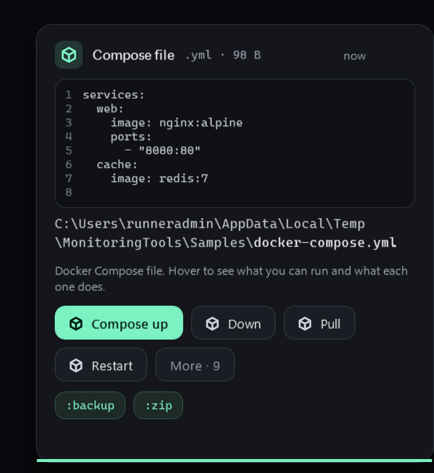

# Docker actions

Copy a Compose file or a Dockerfile and the toast offers buttons for it.

## Compose files

A copied `compose.yaml` or `docker-compose.yml` offers **up**, **down**, **pull**, **restart** and **logs**.

## Dockerfiles

A copied `Dockerfile` offers **build** and **build and run**.

## What each button says

Each button explains what it will do before you press it. Nothing runs until you do.

## Requirements

Docker must be installed and running. If it is not, the command's own error is shown.

## Related

- [File tools](file-tools.md)
- [Clipboard toasts](../clipboard/toasts.md)
- [Minecraft servers](../minecraft/servers.md)
