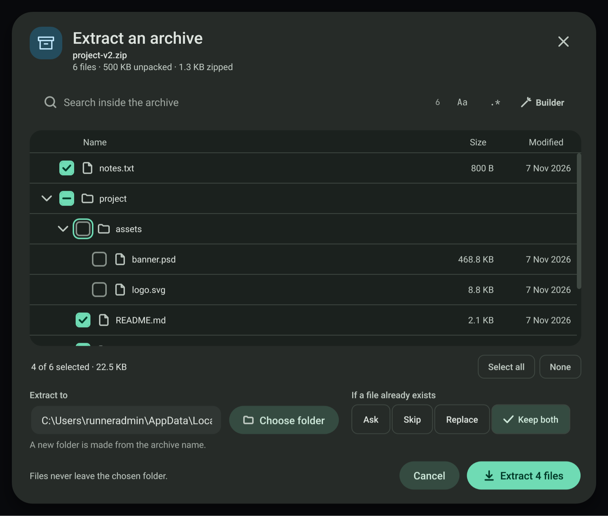
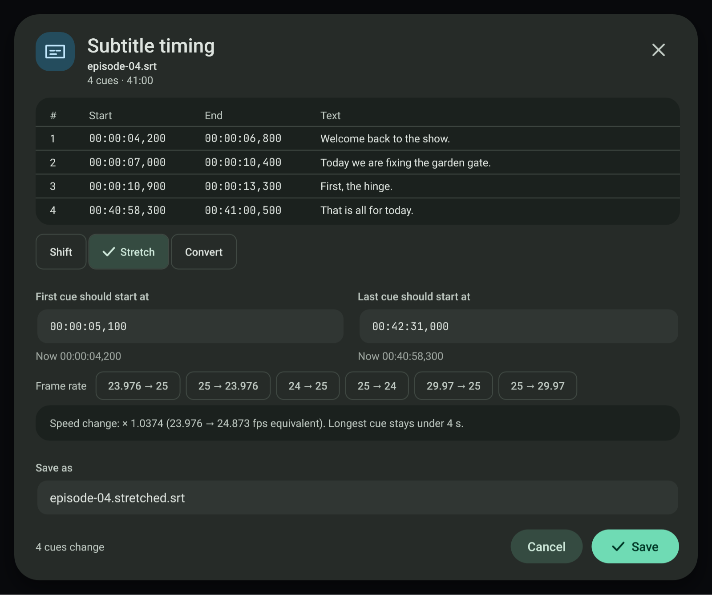
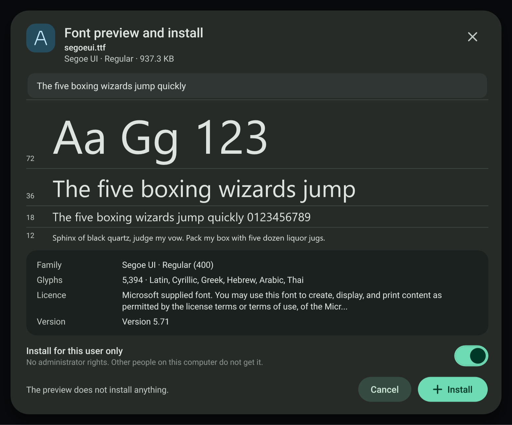
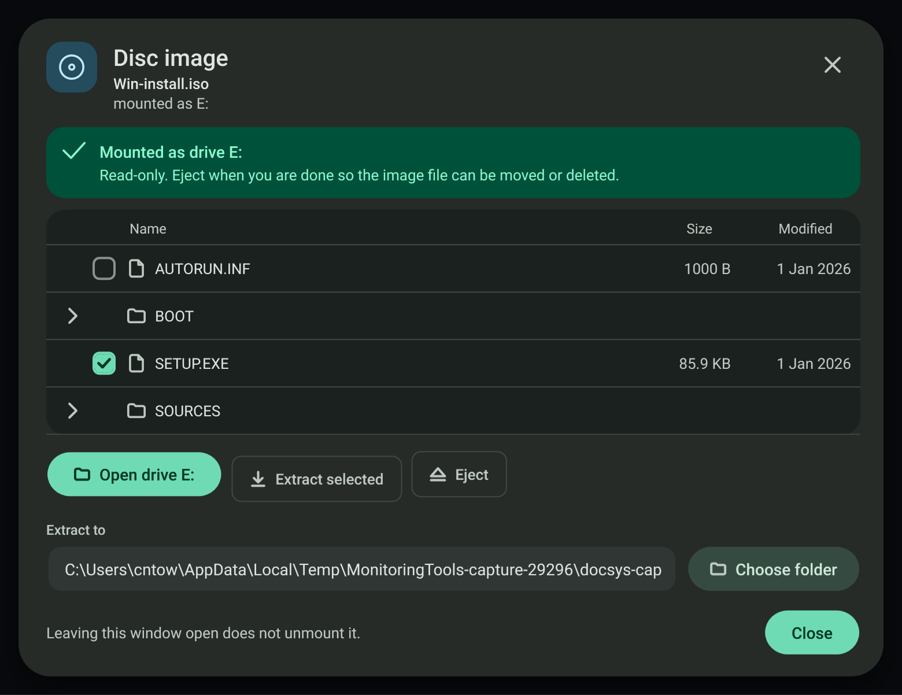
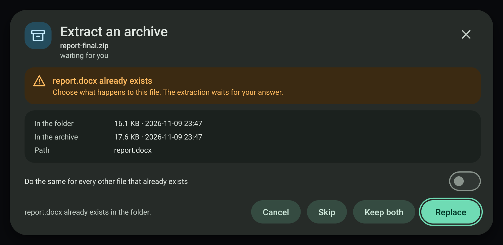
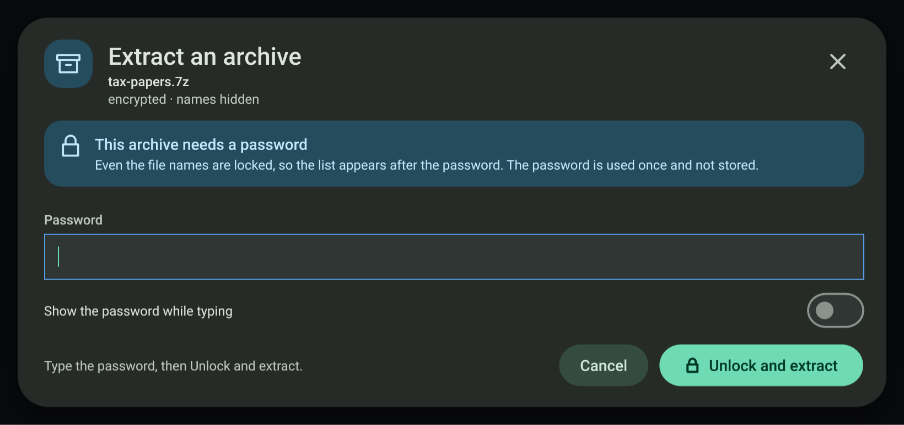
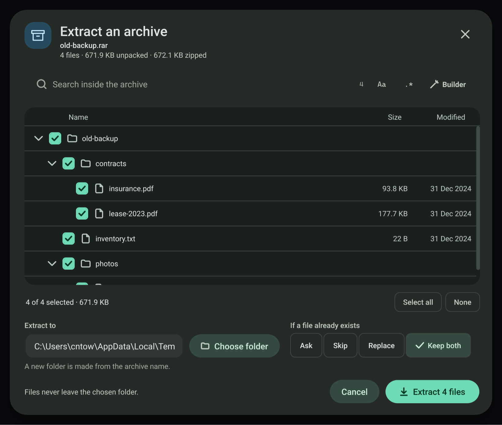
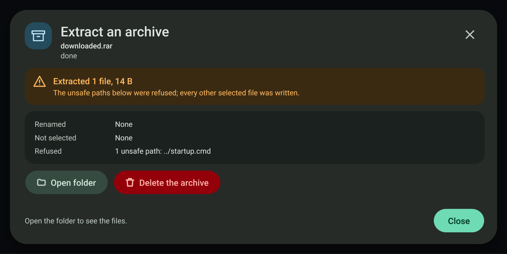
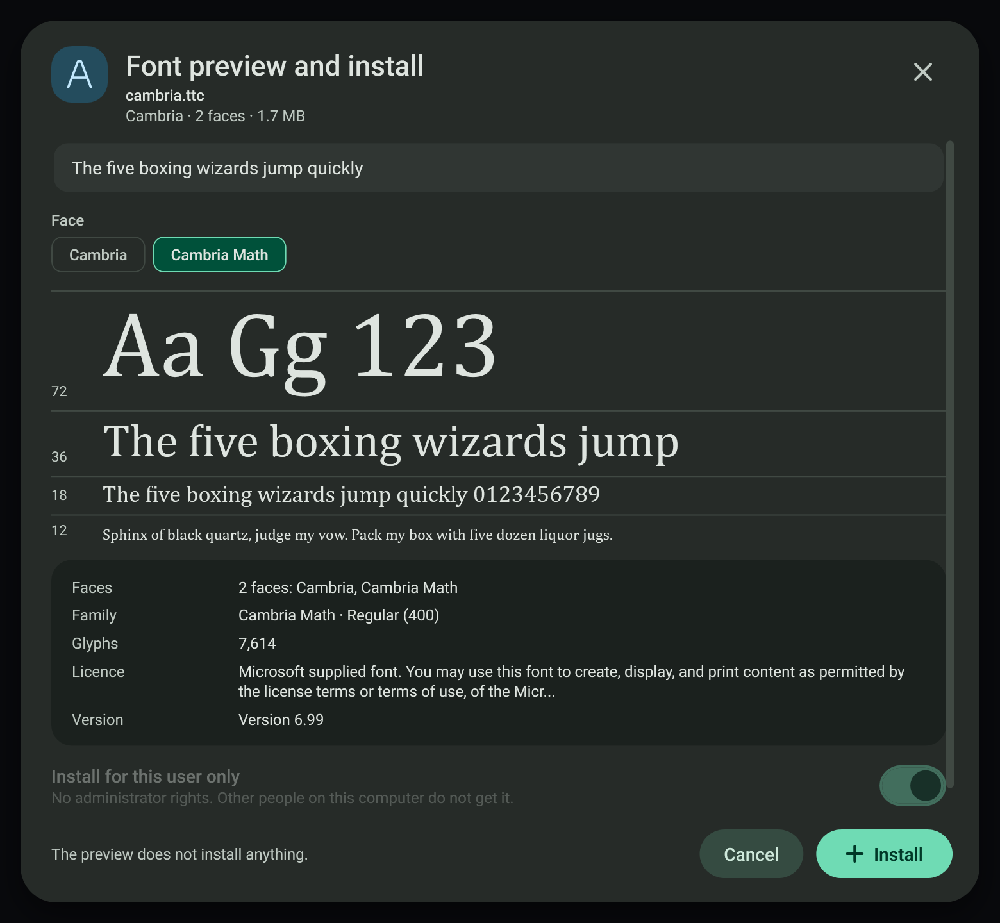
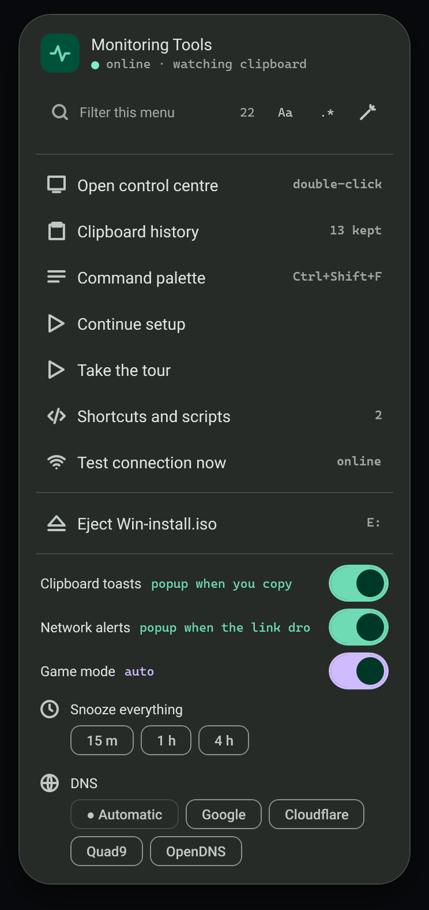

# Archive, subtitle, font and disc image dialogs

Four separate windows that open from the clipboard notice when one file of the matching type is copied. Each shows the
file name in its header, never changes the original file, runs its work off the interface thread and says plainly what it did
not change when something fails. They follow the design in `design/file-tools/` (boards 7, 13, 14 and 15).

| Copied file | Notice button | Window |
| --- | --- | --- |
| `.zip .7z .rar .tar .gz .tgz .xz .txz .bz2 .tbz2 .tbz` | Extract… | Extract an archive |
| `.srt .vtt` | Subtitle timing… | Subtitle timing |
| `.ttf .otf .ttc .woff` | Preview font… | Font preview and install |
| `.iso .img .vhd .vhdx` | Disc image… | Disc image |

## Extract an archive

* **Formats.** Zip, tar, tar.gz, tgz and gz are read with the .NET libraries. 7z, xz, bz2, tar.xz (txz), tar.bz2 (tbz2, tbz) and
  AES-encrypted zip go through the bundled 7-Zip command line (`7za`, 7-Zip 26.05, fetched by `download-dependencies.bat`):
  `7za l -slt` lists a 7z, a single xz or bz2 file is one entry named after the file, and a tar.xz or tar.bz2 is read as a tar
  stream decompressed by `7za x -so`, so its full tree is listed. 7-Zip always gets a password switch and a closed input, so it
  never stops to ask. bzip2 does not store the unpacked size, so a bz2 entry shows 0 bytes until it is extracted.
* **RAR (RAR4 and RAR5).** `7za` contains no RAR decoder, so `.rar` goes through the bundled full 7-Zip command line instead
  (`7z.exe` with `7z.dll` from the official 7-Zip 26.05 x64 package, also fetched by `download-dependencies.bat`). It is listed with
  `7z l -slt`, tested and extracted exactly like a 7z: the same password switch and closed input, the same hidden unpacking folder,
  the same zip-slip refusal and the same Cancel behaviour. A password RAR (encrypted data) shows its names and asks for the password;
  a RAR with encrypted names opens in the "names hidden" state. 7za is still used for every other format. A build without the full
  7-Zip says so in the "cannot be opened here" state and changes nothing. `7z.dll` carries the unRAR code under its licence
  restriction: it is used only to decode RAR archives, and the app never creates RAR archives.
* **Contents.** A tree with check marks (a folder's check selects everything under it and shows a mixed state), sizes and dates,
  Select all and None, and a search with the same plain text and regex builder as every other search. Up and Down move between rows,
  Right and Left expand and collapse, Space toggles, `/` or Ctrl+F focuses the search. Only the first 1,000 visible rows are drawn;
  the list says when more exist and the search narrows it.
* **Destination and names that exist.** The default is a new folder named after the archive. The rule is Ask, Skip, Replace or
  Keep both (a number is added; the default). With **Ask** the extraction stops at each name that already exists and shows the
  file's size and date in the folder and in the archive, with Replace, Keep both and Skip, and a switch that applies the same answer
  to every remaining name. Cancel (or Esc, or closing the window) during the question stops the extraction.
* **Safety.** Every entry path is checked against the destination first. Absolute paths, drive letters and `..` are refused
  (zip-slip), marked in the list, and counted in the Done card, for every format. Each file is written under a `.part` name and
  renamed when whole, so Cancel never leaves a half file under a real name. A 7z or AES zip is unpacked by 7-Zip into a hidden
  `.extracting-…` folder inside the destination, asking only for the entries that passed the check; each finished file is then
  moved into place under the rule for names that exist, and the hidden folder is always removed. A cancel while 7-Zip is unpacking
  therefore leaves nothing in the destination.
* **Passwords.** Zip entries protected with the traditional zip password scheme are decrypted by the app; AES-encrypted zip entries
  and password 7z and RAR archives go through 7-Zip. The password is checked on the first locked file (`7za t`, or `7z t` for RAR) before
  anything is written, is used once and is not stored; a wrong one says "Nothing was extracted". A 7z whose file names are
  encrypted opens in the password state with "names hidden" and lists its files only after the password is accepted.

## Subtitle timing

SRT and WebVTT are read by the app's own parser; times are whole milliseconds.

* **Shift** adds a signed number of seconds to every cue. A move that would put a cue before 00:00:00 is blocked and names the cue.
* **Stretch** maps the first and last cue to two chosen times (`new = a + (t - t1) * (b - a) / (t2 - t1)`) and shows the speed factor.
  Frame rate presets (23.976 to 25, 25 to 23.976, 24 to 25, 25 to 24, 29.97 to 25, 25 to 29.97) fill the two times.
* **Convert** writes SRT or WebVTT. Converting to SRT drops WebVTT cue settings and NOTE, STYLE and REGION blocks and lists what it dropped.
* **Problem cues.** Overlaps and unreadable times are listed. Fix overlaps ends the earlier cue one millisecond before the next
  starts; Skip broken cue removes cues whose time cannot be read. A file with problems can still be shifted.
* The result is saved next to the original under a new name (`.shifted`, `.stretched` or the new extension); an existing name gets a number.

## Font preview and install

* The preview loads the file with WPF `GlyphTypeface` and shows it at 72, 36, 18 and 12 px with editable sample text. It installs
  nothing. Family, face, weight, glyph count, scripts, licence text and version come from the font's own name table.
* **Install** is for this user only: the file is copied to `%LOCALAPPDATA%\Microsoft\Windows\Fonts`, its name is written under
  `HKCU\Software\Microsoft\Windows NT\CurrentVersion\Fonts`, then it is added with `AddFontResource` and a font-change message is
  broadcast. No administrator rights and no system folder. **Uninstall** removes the same file and value.
* An already installed copy (same bytes, same registry value) opens in an "already installed" state with Uninstall. A damaged file, or a WOFF
  web font, opens in an error state and can never reach the installer.
* **Font collections (`.ttc`).** The face count comes from the `ttcf` header and each face is read with `GlyphTypeface` (face index in the URI
  fragment). The window lists every face in a Faces row and as chips; picking a chip switches the specimens, family, weight and glyph count to
  that face. Install adds the whole file, so every face, under one registry value that names them all (`Cambria & Cambria Math (TrueType)`),
  as Windows itself does. The file is read from its own copy in an empty temporary folder, because WPF reads a font through the folder it sits
  in and other font files there can make it fail.

## Disc image

* **Browse and extract without mounting** uses a built-in ISO 9660 reader with Joliet names. It lists folders and files, and copies the chosen
  files out byte for byte. Images that are not plain ISO (`.img`, `.vhd`, `.vhdx`, or a UDF-only ISO) cannot be listed; they can still be mounted.
* **Mount as a drive** runs `Mount-DiskImage -Access ReadOnly` for the current user (no elevation) and reads the drive letter. Eject runs
  `Dismount-DiskImage`. Closing the window never ejects. An image that is already attached opens as mounted.
* A mount Windows refuses shows "Could not mount" with Windows' own reason and a Browse without mounting action.
* **Tray menu.** Each image this app mounted and has not ejected gets an "Eject *name*" row in the tray menu, with its drive letter. The row
  dismounts it off the interface thread and shows a notice; an open Disc image window for that image goes back to its not-mounted view. Images
  attached some other way are not listed.

## Verification

The self-test group `MT_ONLY=docsys` drives each window on files it creates: a zip with zip-slip entries, a password zip, tar, tar.gz and gz;
7z, xz, bz2, tar.xz and tar.bz2 made with the bundled 7-Zip command line (a tar.xz with an escaping path, a password 7z, a 7z with encrypted names,
an AES-256 zip with a `../` name patched into its headers, and a cancel while 7-Zip unpacks); RAR archives built byte by byte from the documented
RAR 4.x and RAR 5.0 formats, because no RAR file can be made without WinRAR (a stored RAR4 and a stored RAR5 with a file in a subfolder, listed
and extracted with SHA-256 compared; a RAR4 with a `..\evil.txt` entry that must be refused; a RAR5 with AES-256 encrypted data and one with
encrypted names, each tried with a wrong and then the right password; and a cancel while the full 7-Zip unpacks a large stored RAR5); a damaged
7z and a damaged RAR; the Ask question answered with Replace, Skip and Keep both plus the apply-to-all switch, and
Cancel during the question; a font collection copied from the system fonts folder, with a face picked and the install recorded; an image mounted
for real and ejected from its tray row;
SRT and VTT samples for shift, stretch, convert and problem cues; a font file copied from the system fonts folder (the install step is replaced
by a recorder, so no font is installed); and an ISO written by the check, which is read back, extracted, and mounted for real through Windows
and ejected again. It also checks that every visible string in the four windows has a Cantonese entry. Captures: `docsys-extract-*`,
`docsys-subtitle-*`, `docsys-font-*`, `docsys-disc-*` and `docsys-tray-mounted` in [screenshots](../../screenshots).
The quick capture loop is `MT_ONLY=docsys` with `--screenshots`.

