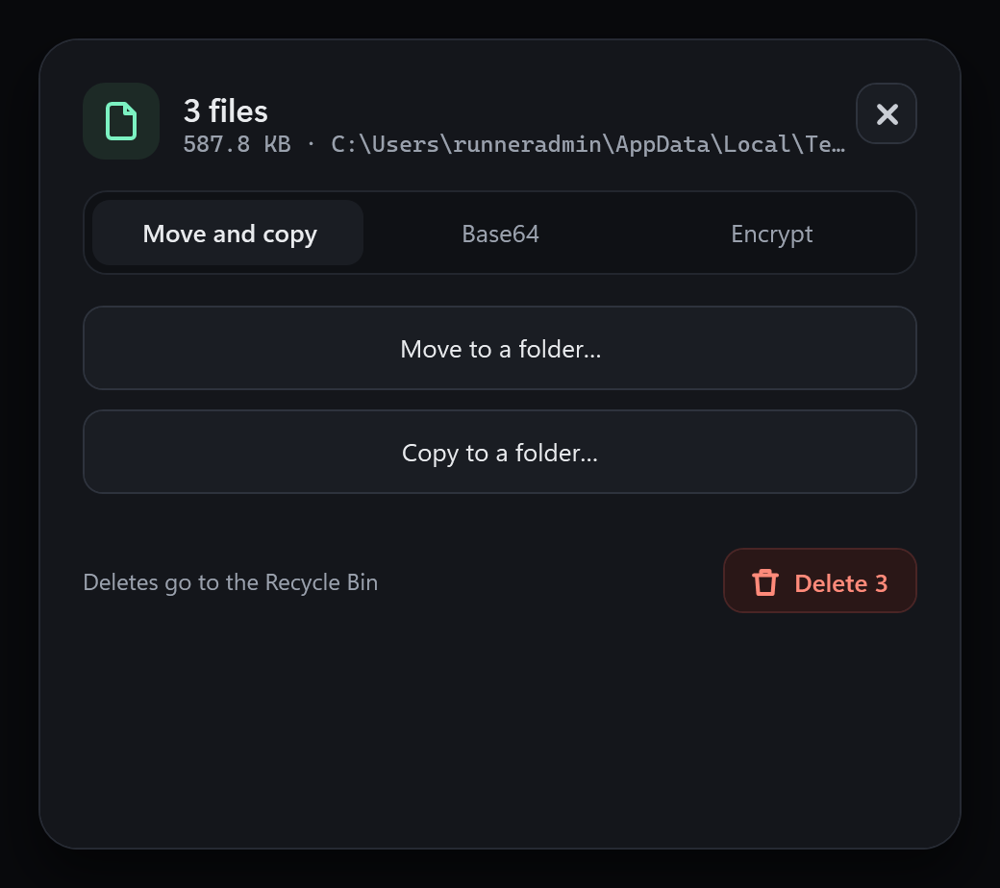
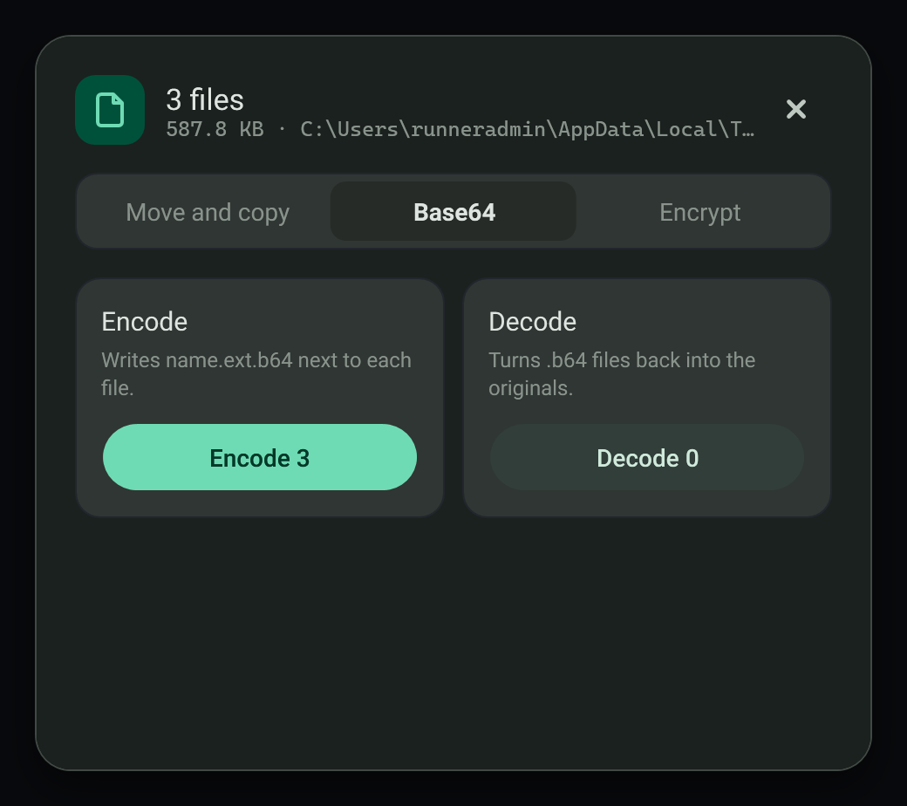
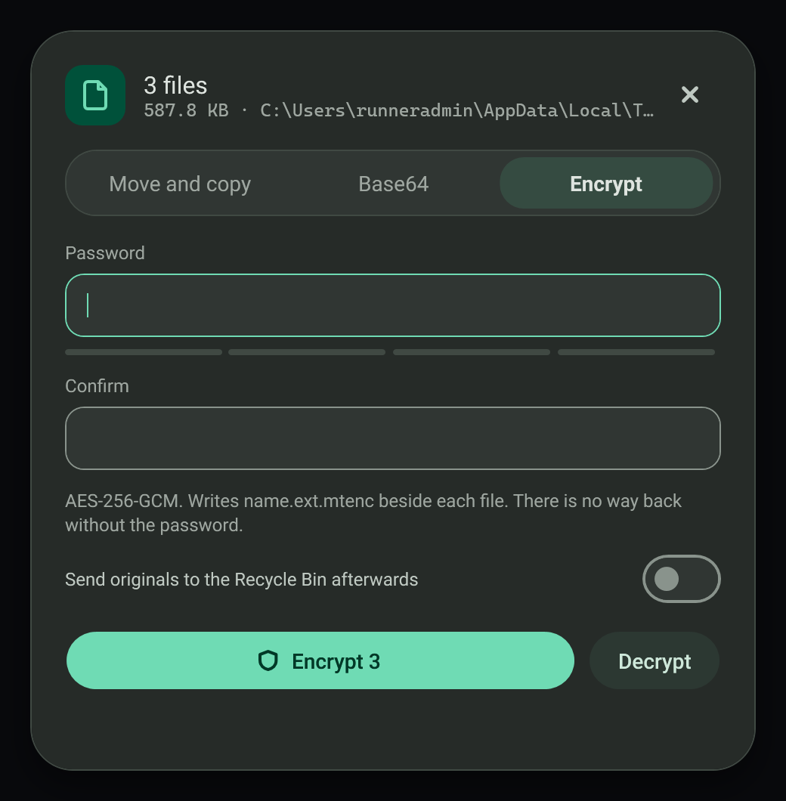

# File tools

When you copy several files, the toast offers the file tools sheet with one tab each for move and copy, Base64, and encryption.

## Move or copy a batch

Choose a destination and move or copy every copied file. Delete sends them to the Recycle Bin.

## Base64

Encode or decode files in a batch. You can also copy a file as Base64 text or as a data URI.

## Encrypt with a password

Files are encrypted with AES-256-GCM using your password and saved as `.mtenc` files next to the originals. Any password works, however short; the strength meter only advises, and only an empty password is refused. Without the password the files cannot be opened, so keep it safe.

## Failure modes

- Existing files are not overwritten.
- A wrong password reports an error.

## Related

- [Clipboard toasts](../clipboard/toasts.md)
- [Docker actions](docker-actions.md)
