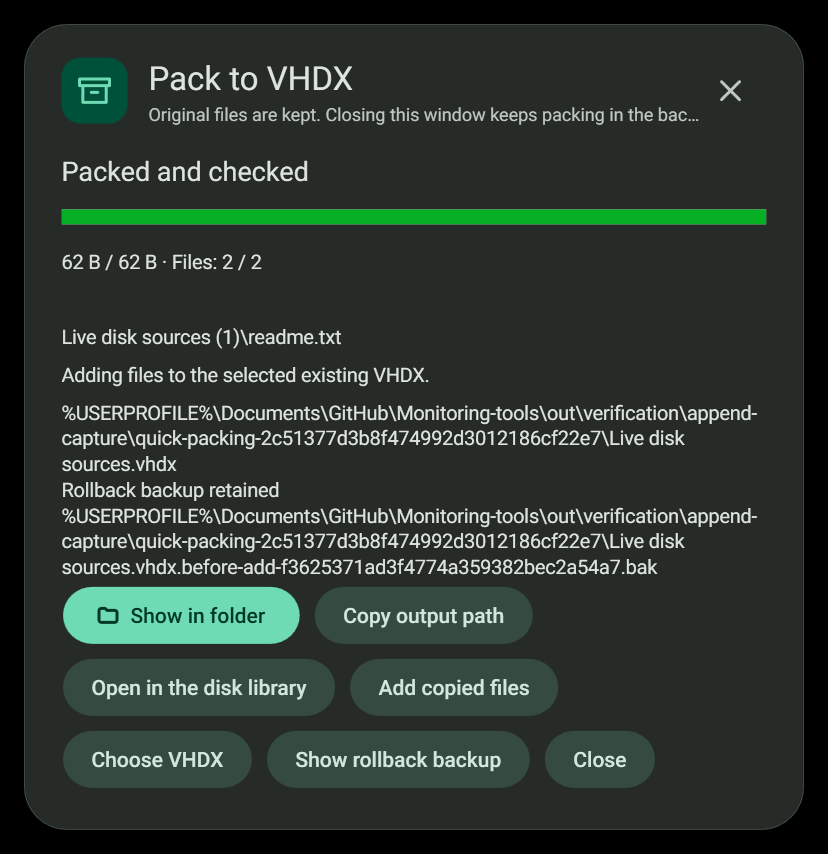

# One-click packing

Quick packing starts immediately. The task handoff records the exact built checks and remaining
verification limits.

## Pack a copied selection

Copy a file, folder, several files or folders, or quoted paths. Choose **Pack to ZIP** or
**Pack to VHDX** on the file notice. The action starts immediately in a dedicated progress
dialog. It does not open the control centre or ask for another Pack click. The full archive
and virtual-disk tools remain available when you need custom options.

One output contains the selected items. It is placed in their parent folder; selections from
different folders use the first item's parent. The output name comes from the single item or
the parent folder. A number is added when the name is occupied. Existing output is never
overwritten. The dialog shows the actual destination.

## Follow progress and keep the originals

The operation counts the selection, writes the output and verifies it. Progress reports its
actual stage, current item, bytes and file counts. A percentage, speed or remaining time is
shown only when measurable. Closing the running dialog hides it without cancelling the job;
use the operation's activity action to reopen it.

ZIP uses normal Deflate compression without a password. VHDX uses a dynamic GPT/NTFS disk,
grows when necessary, verifies copied files with SHA-256 and finishes detached. Creating and
attaching that disk requires Windows' native elevation consent. Declining consent is an
incomplete operation, never success.

Originals remain unchanged. Duplicate and overlapping selections are counted once. Missing,
unreadable or changing inputs, insufficient space and verification failures are reported
explicitly. Cancellation removes only incomplete output owned by the operation. If a disk
cannot detach or an output cannot be removed, the retained path and recovery action are shown.

Links are skipped with an explicit partial-result warning. Inventory stops at 250,000 entries
or 128 nested directory levels rather than silently publishing a truncated selection.

## Finish

After complete verification, the live progress dialog closes immediately. Activity's **Open
progress** reopens its retained result with **Show in folder** and **Copy output path**. A
manually reopened result stays visible. Explorer and the main workspace do not open automatically.
Partial, cancelled and stopped results remain visible and explain what did not complete.

## Lazy clipboard shortcuts

With Quick commands enabled, copy the files or folders, then copy the exact word **vhd** to
start a new quick-pack VHDX. Matching ignores case and surrounding whitespace. The selection is
held in memory, never recovered from stored clipboard history. Each selection is consumed once;
copy it again to run another operation. An unrelated clipboard copy, a sensitive item or a
disabled quick-command route clears the selection. Missing or unsupported inputs stop the lazy
operation without silently omitting them.

To add a selection from another directory, copy it and then copy **vhd add**. This targets the
most recent successful quick-pack VHDX in the current application session. **vhd** always creates
a new disk. If there is no remembered successful disk, choose one explicitly rather than guessing.
The file notice's **Choose VHDX** action selects another existing target. Reopened VHDX results
also offer **Add copied files** and **Choose VHDX**.

Starting a direct action consumes only its matching pending selection. An older notice leaves a
newer, different selection alone. Cancelling the target picker leaves the pending selection intact.

## Preserve an existing disk while adding

The live dialog dismisses immediately after verified success. This genuine built-application
capture shows the retained result reopened afterward, with the target and rollback backup.

The add route supports a detached local dynamic VHDX with one healthy GPT/NTFS data partition.
Mounted disks, network drives, paths through directory links and unsupported layouts are rejected.
Existing user content containing links is rejected rather than silently omitted.

The original disk stays untouched while the application copies it into a sibling staging folder.
It validates the staged copy, attaches that copy without creating or formatting partitions, hashes
existing user files, copies and verifies the additions, checks existing contents again and detaches.
Incoming top-level file and folder names are numbered when they collide. Existing folders are not
merged and existing files are not overwritten.

Only then does the application revalidate and atomically replace the detached target. A uniquely
named `.before-add-....bak` rollback copy remains beside it, and Activity/result actions expose it.
Allow space for both the original and staged disk plus the additions. Cancellation or failure
before replacement leaves the original unchanged. If another writer changes the disk at the final
replacement boundary, both versions are retained and the result reports incomplete recovery;
this route does not claim filesystem compare-and-swap.

To recover an earlier version, first preserve and detach the updated disk. Copy the retained
backup to a new `.vhdx` filename and inspect that copy through Virtual disks. Keep both versions
until the required contents are verified; do not overwrite an active or mounted disk.

## Related

- [Virtual disks](virtual-disks.md)
- [File tools](file-tools.md)
- [Docker actions](docker-actions.md)
