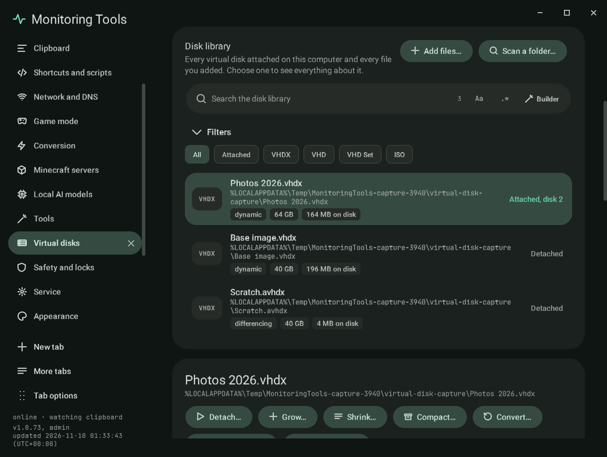
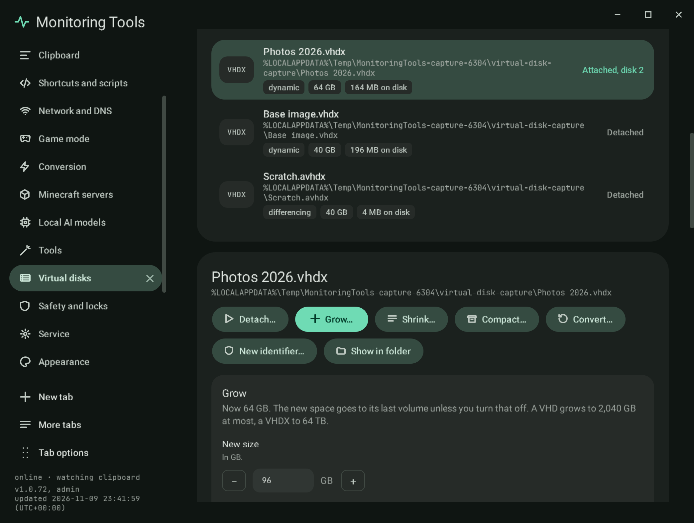
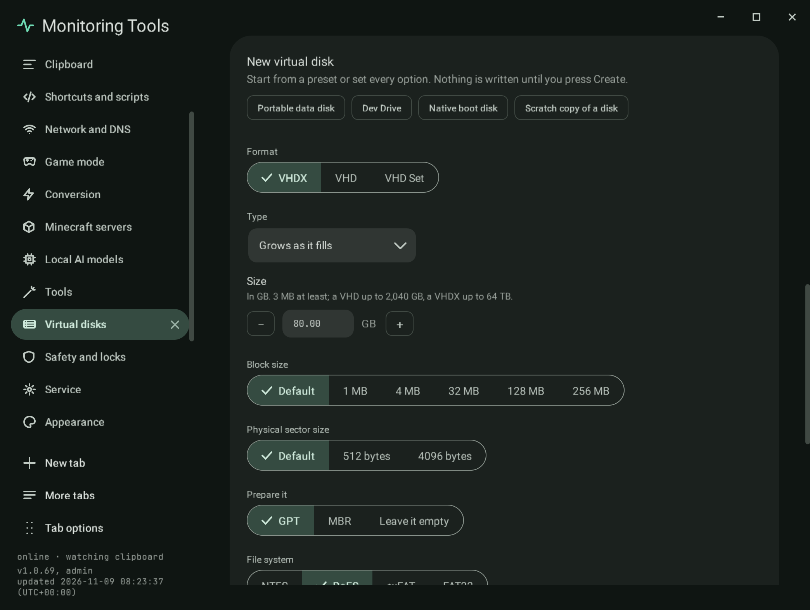
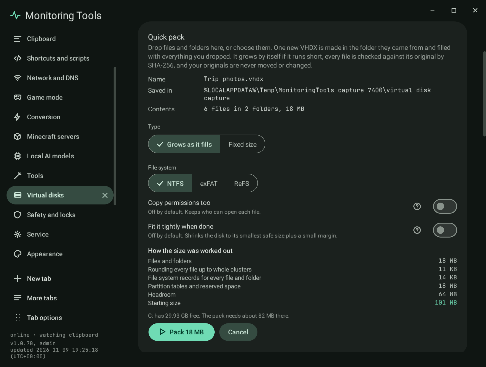

# Virtual disks

The **Virtual disks** page in the control centre manages VHD, VHDX and VHD Set files and attaches ISO images. It works
through the Windows virtual disk service (`virtdisk.dll`), which every edition of Windows 8 and later has, so nothing on
it needs Hyper-V. Open it from the side rail, from the command palette (`Ctrl+Shift+F`, then "Virtual disks"), or by
dropping a `.vhd`, `.vhdx`, `.vhds`, `.avhd`, `.avhdx` or `.iso` file anywhere on the control centre.

## What this computer offers

A row of chips at the top says which ways of working with disks this computer has, checked when the page first opens:

| Chip | Used for |
| --- | --- |
| Windows virtual disk service | Every disk operation: create, attach, detach, grow, shrink, compact, convert, merge, reconnect a parent, a new identifier, and reading every figure. Always there on Windows 8 and later. |
| Storage commands | Partitions and volumes: `Get-DiskImage`, `Initialize-Disk`, `New-Partition`, `Resize-Partition`, `Format-Volume`. When they are missing, DiskPart prepares volumes instead. |
| DiskPart | The second route for volumes, and the second script each action shows. |
| Hyper-V commands | Only used in the script each action shows, when they are there. On Windows Home the chip says they are not part of that edition; elsewhere, that an administrator can turn on Hyper-V. Nothing on the page needs them, and the app never turns Hyper-V on. |

Every result names the route that did the work, for example "Done through the Windows virtual disk service, then the
Storage commands."

## The disk library

The library lists every virtual disk attached on this computer (asked of the disk service each time the page opens)
and every file added to it: by **Add files…**, by **Scan a folder…** (three levels deep, at most 500 files, started by
the person only), by dropping files on the window, and by a finished Quick pack or Convert. The list is kept in the
settings, newest first. **Remove from the list** forgets a file and never touches it.

The library has its own search with the shared regex builder, and filters for attached disks, VHDX, VHD, VHD Set and
ISO (folded away on request, with a badge that says when a filter is on). Each row shows the format, the file name and
folder, the type, the virtual size, the space it takes on disk, and whether it is attached and as which disk number.

## One disk

Choosing a disk shows everything the disk service reports about it:

| Figure | Where it comes from |
| --- | --- |
| Format and type | VHD, VHDX, VHD Set or ISO; fixed, dynamically expanding or differencing |
| Virtual size, on disk | The size the disk shows and the space the file takes |
| Smallest safe size | The smallest a VHDX can shrink to without cutting into its partitions |
| Block size, sectors | Block size and the logical and physical sector sizes |
| 4K alignment, fragmentation | As the service reports them, when it does |
| State | Attached (with the disk number) or detached |
| Change tracking | On or off, with its identifier when on |
| Disk identifier, virtual disk ID | The two identifiers Windows uses to tell disks apart |
| Parent chain | For a differencing disk: whether the chain opens, and each parent path |

For an attached disk, **Inside** lists each partition with its size, file system, label, drive letter and free space,
read with the Storage commands, with an **Open** button for each drive letter.

## Actions

Each action opens a panel under the disk. The panel checks its options before anything is written, says what is wrong
when something is, and shows the same steps as a PowerShell script and as a DiskPart script, each with a copy button.
Where a step has no equivalent in a script language (DiskPart cannot shrink a virtual disk), the script says so in a
comment.

| Action | What it does |
| --- | --- |
| Attach | Read-write or read-only, with or without drive letters. It stays attached until it is detached. An ISO always attaches read-only. A disk that is already attached is recognised and reported as attached, not as a failure. |
| Detach | Detaches the disk. It never deletes the file or what is on it. |
| Grow | Grows a VHD or VHDX to a new size (up to 2,040 GB for a VHD and 64 TB for a VHDX) and, on by default, extends its last volume into the new space. An attached disk is detached for the resize and attached again. A VHD Set is grown from Hyper-V, which manages its checkpoints; the button says so. |
| Shrink | VHDX only. On by default, the last volume first shrinks to what it holds plus 64 MB, then the disk shrinks to its smallest safe size. It asks for the two-key confirmation first. |
| Compact | Dynamic and differencing disks. The disk is attached read-only while it runs, so Windows can ask the file system which blocks are free, and is put back as it was. **Quick** reclaims unused blocks; **Full scan** also looks for zeroed blocks. When the read-only attach is refused, a quick compact runs on the detached file, and the result says which ran. The space on disk before and after is reported. |
| Convert | Writes a new file beside the disk (VHD to VHDX or back, fixed or dynamic), never over an existing name. The original is unchanged. The new file must come out the same virtual size, or it is removed. |
| Merge into parent | A differencing disk's changes are written into its parent. It asks for the two-key confirmation, and says that this child and every other child of that parent stop working. |
| Reconnect parent | Points a differencing disk at its parent's new place after the parent moved. |
| New identifier | Gives the disk a new identifier, so two copies of one disk can be attached together. It asks for the two-key confirmation and says that anything that found the disk by its old identifier will not find it any more. |

### How an action runs

Changing a disk needs administrator rights. The app starts **itself** once, elevated, with
`--vdisk-job <request.json> <sha256>`, behind the Windows consent prompt, which the app never answers. The helper refuses
the request unless its SHA-256 matches the one on its command line and it passes the same checks as the panel. It does
one job, writes its result to a status file in the app's own folder, and exits. A declined prompt (exit code 1223) says
that nothing was changed.

Every finished or failed action is recorded on the Records page under **Recorded actions** (with the route) and in the
activity list.

## New virtual disk

The **New virtual disk** card makes a disk from a preset or from every option:

- **Presets:** a portable exFAT data disk, a Dev Drive (ReFS, 80 GB), a fixed NTFS VHDX of the kind native boot uses,
  and a scratch copy (a differencing child) of a disk.
- **Format:** VHDX, VHD or VHD Set. **Type:** grows as it fills, fixed size, child of a disk, or copy of a disk.
- **Size** in GB (3 MB at least; a VHD up to 2,040 GB, a VHDX up to 64 TB), **block size** (1 MB to 256 MB for VHDX and
  VHD Set) and **physical sector size** (512 or 4096 bytes).
- **Prepare it:** GPT, MBR or leave it empty; then the file system (NTFS, ReFS, exFAT, FAT32; FAT32 only up to 32 GB),
  the volume label, **Make it a Dev Drive** (ReFS, 50 GB at least, Windows 11 build 10.0.22621.2338 or later) and
  **Leave it attached afterwards**.

Before anything is written the card checks that the name is new (nothing is ever overwritten), that a fixed disk fits
in the drive's free space, and warns that a dynamic disk's maximum is not set aside on the drive.

## Quick pack

Drop files and folders on the **Quick pack** card, or choose them there, and one new VHDX is made in the folder they
came from and filled with everything dropped.

- **Name and place.** The VHDX is named after the single dropped item, or the folder the items came from
  (`Photos.vhdx`), and saved in that folder. Items from more than one folder go in the first item's folder, and the plan
  says so. A taken name gets a number (`Photos (1).vhdx`); nothing is ever overwritten.
- **The disk.** Grows as it fills by default (fixed size as an option), GPT, one NTFS volume (exFAT or ReFS as options),
  labelled from the name.
- **Size.** The plan shows how the starting size was worked out: the files and folders, every file rounded up to whole
  4 KB clusters, a file system record for every file and folder, the partition tables and reserved space, and headroom
  of a tenth (at least 64 MB). It also says how much free space the drive has against what the pack needs.
- **Growing by itself.** If the disk still runs short, the half-written file is removed and the disk grows by what is
  left plus a tenth (at least 1 GB): the elevated helper, still running from the start, detaches the disk, grows the
  file, attaches it again at the same drive letter and extends its volume, so there is no second consent prompt. Then
  that file is copied and checked again. It stops, and says why, at the largest size a VHDX allows or when the drive
  cannot hold the growth.
- **Copy and check.** Everything is copied with its folder tree, names, long paths, timestamps, attributes and
  alternate data streams (the mark of the web included), and permissions when **Copy permissions too** is on. Every
  file is read back from the new disk and checked against its source by SHA-256. The sources are only ever read.
- **Progress.** Bytes, files, the file being copied, the speed, the time left and how often the disk grew, with
  **Pause**, **Resume** and **Cancel**.
- **The end.** The disk is detached and sits beside what was dropped. **Fit it tightly when done** shrinks it to its
  smallest safe size plus a small margin first. A file that could not be read is listed with its reason, and the pack is
  reported as partial, with **Pack again**. **Cancel**, or a stop, detaches the new disk and removes only the VHDX this
  run made, and says so.

The consent prompt appears once, to make, attach and format the disk; the copying runs as the person who dropped the
files. Every pack is recorded under **Recorded actions**.

## Checks

- **Unit checks** (`tests/SmartTests`, on any machine): the format limits and the main checks before anything is
  written, the scripts with and without the Hyper-V commands, and the Quick pack name, clash numbering, sizing, growth
  sizes and volume label.
- **Real disks** (`MonitoringTools.exe --selftest <folder>` with `MT_ONLY=vdisk`, run by the build on every push, on a
  machine with administrator rights): create a dynamic VHDX and read it back; attach read-only, list it, attach it again
  and get "already attached", detach; grow and extend its volume; shrink to the smallest safe size; compact; convert to a
  VHD beside it with the original unchanged; make a differencing child, read its parent, merge it; a new identifier; a
  2,041 GB VHD refused before anything is written; a Quick pack of 144 MB into a 96 MB disk that has to grow by itself,
  with a name clash, the mark of the web carried over, every file checked and the sources unchanged; and a cancelled
  pack that leaves no new file. Then every state of the page (each action panel, a differencing child, an attached disk
  with its volumes, every Quick pack stage, three New virtual disk cards) is read in Cantonese and in both languages, and
  any English left over fails the check.
- **The every-surface sweep** opens the page in every look, language mode and screen size with the rest of the control
  centre.

## Not built yet

These parts of the full virtual disk manager are not on the page yet:

- VHD Set checkpoints (list, take, apply, delete, the active leaf) and converting a VHDX into a VHD Set.
- Attaching again at every sign-in, and choosing a VHD Set checkpoint to attach.
- Copying a physical disk into a new virtual disk, and changing the block size of an existing disk.
- The other `Optimize-VHD` modes (Retrim, Pretrimmed, Prezeroed), and resizing an attached disk without detaching it.
- Testing a whole differencing chain, merging into an ancestor further up, and a tree view of the chain.
- Custom VHDX metadata, a live mirror to a new file, and resilient change tracking's changed ranges.
- Dev Drive trust and the allowed filters.
- Native boot: applying a Windows image, `bcdboot`, and adding or removing a boot entry. The native boot preset only
  makes the fixed GPT NTFS VHDX.
- A Quick pack into ReFS is offered but has not been run on a real disk by the checks; NTFS is.
