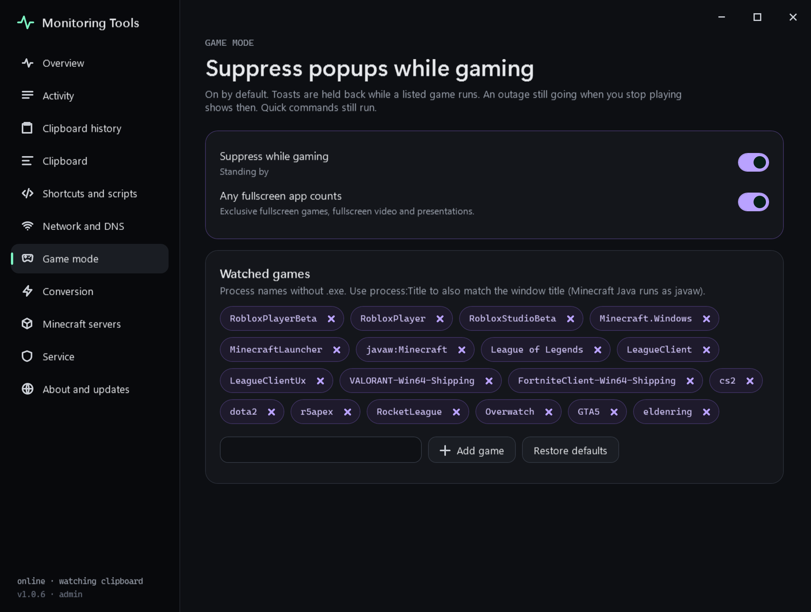

# Game mode

On by default. Popups are held back while a listed game runs, or while any app is fullscreen.

## What is held back

Clipboard toasts and the offline dialog. The tray icon turns violet so you can see game mode is on.

## What counts as a game

- A process on the watched list. The defaults include Roblox, Minecraft, League of Legends, Valorant, Fortnite and CS2.
- Any fullscreen app.

## Edit the list

1. Open **Game mode** in the control centre.
2. Add a process name without `.exe`.
3. Use `process:Title` to also match the window title. Minecraft Java runs as `javaw`, so `javaw:Minecraft` avoids matching other Java apps.
4. **Restore defaults** brings the original list back.

## Failure modes

A game in a borderless window that is not fullscreen is only caught if it is on the list.

## Related

- [Internet watch](../network/internet-watch.md)
- [Service and tray](../app/service-and-tray.md)
