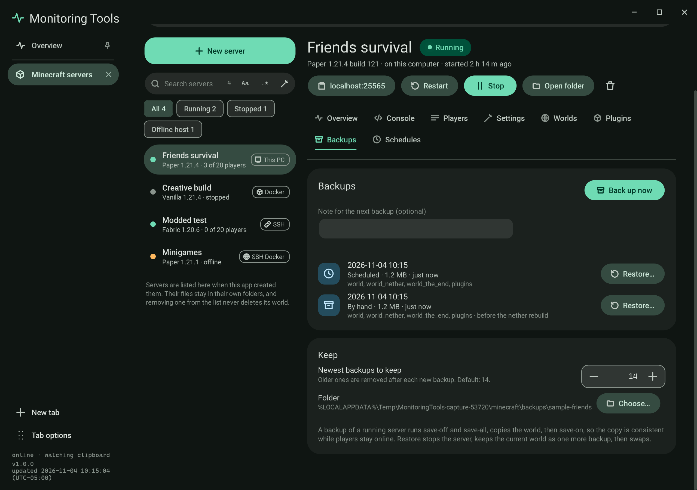

# Backups

Backups are ZIP files of the world, its Nether and End folders, and the plugins, mods and config folders, each with a
small description beside it: when, why (by hand, scheduled, before a restore, a reset or a replace), an optional note,
and what it holds.

- **Back up now** takes a backup with the note you typed. While the server runs it sends `save-off` and
  `save-all flush`, copies the world, then `save-on`, so the copy is consistent while players stay online. The lock file a
  running server holds is skipped.
- **Restore** stops the server, keeps the current world as one more backup ("Before a restore"), then swaps the folders.
  The current folders are moved aside first and only removed once the backup is in place, so a failure leaves the old
  world. It asks for the two-key confirmation.
- **Newest backups to keep** is a typed number (default 14); older ones are removed after each new backup.
- **Folder** chooses where backups go. The default is a folder for the server under the app's `minecraft/backups`.

Backups are made for servers whose files are on this computer, including Docker ones. SSH servers keep their world on
the host, so back them up there.

## Verification

A self-test check backs up a test world, changes it, restores it, confirms the old terrain is back, the added file is
gone, the world as it was is kept in a "Before a restore" backup, and that keeping three leaves three. Capture
`mc-backups`.
