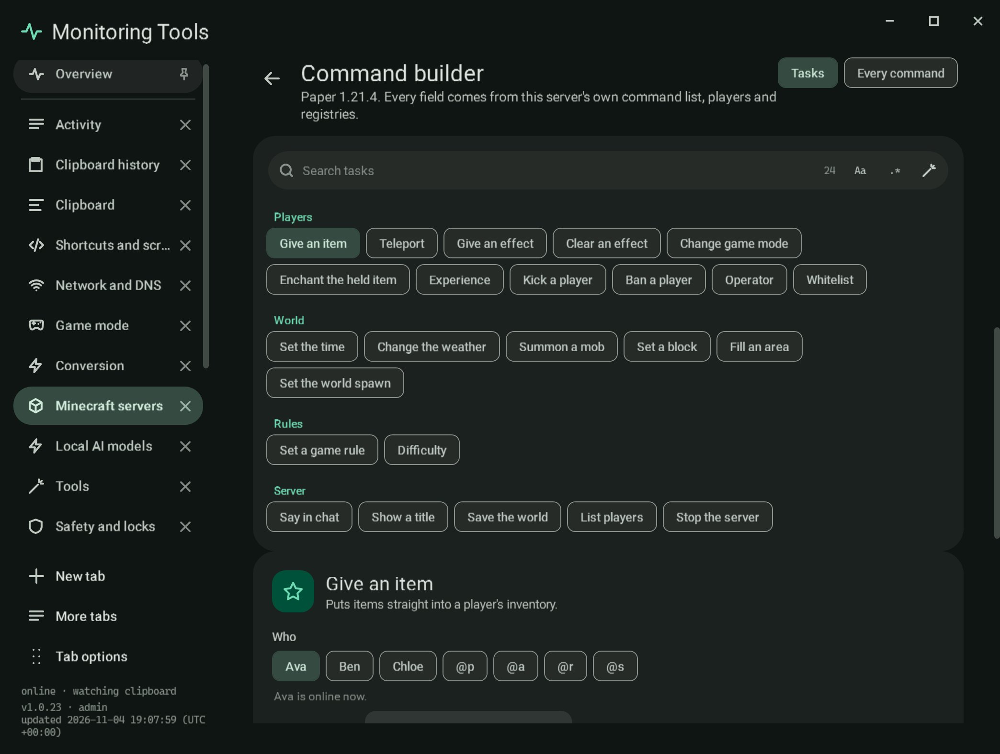
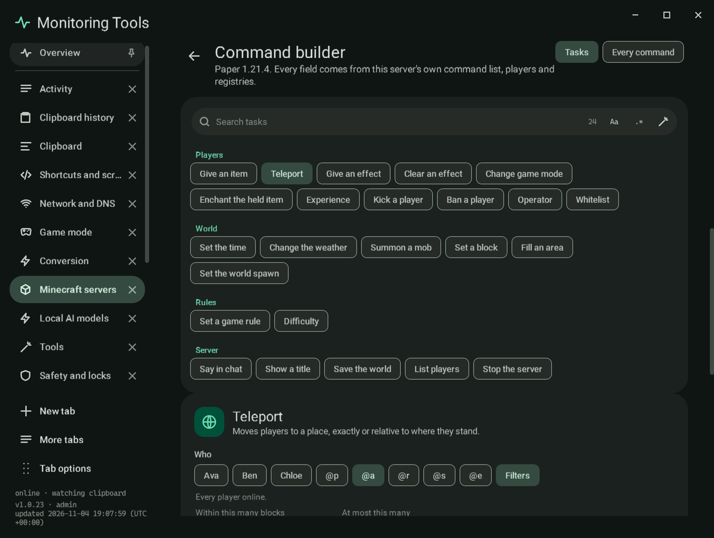
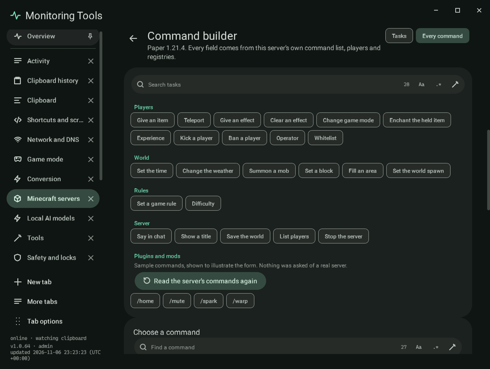
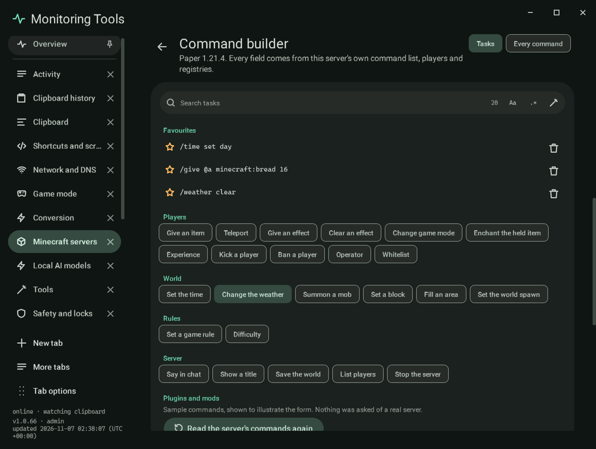
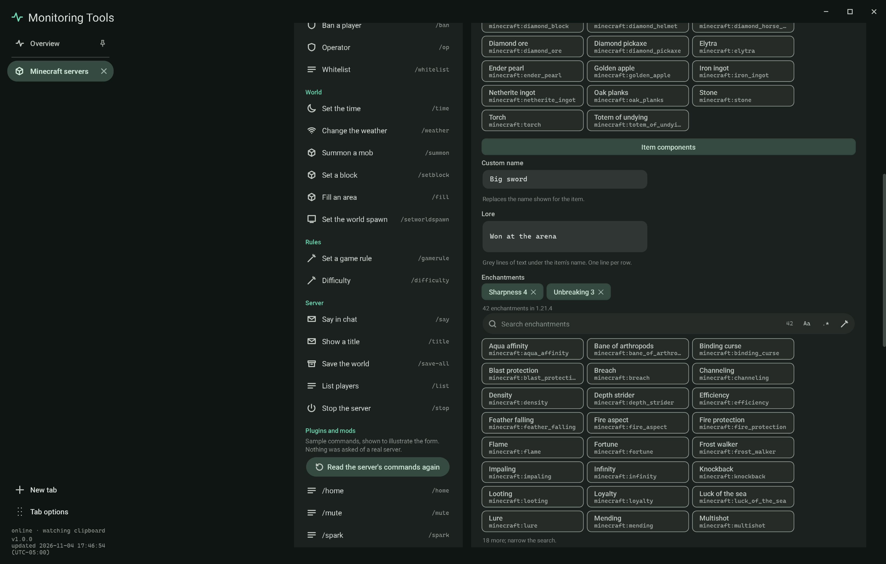
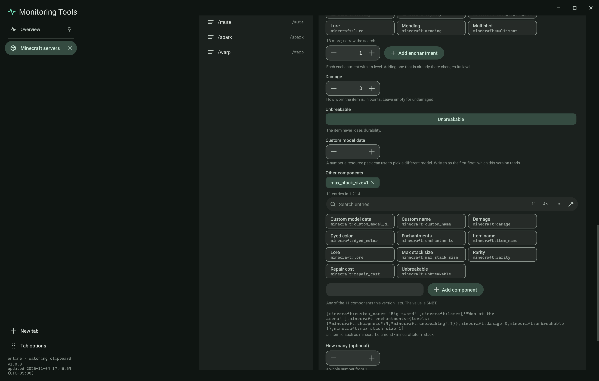
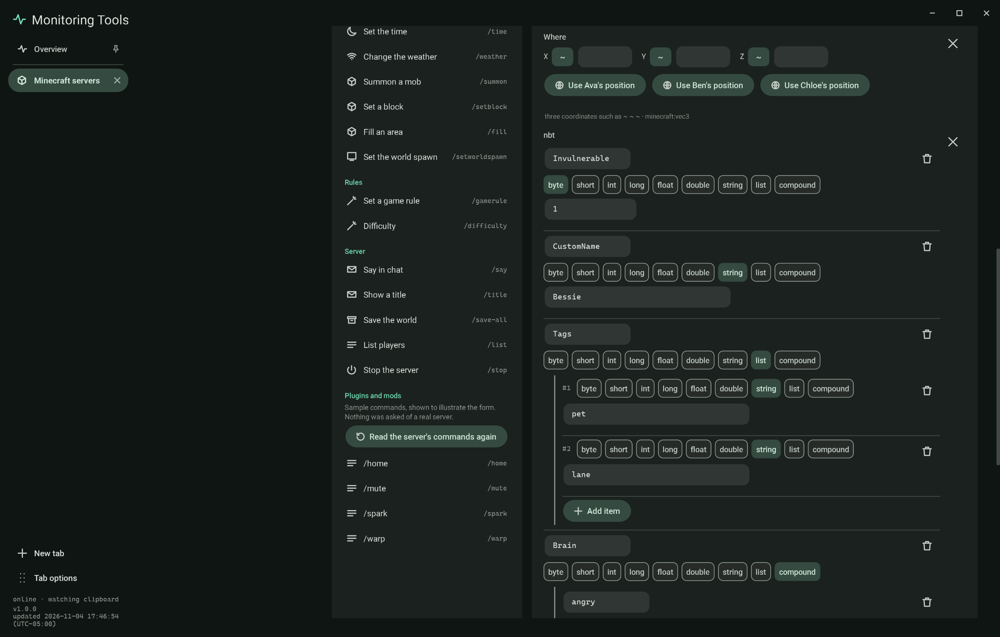
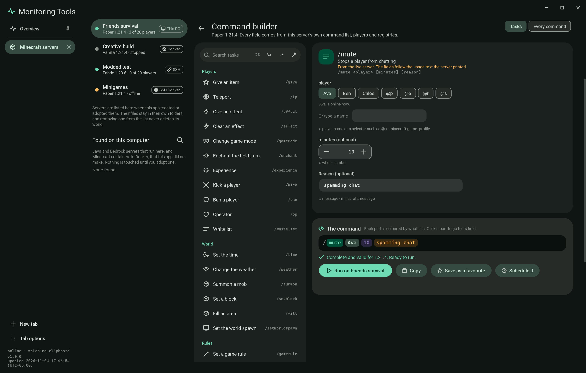

# Command builder

The command builder makes console commands with proper controls instead of a free text field. Open it from the
**Commands** button in the server header, from **Open the command builder** in the Console section, or from the
**Commands** tab. Everything it offers comes from the server's own version: the command tree in the jar's
`reports/commands.json`, the id lists in `reports/registries.json`, and the data-driven lists (enchantments, damage
types and others) read from the `data/minecraft/` folder inside the server jar. If the version's reports have not
been read yet, **Read this version's command list** downloads the official jar once and runs its data generator, the
same step the world generator uses.

Bedrock servers do not report a command list, so their console keeps a typed command line.

## Tasks

A searchable gallery (the shared search field with the regex builder) of what people most often want to do:

| Group | Tasks |
| --- | --- |
| Players | Give an item, Teleport, Give an effect, Clear an effect, Change game mode, Enchant the held item, Experience, Kick a player, Ban a player, Operator (op and deop), Whitelist (add and remove) |
| World | Set the time, Change the weather, Summon a mob, Set a block, Fill an area, Set the world spawn |
| Rules | Set a game rule, Difficulty |
| Server | Say in chat, Show a title, Save the world, List players, Stop the server |

Each task is a template that walks the server's command tree, so a task whose command the version does not have says
so instead of building a line the server would refuse. Its form has a control for each argument:

- **Who**: the online players (from `list`) as chips, the selectors `@p`, `@a`, `@r`, `@s` (and `@e` where entities are
  allowed) with a plain explanation of each, a box for a player who is not online, and **Filters** for a selector:
  within a distance, at most a number, an order and a game mode, written as `@a[distance=..10,limit=2,sort=nearest]`.
- **Item, block, effect, enchantment, mob**: a searchable list from the version's registry, each entry with its
  readable name (from the id) and the id, and the count of entries in the version.
- **Numbers**: typed number fields with steppers and the argument's real bounds from the parser properties in
  `commands.json` (for example the effect amplifier is 0 to 255 and the duration 1 to 1,000,000 seconds). Optional
  numbers can be left empty. Times take ticks, seconds or days.
- **Positions**: each axis with a `~` toggle for relative coordinates (`~` alone or `~5`) and a typed value, plus
  **Use a player's position**, which runs `data get entity <player> Pos` on the running server and fills the axes from
  the reply. It is unavailable, with the reason, when the server is not running or is a sample.
- **Choices and true or false**: chips with an explanation; the game rules come from the version's own `gamerule`
  command and are searchable.

## Every command

All of the server's commands, walked node by node from its command tree (redirects such as `tp` to `teleport` and `xp`
to `experience` are followed). Each argument gets the control its parser needs: `brigadier:integer`, `float`,
`double` and `long` with their minimum and maximum, `brigadier:bool`, `brigadier:string` (word, phrase or the rest of
the line), `minecraft:entity`, `game_profile` and `score_holder`, `minecraft:block_pos`, `vec3`, `vec2` and
`column_pos`, `minecraft:item_stack`, `minecraft:block_state` and `block_predicate`, `minecraft:resource`,
`resource_key` and `resource_or_tag` with their registry, `minecraft:message`, `minecraft:component`, `minecraft:time`,
`minecraft:gamemode` and `minecraft:dimension`. Any other parser gets a text box that names it.

## The command line

Below the form the command is shown as it will be sent, each part coloured by what it is: the command words, a target,
a number and other values. Each part has a tooltip, and clicking it moves keyboard focus to its field. A status line
says **Complete and valid for** the version, or names exactly what is missing or wrong: "Fill in Who.", "How many must
be at least 1.", "minecraft:not_an_item is not in this version's item list.", "Who takes players only, so @e cannot be
used here.".

- **Run on** the server sends it through the same console route as the rest of the manager (the process's console, RCON,
  or `rcon-cli` in Docker) and shows the reply; for a process server the reply is read from the console lines that
  follow. `stop`, `ban` and operator changes ask for the two-key confirmation first. **Ctrl+Enter** runs too.
- **Copy** puts the line on the clipboard.
- **Save as a favourite** keeps the line for this server in `servers.json` (`FavouriteCommands`). Favourites are listed at
  the top of the gallery, where one opens again in Every command with its fields filled, and in the Console section,
  where one runs with a click (lines that need confirmation open in the builder instead).
- **Schedule it** opens the schedule form with a **Run a command** schedule holding the line. See
  [schedules](schedules.md).

## Item components and NBT

An item argument (`give`, `item replace`, `summon` equipment and the rest that take `minecraft:item_stack`) has an
**Item components** control under its id list. On Java 1.20.5 and newer it is a component editor: a custom name, lore
(one line per row), enchantments chosen from the version's enchantment list with a level, damage, unbreakable, custom
model data, and a generic row for any other component, whose id is chosen from the version's own
`minecraft:data_component_type` list in `registries.json` and whose value is checked as SNBT. It writes
`id[component=value,...]` in the form the version takes: custom names and lore are JSON text in SNBT strings before
1.21.5 and plain SNBT from 1.21.5, enchantments are `{levels:{...}}` before 1.21.5 and a flat compound from it, and
custom model data is a number before 1.21.4 and `{floats:[n]}` from it. A component the controls cannot read back stays
in the generic list untouched. Before 1.20.5 the same place is the NBT editor below.

An argument that takes NBT (`minecraft:nbt_compound_tag`, for example the last argument of `summon` and `data merge`) gets
a structured tree editor: **Add key**, a name, a type (byte, short, int, long, float, double, string, list or compound),
a typed value checked against its range, nested compounds and lists (a list holds one type), and the SNBT it writes under
the tree. A value that uses a typed array (`[B;1b]`) is left as a text box. An invalid tree turns Run off and says what
is wrong beside the field. The Every command walker keeps quoted and bracketed parts in one word, so a saved favourite
with components or NBT opens again.

## Plugin and mod commands

The jar's report lists only vanilla commands. While a server runs, the builder asks it: `help` (all pages of Paper's
index) and `minecraft:help`, over RCON, `rcon-cli` or the console, and keeps the commands that are not in the jar's own
list. They appear under **Plugins and mods** in the gallery, labelled as read from the live server and when. A
`/name: description` line gives the description; a usage line such as `/mute <player> [minutes] [reason]` becomes a
form with one field per token: a player picker for player-like names, whole numbers, true or false, text, and choices
for `(a|b)` words, with `[...]` optional. Names the server printed are shown as written. Sample servers show sample
commands and say so. The list is read again on request, never guessed when the server does not answer, and a stopped
server shows how to get the group instead.

## Layout and access

At narrow widths the task gallery becomes rows of chips above the form. Every control has an accessible name; the mode
tabs move with the arrow keys; the command parts are buttons in the tab order. Motion follows the app's reduced motion
setting. Every label has Cantonese.

## Verification

Self-test checks build `give`, `tp`, `effect`, `summon`, `gamerule`, `fill`, `time`, `experience` and `title` from a
trimmed copy of the real 1.21.4 reports and assert the exact lines; refuse out-of-range numbers, unknown ids, `@e` for
players and fractional block coordinates with the field named; write relative axes as `~` and `~5`; read ten commands
of eight argument types back through the Every command walker; read enchantments from inside a bundler jar; drive the
form until Run turns on and a click on a part focuses its field; check that stop, ban and op are confirmed first; save
a favourite to `servers.json` and open it again; and open a command schedule. Further checks write and read back SNBT
for every tag type, write item components in each version's form, drive the item editor and the NBT editor through
their real buttons to exact lines (including a refused byte of 300), read plugin help into forms, and press **Use a
player's position** with a stand-in reply. The live check (`MT_LIVE_ONLY=minecraft-commands`) starts a throwaway Vanilla
1.21.4 server, builds `time set day`, `give @a minecraft:diamond 2` and `gamerule keepInventory true` with the builder's
own code, runs them and checks each reply in the console. `MT_LIVE_ONLY=minecraft-lane` goes further, on a real Paper
server with a headless bot player (mineflayer in a throwaway folder): the server's own `data get entity` reply gives the
position the bot itself reports, a `give` with seven components is answered and read back from the player's inventory,
a `summon` with NBT from the tree is answered, and `help` is read into Plugins and mods; it also runs the builder's lines
over the Docker, SSH and SSH Docker targets, and (`MT_LIVE_LANE=fabric`) reads `help` on a real Fabric server with the spark mod into a form. Captures `mc-commands-give`, `mc-commands-tp`, `mc-commands-tree`,
`mc-commands-favourites`, `mc-commands-item-components`, `mc-commands-item-components-more`, `mc-commands-nbt` and `mc-commands-plugins` use the sample
server.

## Limits

- Plugin and mod commands depend on what `help` prints: a plugin that registers a command without usage text gets a
  form with one text field for its words, and one the server does not list in `help` is not offered. The live check ran
  Paper (its `help` index, 15 commands) and a Fabric server with the spark mod (`/spark`, whose usage Fabric prints as
  `[<args>]`, so its form is one optional text field); Forge and NeoForge servers were not run. Over RCON the reply to
  `help` comes back as one run of text, so the reader splits glued usage lines apart again.
- The component editor builds six components with controls and any other by id and SNBT; item *predicates* (the
  `item_predicate` parser used by `clear` and `execute if items`) keep the id list and a typed value.
- An invalid NBT tree turns Run off, and the status line names the exact reason (for example "Invulnerable: A byte is
  from -128 to 127.") as well as the field.
- Data pack dimensions are typed; the list offers the overworld, the nether and the end.
