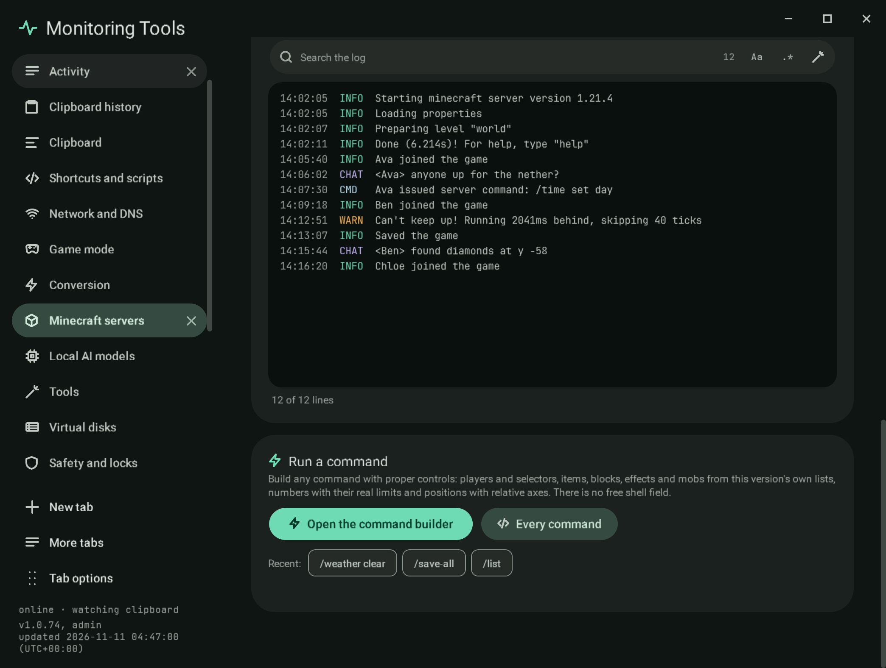

# Console

## The log

The live log, with each line split into its time, level and message. Chips show or hide **Info**, **Warnings**,
**Chat** and **Commands**; **Follow** keeps the newest line in view. The log search is the shared search field with the
regex builder. For a process on this computer the lines arrive as the server prints them; for Docker and SSH servers the
app reads the newest 400 lines every few seconds. The last 2,000 lines are kept.

## Run a command

There is no free shell field. **Open the command builder** (or **Every command**) opens the
[command builder](commands.md): task forms with players, selectors, items, blocks, effects, numbers with the jar's
bounds and relative positions, and the whole command tree of the server's version, with a coloured preview, a
completeness check, Run, Copy, favourites and scheduling.

Under the button, **Favourites** and **Recent** (the last eight commands sent, per server) run again with a click.
`stop`, `ban` and operator changes open in the builder instead, where they ask for the two-key confirmation.

Bedrock servers have no command list to build from, so their console keeps a typed command line, sent as it is.

## Verification

A self-test check presses **Open the command builder** in the Console section and finds the Commands section open;
another finds a saved favourite as a chip in the console. Capture `mc-console`. The builder's own checks are listed in
[commands](commands.md#verification).

