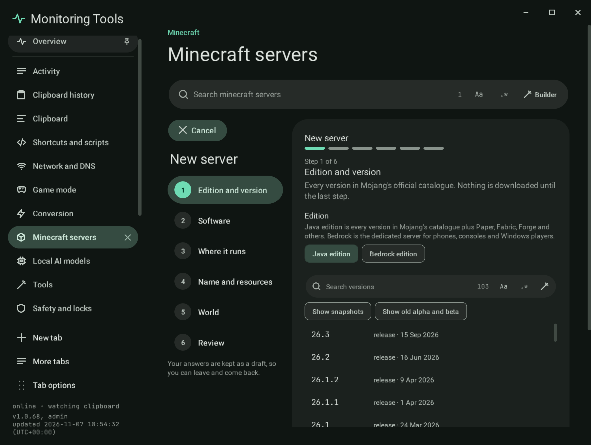
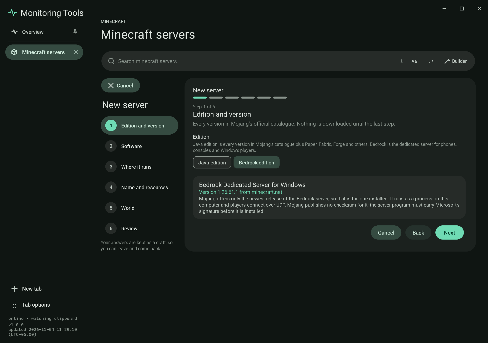

# Create a server

**New server** opens a six-step guide in the workspace. A step rail on the left shows each step, ticks the ones you have
finished with their answer, and lets you go back to any of them. The progress bar, Back, Next and Cancel come from the
app's shared guided form. Your answers are kept as a draft while you move between sections and pages; Cancel discards it.
Nothing is downloaded until the last step.

1. **Edition and version.** Java edition lists every version in Mojang's official catalogue, newest first, with its type
   and release date. **Show snapshots** and **Show old alpha and beta** add those types. The search field has the regex
   builder. Picking a version reads its metadata and says whether Mojang publishes a dedicated server for it and which Java
   it needs. **Bedrock edition** reads Mojang's download links service (the one the minecraft.net download page uses)
   and shows the current Windows release of the Bedrock Dedicated Server. Mojang links only the newest release, so that
   is the one installed; Next waits until the link has been read.
2. **Software.** Vanilla, Paper, Purpur, Fabric, Forge and NeoForge. Each card shows the newest build its project lists
   for the chosen version, read from the project's own public API: PaperMC's Fill API, the Purpur API, the Fabric meta
   service, and the Forge and NeoForge Maven metadata. Software without a build for that version cannot be picked, and an
   API that cannot be reached is shown as unavailable rather than guessed. The newest builds are offered as a choice.
   For Bedrock the step shows the Bedrock Dedicated Server, the only software it has.
3. **Where it runs.** This computer, Docker on this computer, another computer over SSH, or Docker over SSH. Each card
   runs a live check when you pick it: which Java will be downloaded (or is already there), whether Docker is running and
   its version, or whether the SSH host answers and has Java or Docker. SSH targets ask for the host and an optional
   folder, with **Check host key** and **Check the host**. A Bedrock server runs as a process on this computer only.
4. **Name and resources.** The name, and typed number fields with steppers and their real bounds for memory (512 to
   65536 MB), port (1024 to 65535) and maximum players (1 to 1000). The step checks that the port is free on this computer
   and not used by another server here, and compares the memory with what the computer has. For Bedrock there is no
   memory field (it is not a Java server), and the port is a free UDP pair starting at 19132 (the next port is its IPv6
   port).
5. **World.** A new world with a seed and a world type, a world you have (a folder or a ZIP, checked for a `level.dat`
   and copied, never moved), or a backup of another server on this computer. A Bedrock server starts with a new world
   from a seed; an existing Bedrock world is copied into its `worlds` folder afterwards.
6. **Review.** A summary of every answer and the Minecraft EULA switch. **Create server** refuses until the EULA is
   accepted, then downloads and checks the server: the Vanilla jar against Mojang's SHA-1, Paper against PaperMC's SHA-256,
   Purpur against its published MD5, and Java against Adoptium's SHA-256. Mojang publishes no checksum for the Bedrock
   server, so its download is accepted only from minecraft.net over HTTPS, and `bedrock_server.exe` must carry a valid
   Authenticode signature from Microsoft Corporation before anything is copied into the server's folder.

## Failure modes

- A version without a dedicated server, software without a build, or a target that cannot run the chosen software stops
  the step with the reason.
- A failed download or checksum leaves no half-made server in the list.

## Verification

A self-test check drives the flow through its buttons and confirms it holds Bedrock until its version is known, and
refuses Fabric as a local process, memory below 512 MB, an empty name, and a world folder without `level.dat`. A second
check takes a Bedrock server through every step to the review (Docker and an existing world are refused, no memory field)
with a sample release, so it needs no network. The [live check](../tools/live-check.md) creates, starts, asks `list` and
stops a real Bedrock server. The guided-forms check walks all six steps and
confirms nothing is created without pressing **Create server** and accepting the EULA. Captures `mc-create-1` to
`mc-create-6`, `mc-create-bedrock` and `mc-create-bedrock-review`.
