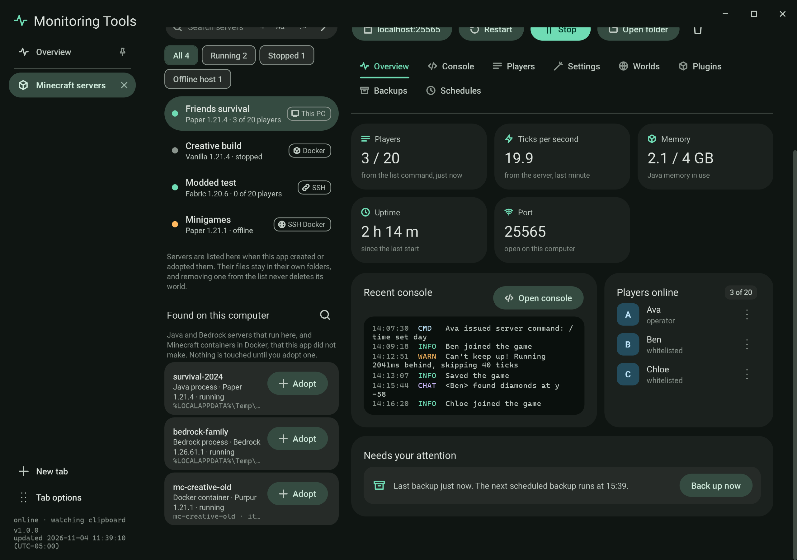
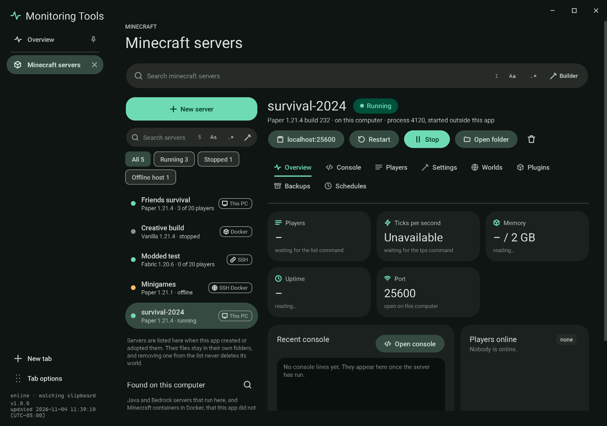

# Servers found on this computer

Below the server list, **Found on this computer** lists Minecraft servers that run here but that this app did not make.
The list is read when the page first opens and again with the search button beside its title. Finding a server only
reads; nothing is stopped, changed or written until you adopt it.

## What is found

| Kind | How it is recognised | What is read |
| --- | --- | --- |
| Java process | A `java` or `javaw` process with `-jar <file>.jar`, whose folder has a `server.properties`, or that was started with `nogui`, or a Forge or NeoForge launch | The command line and the working folder (read from the process itself), the jar, the port from `server.properties`, the version from a `paper-` or `purpur-` jar name or the jar's own `version.json`, the software |
| Bedrock process | A `bedrock_server` process | Its folder, the port from `server.properties`, the version the app recorded when it installed it (otherwise unknown) |
| Docker container | A container whose image name contains `minecraft` (for example `itzg/minecraft-server` or `itzg/minecraft-bedrock-server`) | The image, the state, `VERSION` and `TYPE` from its environment, the published port, and the `/data` folder when it is a folder on this computer |

A Java program that is not a server (no `server.properties`, no `nogui`) is left out. Servers the app already manages are
left out: a process in a listed server's folder, and a container with this app's own label for a listed server.

## Adopting

**Adopt** asks first, then adds the server to the list as an adopted entry that points at the existing folder or
container. Nothing in the folder or container changes.

- **An adopted container** is started, stopped and sent commands through Docker (`rcon-cli`, which the `itzg` images
  carry). When its `/data` is a Docker volume rather than a folder here, `server.properties` is read and written through
  `docker exec`. The app never removes an adopted container: removal is allowed only for a container that carries this
  app's own label for that server.
- **An adopted process that is still running** belongs to the program that started it, so the app cannot write to its
  console. It shows as Running ("started outside this app"), with memory and uptime from the process. Commands, and a
  graceful **Stop**, go over RCON when `enable-rcon` and `rcon.password` are set in its `server.properties`; without them
  the app says so and refuses. The process is never killed. Once it has stopped, **Start** runs it from here with the jar
  it was found running, and from then on its console works as for any other server.

## Failure modes

- Docker not running: no containers are listed, and processes still are.
- A process that cannot be read (another user's, or 32-bit) is skipped.
- An adopted process without RCON cannot be stopped or sent commands from here; the message says what to turn on.

## Verification

A self-test check classifies a sample process and container list (a Paper and a Bedrock process, a container, another
Java program, a container this app made, and a process in a managed server's folder) and checks what is read from each.
Another drives the Found list with that sample: **Adopt** points the entry at the folder, leaves the folder unchanged,
reads the still-running process as Running and refuses a stop and a command without RCON. The
[live check](../tools/live-check.md) starts a real Java server outside the app with RCON on, discovers it (command line
and folder read from the process), adopts it, sends `list` over RCON and stops it over RCON; and starts a real
`itzg/minecraft-server` container without this app's label, discovers and adopts it, reads its state and
`server.properties` through Docker, confirms the app refuses to remove it, and removes it afterwards itself. Captures
`mc-found` and `mc-adopted` use sample processes.
