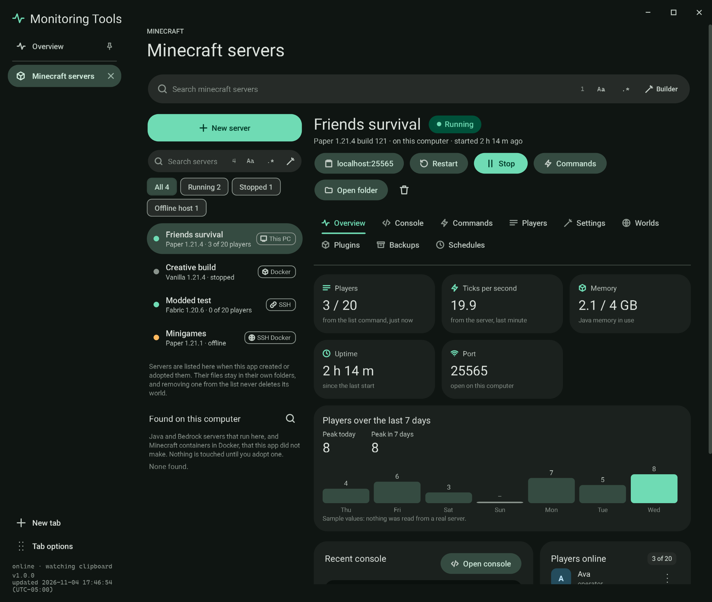
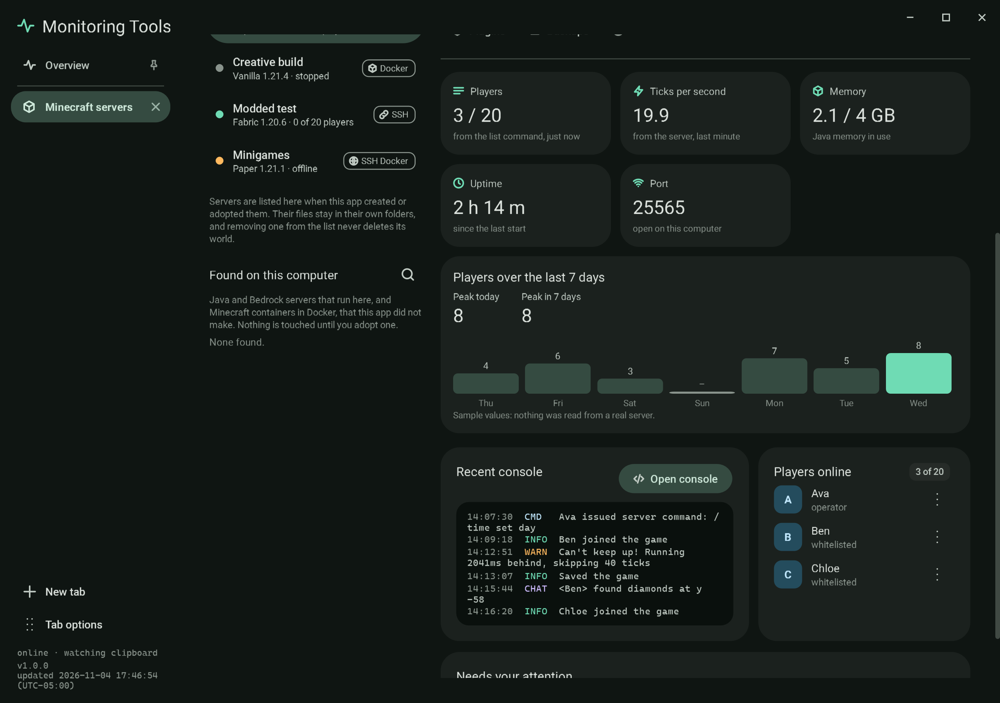

# Overview

The first section of a server's workspace.

## Live tiles

| Tile | Where the value comes from |
| --- | --- |
| Players | The server's own answer to the `list` command, asked every 20 seconds while it runs |
| Ticks per second | Paper and Purpur answer the `tps` command; other software does not report it, and the tile says so |
| Memory | The Java process's working set on this computer, `docker stats` for a container, or `ps` on an SSH host, against the memory allowance |
| Uptime | The process start time, the container's start time, or the elapsed time `ps` reports on the host |
| Port | Whether it is open, free, in use by another program, or shared with another server here |

A value that is not known is shown as "–" or "Unavailable" with the reason underneath, never as an estimate.

## Players over the last 7 days

Every `list` answer the app reads raises that day's peak for the server, kept for 30 days in `player-peaks.json` beside
`servers.json`. The card shows **Peak today**, **Peak in 7 days** and a bar for each of the last seven days. A day with
no reading is a dash, never a zero, because nothing was known that day. Readings replayed from an old log tail are not
counted. Sample servers show fixed sample values and say so.

## Recent console and players online

The last six console lines, with a link to the [console](console.md), and the players the last `list` answer named,
each marked as operator or whitelisted from the server's files and with a menu for kick, ban and game mode.

## Needs your attention

- **Host offline**, with Reconnect.
- **The last start failed**, with the reason.
- **Port in use** by another program on this computer, for a stopped server.
- **A newer build** of Paper, Purpur, Fabric, Forge or NeoForge, compared with the build the server was created with.
  It is checked once per session, and by an update-check schedule. The suggestion is to take a backup first.
- **Last backup** age and the next scheduled backup, or that there is no backup yet.

## Verification

Capture `mc-overview` uses the sample servers of the capture run; its players, memory and uptime are sample values, and
`mc-overview-peaks` shows the history card. Self-test checks keep the peak per server and per day (only upward within a
day), save it to the file and read it back after a reload, prune after 30 days, and show a real server's recorded peaks
and the dashes on the Overview, redrawn when a new peak arrives. The live check (`MT_LIVE_ONLY=minecraft-lane`) starts a
real Paper server and reads `tps` through the same poll the Overview uses (20.0 on a quiet server), and runs the
update check against the real Paper API: the newest build is reported as current, and a server recorded as build 1 is
told a newer build exists. The update check was also run against the real Purpur, Fabric, Forge and NeoForge APIs (`MT_LIVE_LANE=updates`, 2.7 s): for each the newest build is current and the oldest listed build is told the newest is newer.
