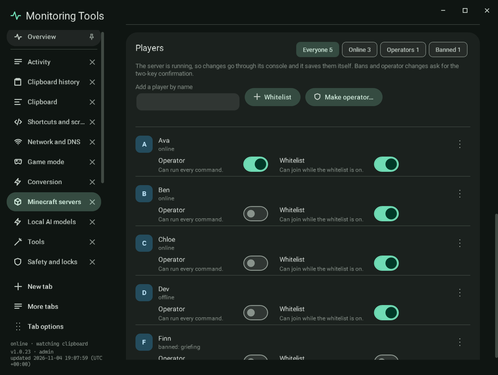
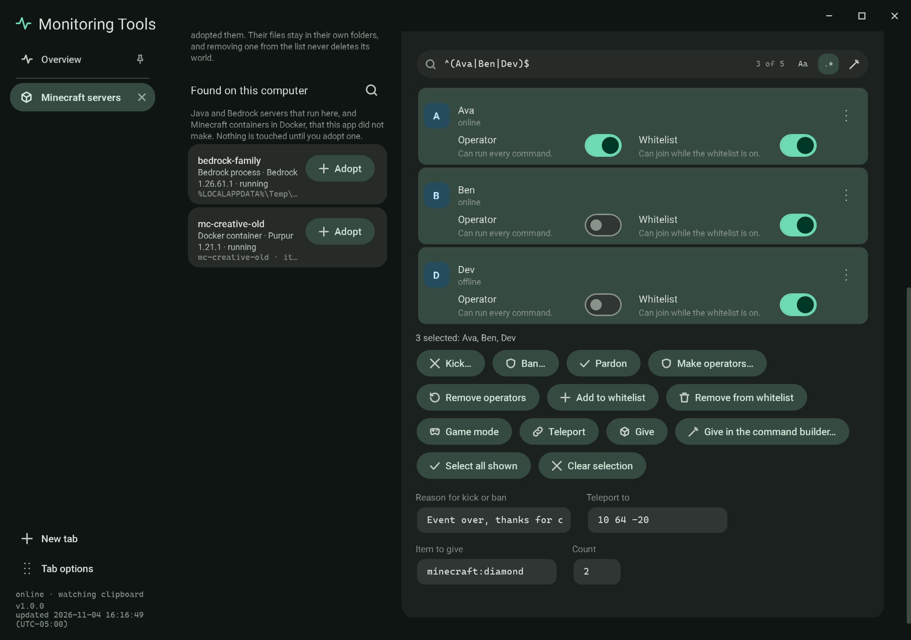
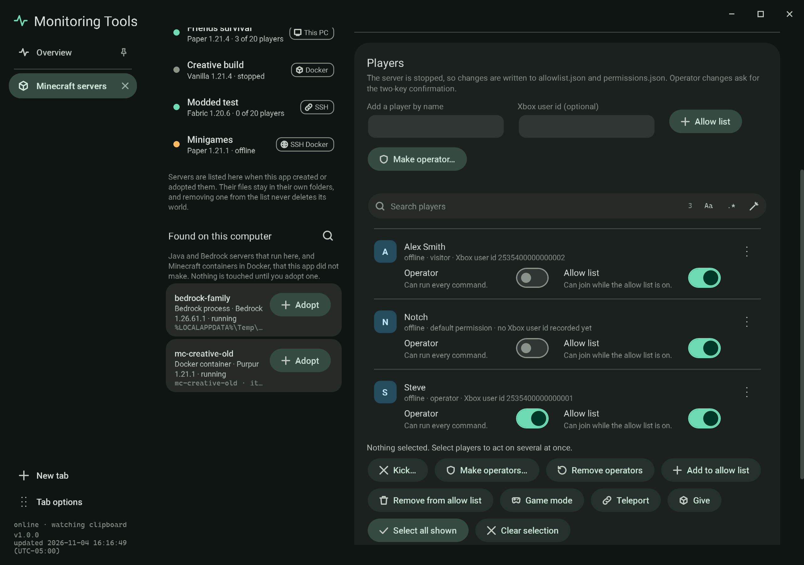

# Players

Everyone the server knows: the names in `ops.json`, `whitelist.json` and `banned-players.json`, and the players the last
`list` answer named. Chips filter **Everyone**, **Online**, **Operators** and **Banned**, with counts.

Each player has an **Operator** switch, a **Whitelist** switch, a status line (online, offline, or banned with the reason),
and a menu with **Kick**, **Ban** or **Pardon**, and the game modes while they are online. **Add a player by name** checks
the name (1 to 16 letters, digits or underscores) and offers **Whitelist** and **Make operator**.

## How changes apply

- **While the server runs**, changes go through its console (`op`, `deop`, `whitelist add`, `whitelist remove`, `ban`,
  `pardon`, `kick`), so the server applies them and saves its own files.
- **While it is stopped**, the JSON files are edited directly. Every entry the app does not change is kept, a player
  keeps the UUID the server already recorded for them (from the other files or `usercache.json`), and a new ban is written
  in the server's own format.
- **SSH servers** keep their files on the host. While stopped, the four files are read in one SSH round trip and the one
  file a change belongs to is written back (text travels as base64 on standard input, so no character is interpreted by a
  shell). A host that cannot be reached is an error, never an empty list.

Making someone an operator, removing an operator and banning ask for the app's two-key confirmation. A kick is only
possible while the server runs.

## Selecting several players

The list is a real multi-select list: click, Ctrl or Shift and click, the arrow keys, or Ctrl+A (or **Select all shown**).
Above it sit the shared search field and its regex builder; the list filters as you type and the field shows how many of
the players are shown. A line below the list says how many are selected and names them (read out by screen readers).

The actions below act on the whole selection: **Kick**, **Ban**, **Pardon**, **Make operators**, **Remove operators**,
add or remove from the whitelist (the allow list on Bedrock), **Game mode**, **Teleport** (a player's name or three
coordinates, `~` for relative) and **Give** (an item id and a count). **Give in the command builder** opens the builder's give form with the item and count you typed and the first selected
player as the target (the builder takes one target at a time; the status line says so when several are selected).
One reason field serves kick and ban. Kick, ban
and make operators ask for the two-key confirmation, which shows the exact count and the names.

- While the server runs, one console line is sent per player and each reply is kept; the result line says how many
  worked and names every player that failed with the reason.
- While it is stopped, ban, pardon, operator and whitelist or allow list changes edit the files (here, over SSH, or the
  Bedrock files); kick, game mode, teleport and give say they need a running server.
- Bedrock has no ban or pardon command, so those buttons are not shown.

## Bedrock

A Bedrock server keeps allowlist.json (a name and, once the player has joined, an Xbox user id) and permissions.json (a
level per Xbox user id). While it runs, changes use the console (`allowlist add`, `allowlist remove`, `op`, `deop`,
`kick`); while it is stopped, the two files are edited. Because permissions.json knows only ids, an operator change from
the files needs the id (taken from allowlist.json or typed in the optional field); without one the app says so. Ids that
permissions.json holds with no name are shown by id. A note appears when `allow-list` is false in server.properties.

## Verification

A self-test check writes and reads the three files in a temporary folder: whitelist and op with a known UUID, a ban with
its reason, then pardon, deop and whitelist remove, an invalid name and a kick while stopped are refused, and the Players
section of a sample server lists its five players with their switches. Capture `mc-players`.
