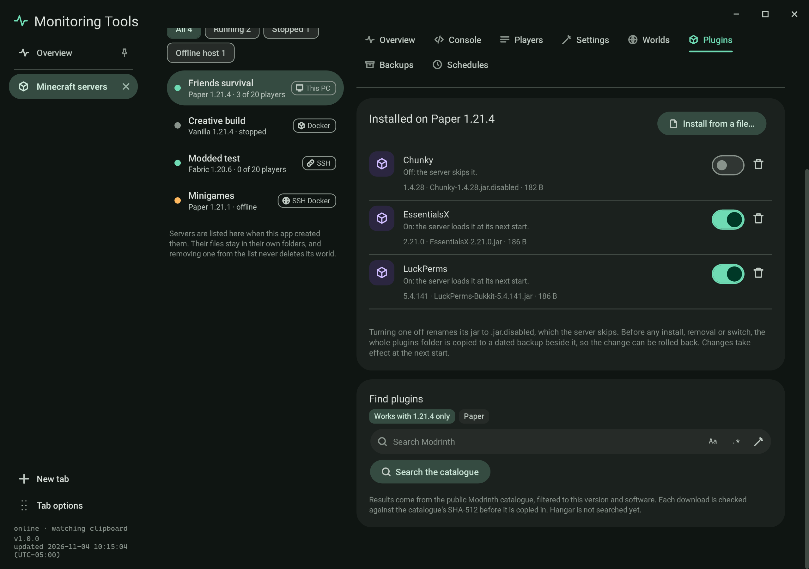

# Plugins and mods

Paper and Purpur servers take plugins (the `plugins` folder); Fabric, Forge and NeoForge take mods (`mods`); Vanilla
takes neither, and the section says so. The section is named **Plugins** or **Mods** to match.

## Installed

Every jar in the folder, with the name and version it declares for itself (`plugin.yml`, `paper-plugin.yml`,
`fabric.mod.json` or `mods.toml`), its file and size, an on switch and a remove button.

- **Off** renames the jar to `.jar.disabled`, which the server skips; **on** renames it back.
- **Remove** deletes the jar after the two-key confirmation.
- **Install from a file** copies a jar in (anything that is not a readable jar is refused). For SSH servers it is copied to
  the host with `scp`.
- Before any install, removal or switch, the whole folder is copied to a dated backup in `plugins-backups` or
  `mods-backups` beside it, so the change can be rolled back.

Changes take effect at the next start.

## The catalogue

**Search the catalogue** asks the public Modrinth API, filtered to the server's game version and to the loaders its
software accepts (Paper and Purpur also accept Spigot and Bukkit plugins), for server-side projects. **Install** takes
the newest file for that version and loader and copies it in only after its bytes match the SHA-512 the catalogue lists.

## Not done

- Hangar is not searched yet.
- There is no **Update all** and no compatibility badge yet: the app does not compare installed jars with catalogue
  versions.

## Verification

A self-test check turns a sample jar off and on, confirms the rename, the folder backup and that the name comes from its
`plugin.yml`, and that a file that is not a jar is refused. The catalogue search and the SHA-512 install were not run in
the self-test, which has no network. Capture `mc-plugins`.
