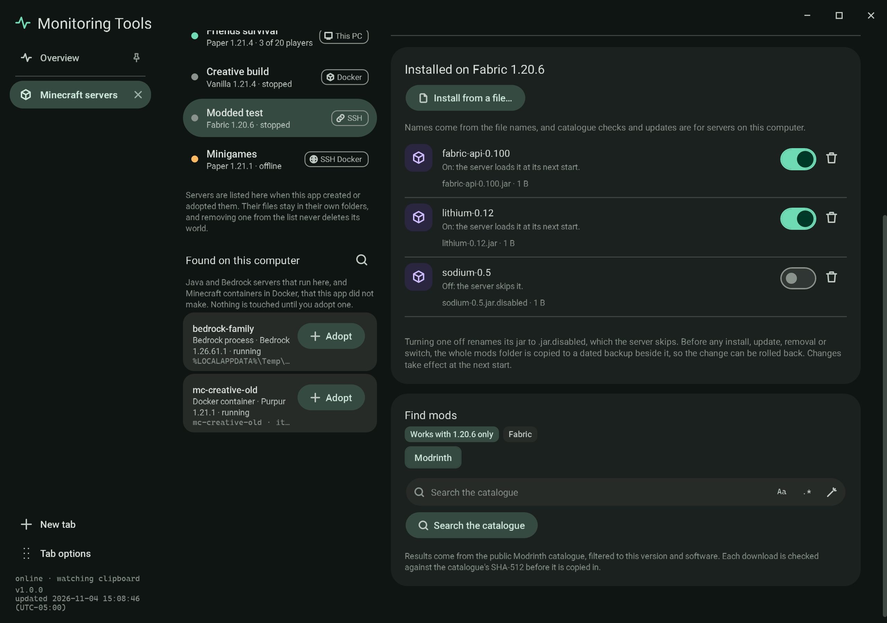
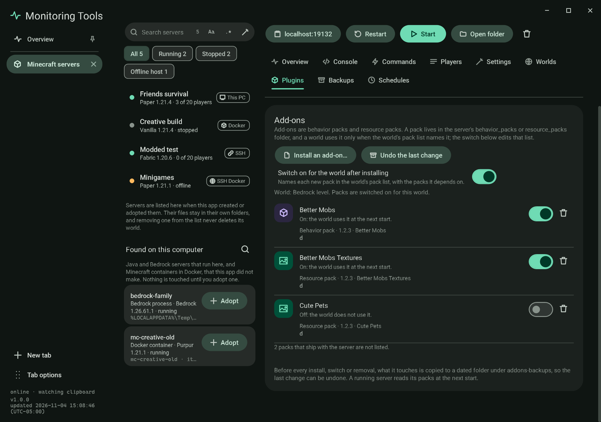
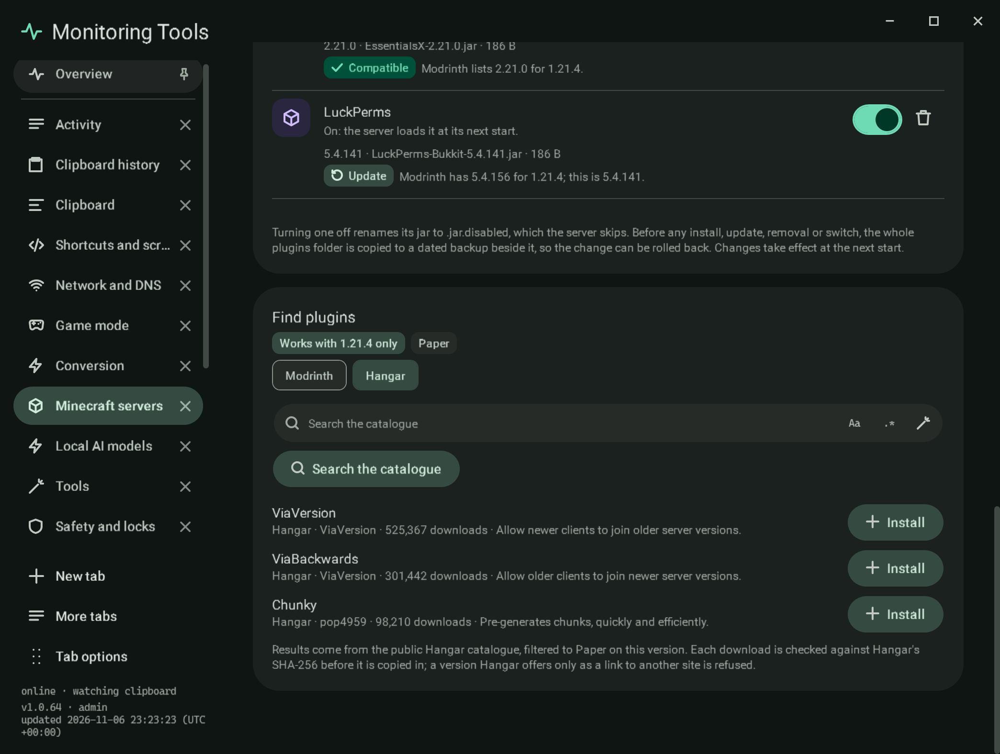

# Plugins and mods

Paper and Purpur servers take plugins (the `plugins` folder); Fabric, Forge and NeoForge take mods (`mods`); Vanilla
takes neither, and the section says so. A Bedrock server takes add-ons (behavior and resource packs) instead; its section is described under
[Bedrock add-ons](#bedrock-add-ons). The section is named **Plugins** or **Mods** to match.

## SSH servers

A server on an SSH host lists its `plugins` or `mods` folder over SSH. Names come from the file names (jars are not
downloaded to read their metadata). The switch (rename to `.jar.disabled`), **Remove** and **Install from a file** (scp)
work on the host, each after the folder is copied to a dated `plugins-backups` or `mods-backups` folder beside it on the
host. Catalogue search, installs, update checks and **Undo** are for servers on this computer.

## Bedrock add-ons

An add-on is a pack folder with a `manifest.json` inside `behavior_packs` or `resource_packs`. A world uses it only when
the world's `world_behavior_packs.json` or `world_resource_packs.json` names its id and version, so the section edits
those files. Packs the server ships (vanilla, chemistry, editor, experimental) are counted but not listed.

- **Install an add-on** takes a `.mcpack`, a `.mcaddon` or a ZIP of either. Entries pointing outside the folder are
  refused, a `.mcpack` inside a `.mcaddon` is unpacked, and skin packs and world templates are skipped with the reason.
  Manifests may carry comments and trailing commas, as the game allows. A pack with the id of an installed one replaces it.
- The switch **Switch on for the world after installing** names each new pack (and the packs it depends on) in the
  world's pack list. Before the first start there is no world; the add-on is installed and switched on after the server
  has made its world.
- Each pack has a switch (on and off edit the world's list, switching on also switches on installed dependencies) and a
  remove button with the two-key confirmation.
- Before each install, switch or removal, what it touches is copied to `addons-backups/<time>` with a plan, and **Undo the
  last change** puts it back and removes what that change added; an undo can itself be undone.

The same code serves this computer, a Docker bind mount and an SSH host.

## Installed

Every jar in the folder, with the name and version it declares for itself (`plugin.yml`, `paper-plugin.yml`,
`fabric.mod.json` or `mods.toml`), its file and size, an on switch, a remove button and a compatibility badge.

- **Off** renames the jar to `.jar.disabled`, which the server skips; **on** renames it back.
- **Remove** deletes the jar after the two-key confirmation.
- **Install from a file** copies a jar in (anything that is not a readable jar is refused). For SSH servers it is copied to
  the host with `scp`.
- Before any install, update, removal or switch, the whole folder is copied to a dated backup in `plugins-backups` or
  `mods-backups` beside it.
- **Undo the last change** puts the folder back as the newest backup holds it: jars added since are removed and every
  backed-up file is copied back. The folder as it is now is backed up first, so an undo can itself be undone.

Changes take effect at the next start.

## Compatibility badges

When the section opens (and on **Check for updates**) every jar is looked up:

- **Modrinth** recognises any of its own files by SHA-512, so a jar copied in by hand is found too. Its declared game
  versions and the newest file for this version and loader come from Modrinth's `version_files` and
  `version_files/update` endpoints.
- **Hangar** has no lookup by file, so a jar installed from Hangar by this app is recorded (in `minecraft/catalogue/` in
  the app's data folder) and checked against Hangar's version list for this game version. A recorded Hangar install is
  checked against Hangar even when Modrinth also carries the file.

| Badge | Meaning |
| --- | --- |
| Compatible | The catalogue lists this file for the server's game version, and there is nothing newer for it. |
| Update | The catalogue has a newer file for this version; the row gets an **Update** button. |
| May not work | The catalogue does not list this version for the file and has no file for it. |
| Not in a catalogue | The jar is not in Modrinth and was not installed from Hangar by this app. |

**Update all** installs every newer compatible file, each checked against its catalogue's hash. The whole folder is
backed up first, and if any one update fails the folder is put back exactly as it was and the message says so.

## The catalogues

**Modrinth** and, for Paper and Purpur, **Hangar** are chips above the search.

- **Modrinth** asks the public Modrinth API, filtered to the server's game version and to the loaders its software accepts
  (Paper and Purpur also accept Spigot and Bukkit plugins), for server-side projects. **Install** takes the newest file for
  that version and loader and copies it in only after its bytes match the SHA-512 the catalogue lists.
- **Hangar** asks `hangar.papermc.io/api/v1/projects` with the Paper platform and the game version. **Install** takes the
  newest Release-channel version for that game version (or the newest one when there is no Release) and copies it in only
  after its bytes match the SHA-256 Hangar lists. A version Hangar offers only as a link to another site has no checksum,
  so it is refused.

## Failure modes

- A catalogue that cannot be reached leaves the badges unchecked and says so; nothing is changed.
- A download whose hash does not match is deleted and nothing is installed.
- An update that fails during **Update all** rolls the whole folder back.

## Verification

Self-test checks turn a sample jar off and on (rename, folder backup, the name from `plugin.yml`, a non-jar refused);
check every badge rule; run **Update all** with one update that fails (the folder comes back unchanged) and one that
succeeds, then **Undo**; and open the section on the sample Paper server to find the three badges, **Update all**, **Undo
the last change** and the Hangar chip (absent on a Vanilla server). The [live check](../tools/live-check.md) searches
Modrinth and Hangar for real, installs a Hangar plugin and an older Modrinth file into a throwaway server folder with
their hashes checked, finds the older file badged **Update** and the Hangar one **Compatible**, and runs **Update all**.
Captures `mc-plugins-badges` and `mc-plugins-hangar` (sample data and sample results).
