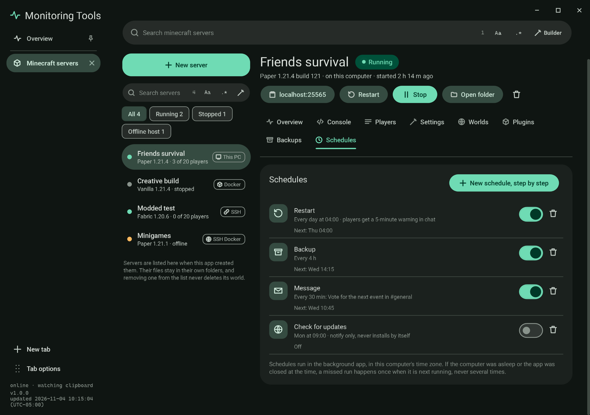

# Schedules

Jobs that run for one server on a timetable, each with its next run, its last result and an on switch:

| Job | What it does |
| --- | --- |
| Restart | Warns players in chat a chosen number of minutes before, then stops and starts the server |
| Backup | Takes a [backup](backups.md), pausing saves while the server runs |
| Message | Says a line in chat |
| Check for updates | Compares the installed build with the newest one its project lists; it tells you and never installs anything |

**New schedule, step by step** is a guided form: the job, when (daily at a time, on chosen weekdays at a time, or every
so many minutes), the details (the warning minutes or the message), and a review with the first run.

## How they run

Schedules are stored in `servers.json` and run by the background app, which looks once a minute, in this computer's
time zone. A run that was missed because the computer was asleep or the app was closed happens once when it is next
running, never once per missed time. A restart or message for a server that is not running is skipped and recorded as
skipped, and nothing runs for a host that cannot be reached. Results go to the activity log.

## Verification

A self-test check computes next runs for daily, every-four-hours and weekly schedules, confirms three missed daily runs
are due once and not again, that a schedule that is off is never due, and runs a due message schedule through the
background runner for a stopped server, which records it as skipped. Capture `mc-schedules`.
