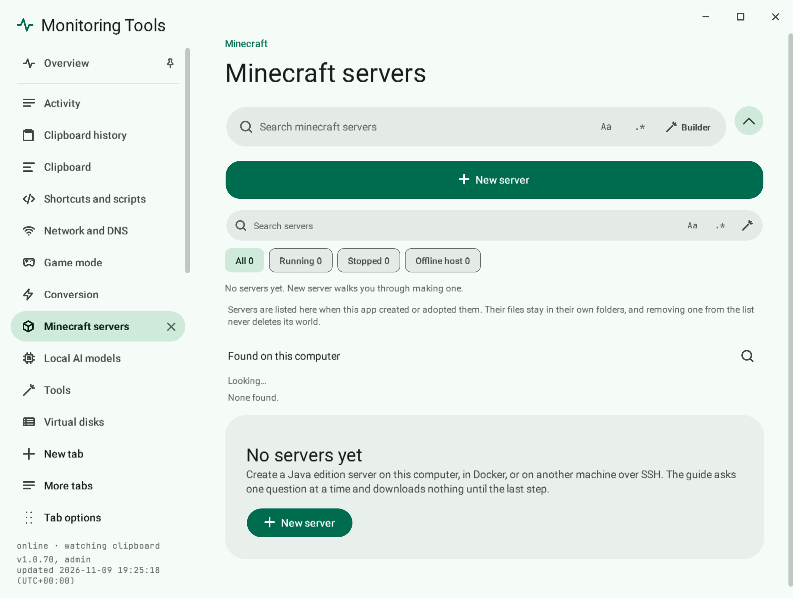

# Minecraft servers

Create and run Java edition servers on this computer, in Docker, or on another machine over SSH.

## Create a server

1. Open **Minecraft servers** in the control centre.
2. Pick a version. The list comes straight from Mojang's official catalogue; choose the type and search the version picker.
3. Pick a flavour: Vanilla, Paper or Fabric.
4. Pick where it runs (see below), a port and the memory it may use.
5. Accept the EULA and press **Create server**. Nothing is downloaded until then.

## Where it can run

| Target | What it means |
| --- | --- |
| Local process | Runs with Java on this computer |
| Local Docker | Runs in a container on this computer |
| SSH process | Runs on another machine over SSH |
| SSH Docker | Runs in a container on another machine over SSH |

For SSH targets, **Check host key** shows the machine's key first so you can confirm you are connecting to the right one.

## Manage it

Each server has Start, Stop, Restart, Add plugin or mod, Open folder and Remove. A console shows output and has a box to send commands to the server.

## Failure modes

- A server that cannot start shows the error it printed.
- The EULA must be accepted before a server will run.

## Related

- [Docker actions](../files/docker-actions.md)
- [Game mode](../game/game-mode.md)
