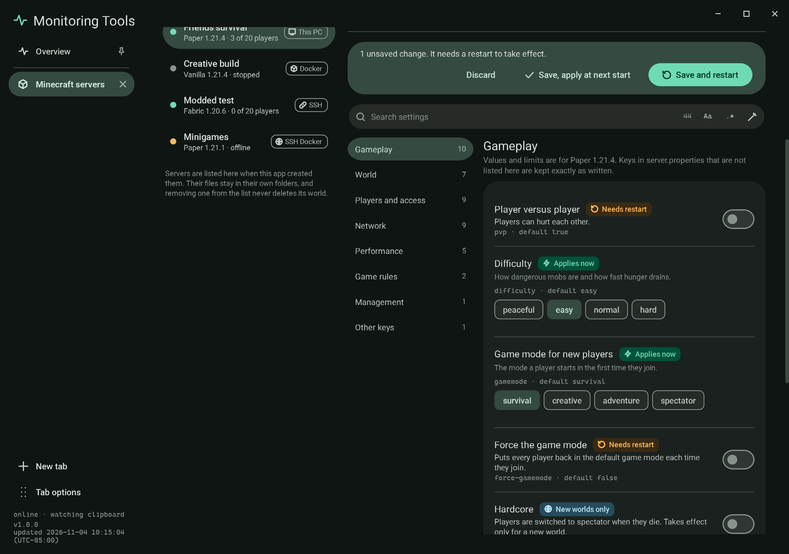

# Settings

`server.properties` as a list of explained settings, in groups: **Gameplay**, **World**, **Players and access**,
**Network**, **Performance**, **Game rules**, **Management** and **Other keys**, each with a count. A search with the
regex builder looks across every group.

Each row shows the label, what it does, the real key and its default, a badge for when a change applies, and the right
control: a switch for true or false, a typed number field with a stepper, its unit and its bounds, a list of choices for
an enumeration, or a text field.

| Badge | Meaning |
| --- | --- |
| Applies now | While the server runs, saving also sends the matching command (`difficulty`, `defaultgamemode`, `whitelist on`, `setidletimeout`, `gamerule`) |
| Needs restart | Saved to the file; the server reads it at its next start |
| New worlds only | Only affects a world that has not been made yet (seed, world type, structures, hardcore) |
| Not on this version | The key arrived in a later release (for example the management API in 1.21.9); the control is off |

## Saving

Changes collect in an unsaved bar with **Discard**, **Save, apply at next start** and **Save and restart**. Saving
changes only the lines of the keys you changed: comments, blank lines, the order of the file and keys this app does not
document are written back exactly as they were. Keys it does not document are listed under **Other keys** as they are.
Memory is stored by the app, not in the file. For SSH servers the file is read and written on the host (sent as base64,
so no character is interpreted by a shell).

## Game rules

The list of rules and the type of each value come from the jar's own `gamerule` command. Rules live inside the world,
so they can only be changed while the server runs; **Read the current values** asks the server for each rule.

## Failure modes

- A number outside its bounds is marked in the field and is not saved.
- Docker servers set some values (name, memory, maximum players, seed) from the container's settings at each start.

## Verification

A self-test check round-trips a file with comments, an unknown key, CRLF line ends and no final newline byte for byte,
and drives the section of a sample server: switching **Player versus player** off and pressing **Save, apply at next
start** writes `pvp=false` and keeps the comments and the unknown key. Capture `mc-settings`.
