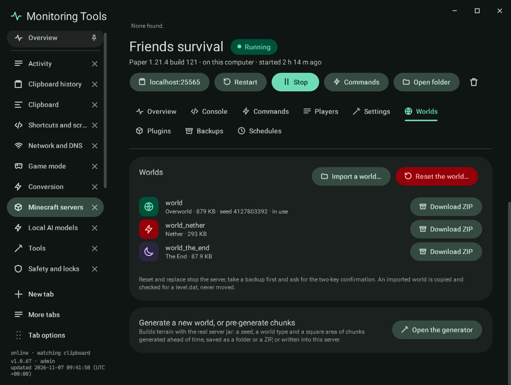

# Worlds

Each dimension of the server's world with its size: the Overworld (the `level-name` folder), the Nether and the End,
whether they sit beside the world (`world_nether`, `world_the_end`, as Paper writes them) or inside it (`DIM-1`, `DIM1`,
as Vanilla writes them). The seed is read from the world's own `level.dat`, or from `level-seed` before the world exists.

- **Download ZIP** writes one dimension as a ZIP, skipping the lock file a running server holds.
- **Import a world** takes a ZIP or a folder. It is checked for a `level.dat` (also one folder down), copied in, and never
  moved. A ZIP entry that points outside its folder is refused.
- **Reset the world** removes the world folders so the server makes a new world at its next start. When a world already
  exists, an import becomes **Replace**. Both stop the server, take a backup first, and ask for the two-key confirmation.
- **Generate a new world, or pre-generate chunks** opens the [world generator](world-generator.md) here, aimed at this
  server when it is on this computer.

SSH servers keep their world on the host, so import, download and reset happen there.

## Verification

Capture `mc-worlds` (and `mc-worlds-generator` for the generator's actions). A self-test check drives the section's real
buttons on a throwaway local server with real folders: **Import a world** refuses a folder without `level.dat`, copies a
world folder (the region file's content is compared), asks before a ZIP replaces it (declining changes nothing, confirming
swaps in the ZIP's content after a backup), and **Reset the world** removes the world folder after a second backup. The
file pickers and the two-key confirmation window are replaced by test hooks in that check; the dialogs themselves were
not driven. The generator's **Pause pre-generation** button is checked to exist and to be off until a build runs.
