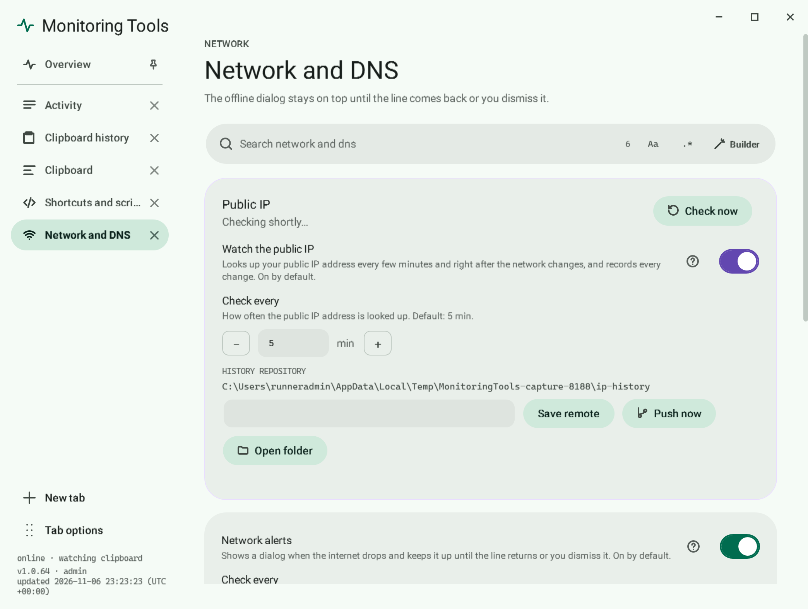

# DNS profiles

Switch between Automatic, Google, Cloudflare, Quad9, OpenDNS or your own saved servers.

## Switch DNS

You can switch from three places: the offline dialog, the tray menu and the **Network and DNS** page in the control centre. The page shows which profile is active and the servers behind it.

## Your own profile

On the Network page add a profile with a name and server addresses. It is saved in the settings and listed beside the built-in ones. Remove it any time.

## Administrator rights

Changing DNS needs administrator rights. You get one UAC prompt, or none when the service already runs elevated.

## Going back

Choose Automatic to return to whatever your router hands out.

## Related

- [Internet watch](internet-watch.md)
- [Service and tray](../app/service-and-tray.md)
