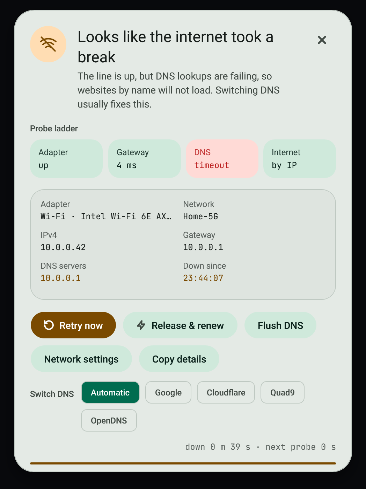

# Internet watch

When the connection drops, an always-on-top dialog explains where it broke and stays until the connection returns or you dismiss it.

## Fix a broken connection

1. Read the diagnosis. It names where the chain broke: adapter, IP address, gateway, DNS, upstream, or a captive portal.
2. Press **Release and renew** to run `ipconfig /release`, `/renew` and `/flushdns` in one step.
3. If the diagnosis points at DNS, try a different server. See [DNS profiles](dns-profiles.md).
4. On a captive portal, use the sign-in button to open the sign-in page.
5. Copy the report if you need to send it to someone.

## What is checked

Live probes of the adapter, the local address, the gateway, DNS lookups and an outside address. The Network page shows the recent probes; gaps are failed checks.

## Quiet times

The dialog follows game mode and snooze, so it does not interrupt a game. See [Game mode](../game/game-mode.md).

## Failure modes

- Release and renew needs administrator rights; the service can ask once through UAC.
- A diagnosis is a best reading of the probes. It is not proof of the cause.

## Related

- [DNS profiles](dns-profiles.md)
- [Service and tray](../app/service-and-tray.md)
