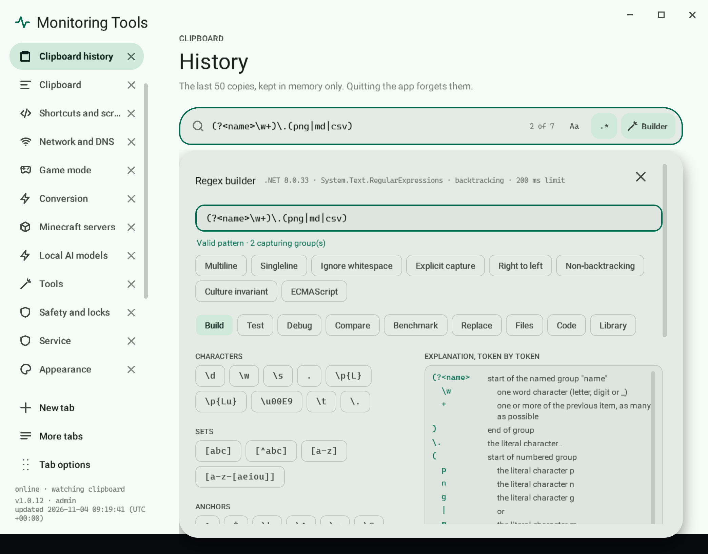

# Regex builder

The builder opens directly under the search bar it belongs to (Builder button or Alt+B) and edits that bar's pattern. The pattern box at its top and the search bar stay in step in both directions.



## Always visible

- **Engine line:** the running .NET version, `System.Text.RegularExpressions`, backtracking or non-backtracking, and the 200 ms limit.
- **Validation:** "Valid pattern · N capturing group(s)" or the engine's own error message.
- **Backtracking warning:** nested quantifiers such as `(a+)+` and repeated overlapping alternations are flagged with a plain explanation and the fixes (an atomic group or the Non-backtracking option).
- **Options:** Multiline, Singleline, Ignore whitespace, Explicit capture, Right to left, Non-backtracking, Culture invariant, ECMAScript. Case is the bar's `Aa`.

## Views

| View | What it does |
| --- | --- |
| Build | Token palette (characters, Unicode properties, sets with subtraction, anchors including `\G`, groups including balancing groups, backreferences, conditionals, quantifiers, lookaround, inline options) inserted at the caret; group tokens wrap the selection. "Escape and insert" turns literal text into a safe pattern. A **Not available in .NET** group lists recursion, subroutine calls, POSIX classes and replacement case conversion as marked entries; choosing one explains why it is missing and inserts nothing. Beside the palette is an expandable **syntax tree** of the pattern (see below). |
| Test | Sample text (defaults to the list the bar searches), every match with its position, the capture groups of the selected match including groups that did not take part, and the measured time. Selecting a match selects it in the sample. Below the sample, **Expected outcomes**: add lines marked *should match* or *should not match*; each shows pass or FAIL live as the pattern or the line changes, with a count of passes. |
| Debug | Replays one match attempt step by step (match, fail, backtrack, enter and leave group) with Prev, Next and Play. The current pattern token and text position are highlighted, the step count is shown, and the trace stops at 100,000 steps with a clear message. It uses a small built-in backtracking interpreter for a stated subset; it is checked against the real .NET engine on the same subject first, and withheld with an explanation if the two disagree or the pattern uses an unsupported construct. Traced: literals, classes with Unicode general categories and class subtraction (`[a-z-[aeiou]]`), anchors including `\G`, lookaround, atomic groups, conditionals on a group or a lookaround test, inline options `(?imsn-imsn)` and `(?imsn-imsn:...)`, alternation, repeats and backreferences. Not traced, and named when used: the `x` option, comments, Unicode scripts and blocks, a conditional whose condition names no group, octal and control escapes, right-to-left, non-backtracking and ECMAScript. |
| Compare | Runs the pattern over the sample in the .NET modes that exist here (default backtracking, non-backtracking, ECMAScript, compiled): whether each is supported, match count, first difference from the default engine, and time. Other languages' engines are not available in this app. |
| Benchmark | Times a subject that should match and one that should not, then repeats each 1x, 2x, 4x, 8x and 16x with a verdict on growth. Runs in the background, stops at the 200 ms limit, and can be cancelled. |
| Replace | Replacement text with `$0`, `$1`, `${name}`, `$$`, `` $` ``, `$'` and `$_` chips, a **Replacement explained** list (every `$` token and literal run described; a reference to a group the pattern does not have is flagged, because .NET silently copies it as plain text), a live preview of the sample, and Split mode. Nothing changes until you copy the result. |
| Code | Match, replace and split snippets in C#, PowerShell, Python, JavaScript and Java with the current options and, where the language has one, a timeout. Output for other languages converts group syntax and lists what it cannot express. Every snippet comes from an editable template (`{{literal}}`, `{{flags}}`, `{{replacement}}`, `{{timeout}}`, `{{notes}}`), saved per language and kind. |
| Files | Search and replace across files in a folder. See [Files view](#files-view). |
| Library | Save the current pattern with a name, use or remove saved ones (the expected outcomes from the Test view are saved with the entry), recent patterns for this bar, an opt-in switch to remember them across restarts, and JSON export and import (imports are size-capped and validated; older exports without test lines still import). |

## Limits, stated plainly

- The syntax tree comes from a parser inside the app for the .NET flavour, not from the engine's internal parse tree, which .NET does not expose. Every tree is cross-checked by compiling the pattern with the real engine: when .NET rejects a pattern, its own message and position are shown with whatever partial tree could be built, and a mismatch in the capturing-group count is reported. Very deep nesting (over 150 levels) is reported as a partial tree. The older flat token list remains available as **Flat tokens**.

## Build view: the syntax tree

- **Tree rows** show the pattern text of each part and a label. **Brief** gives short labels, **Detailed** full sentences (default Brief). Click the arrow, or press Left and Right, to collapse and expand; Up and Down move between rows; Enter or Space selects. At most 400 rows are drawn; collapse a branch to reach the rest.
- **Two-way selection:** choosing a row selects exactly that part in the pattern box (the selection stays visible while focus is in the tree); moving the caret or selecting text in the pattern box highlights the smallest part that contains it.
- **Guided editing:** selecting a quantifier shows minimum, maximum (empty for no limit), a Lazy switch and presets for `*`, `+` and `?`; a character set shows its members and a negate switch (a subtracted set is kept); a group offers numbered, named, non-capturing, atomic and the four lookaround kinds. **Apply to the pattern** rewrites only that span. A change that would turn a valid pattern into an invalid one is refused with the engine's message. Anchors, shorthand classes, escapes, `(?#...)` comments and balancing groups have their own editors. A **conditional** (or its condition) shows the condition kind (group has matched, look-ahead, negative look-ahead, look-behind, negative look-behind), the test, and the yes and no branches, with **Swap branches**; a group test must name a group that exists, by name or number, and a branch may not have its own top-level `|`.
- **Reordering:** **Earlier** and **Later** swap the selected part with a neighbour. With the mouse, press on a tree row, drag it past the system drag distance and release it on a neighbouring row at the same level; the moving row's target is highlighted. A release on the same row is a click, a release on a row at another level is refused with a message, and leaving the tree cancels the drag. The text of each part never changes, and a result .NET rejects is refused.
- **Export Markdown / Export HTML** write the current analysis (pattern, engine, options, validity, and the tree at the chosen detail level with character spans) to a file you choose. Nothing is sent anywhere.
- The Debug trace comes from a separate small interpreter, not from the .NET engine, and covers a stated subset. It never shows a trace that disagrees with the engine. Benchmark and Compare timings are short real measurements and vary from run to run.
- The Compare view also runs the pattern in the Windows JScript engine, Windows PowerShell 5.1, and Python and Node.js when installed. Other engines are not available offline. Code for other languages is generated; the checks run the Python, JavaScript and PowerShell snippets but not Java.
- The Help view has short syntax pages and the builder preferences (opening view, width, height, visible views). The full parity status is in `regexbuddy-parity.md`.

See the [parity ledger](regexbuddy-parity.md) for every missing family.

## Files view

Searches the text of files in a folder with the pattern above. Controls and defaults:

- **Folder** (Browse), **file masks** (default `*`, e.g. `*.txt;*.md`), **exclude masks** for file or folder names (default `.git;node_modules`), **Include subfolders** (on), **Search inside archives** (off), binary files (**Skip binary files** by default, a null byte in the first 8,000 bytes unless a UTF-16 byte order mark explains it; or **Binary files as bytes**; or **Binary files as text**) and **Skip files over (MB)** (5). Links to folders are not followed.
- **Archives:** with **Search inside archives** on, `.zip`, `.jar` and `.nupkg` are read directly, and `.7z`, `.rar`, `.tar`, `.gz`, `.tgz`, `.bz2`, `.xz` and `.cab` are unpacked by the bundled 7-Zip into a temporary folder that is deleted afterwards. The masks and the file name pattern then apply to the entries, and results show `archive!/entry`. An archive that would unpack to more than 200 MB, is encrypted or cannot be read is listed as skipped. Archives inside archives are not opened (a `.tgz` yields its `.tar`).
- **Binary files as bytes:** the file is searched one character per byte, so `\x00` to `\xFF` in the pattern are byte values and text inside the file is still found. Each match shows its byte offset, the printable bytes around it and their hexadecimal, with the match highlighted; CSV export adds a `byte_offset` column.
- **File type settings:** rules per extension, saved in settings and used by every search: the encoding (Auto, UTF-8, UTF-16 LE, UTF-16 BE, Latin-1), **Skip**, and the binary handling for that extension (Default, Skip, Bytes, Text). A forced encoding reads the file as text even when it has null bytes, and a replace writes it back in that encoding.
- Encoding: a byte order mark is honoured (UTF-8, UTF-16, UTF-32); otherwise strict UTF-8, otherwise Latin-1 so no file is unreadable. The encoding is shown per file and a replace writes the file back in the same encoding.
- The search runs off the UI thread with a running count and **Cancel**. Matches are found on the whole file, so a pattern may span lines; each is reported with line and column. A pattern that hits the 200 ms limit on a file skips that file and lists it.
- Results are grouped by file; each match row highlights the match and opens the file in the editor chosen on the Tools page (it opens the file, it does not jump to the line). At most 1,000 rows are shown, 2,000 matches are kept per file and 50,000 overall; **Export CSV** writes the kept matches (a leading `=`, `+`, `-` or `@` is prefixed so a spreadsheet does not run it).
- A replace never writes into an archive or a file searched as bytes: those files are left out of the preview, which says how many were left out.
- **Replace in files...** needs a finished search made with the same pattern and options. It first shows a preview of every affected file and its replacement count and writes nothing. **Write changes...** then opens the two-key danger confirmation. Only after that, each file is copied to a timestamped folder under `regex-backups` in the app data folder, then rewritten. A file that changed since the preview, is read-only, or whose backup cannot be verified is skipped and reported, never half-written. **Restore last backup...** (also confirmed) copies the newest run's backups back; any later edits to those files are lost.
- Closing the builder or leaving the view cancels a running search. Folder, masks and results are kept only while the app runs.

## Remembered patterns

Recent patterns per search box are kept in memory (up to 50). **Remember across restarts** in the Library view is off by default because patterns can be private; when on, they are stored per box in `settings.json`. Turning it off, or **Forget all remembered patterns**, erases them.

## Command line

```
MonitoringTools.exe --regex "<pattern>" [--options i,m,s,x,n] [--replace "<text>"] [--json] <file>...
```

Prints each match as `file:line:col: text`, or with `--replace` the replaced text (a `==> file <==` header precedes each file when there are several). `--json` prints an array instead. Wildcards in a file name are expanded; with no file, text is read from standard input. Files are never modified. Exit code 0 when anything matched, 1 when nothing matched, 2 for an invalid pattern, replacement or usage. Each match is limited to 200 ms like the builder. Options: `i` ignore case, `m` multiline, `s` singleline, `x` ignore pattern whitespace, `n` explicit capture. The app is a windowed program, so output appears when started from a terminal that it can attach to, or when redirected; `--regex --help` prints usage.

**Several patterns.** `--pattern P` may be repeated, and `--patterns-file F` reads one pattern per line (empty lines and lines starting with `#` are skipped; write `\#` for a pattern that starts with `#`). Every other argument is then a file. Each pattern is checked before anything runs (exit 2 names the bad one). Matches print as `file:line:col: [n] text` in text order, `n` being the pattern's number; `--json` rows carry `pattern`. With `--replace`, the patterns are applied in order, each to the result of the one before; `--in-place` takes one pattern at a time so each run has its own backup.

**Automation entry.** `MonitoringTools.exe --regex --automation` reads one JSON request from standard input (or `--regex --request request.json`) and prints one JSON result. Nothing is written to disk.

```json
{
  "operation": "match",
  "patterns": [ { "pattern": "(?<n>\\d+)", "options": "i", "name": "numbers" }, "red|blue", { "library": "Dated", "parameters": { "word": "inv" } } ],
  "text": "inline text",
  "files": [ "C:\\data\\a.txt" ],
  "maxMatches": 1000
}
```

`operation` is `match` (default), `replace` (uses each pattern's `replacement`, or the top-level one), `split` or `validate`. A single `pattern`, `options` and `replacement` may be given at the top level instead of `patterns`. The result is `{ "ok", "error", "operation", "matched", "results": [ { "index", "pattern", "name", "valid", "error", "groups", "inputs": [ { "source", "count", "truncated", "matches": [ { "index", "length", "line", "column", "value", "groups": [ { "name", "number", "success", "index", "length", "value" } ] } ] } ] } ] }`; a replace input carries `replacements` and `text`, a split input carries `parts`, and an input that could not be read or hit the 200 ms limit carries `error`. Exit code 0 when anything matched (validate: every pattern valid), 1 when not, 2 for a request that is not valid JSON or lacks patterns or input, with `"ok": false` and the reason. No COM server is registered; the JSON entry is the automation interface.
