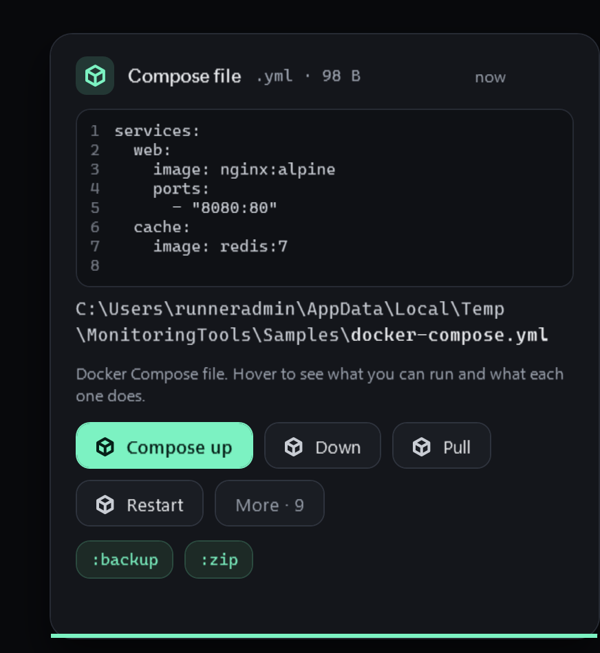

# Docker actions

Copy a Compose file or a Dockerfile and the toast offers buttons for it.

## Compose files

A copied `compose.yaml` or `docker-compose.yml` offers **up**, **down**, **pull**, **restart** and **logs**.

### Start and follow a stack

**Compose up** opens a dedicated operation dialog. Review the selected file, directory and
exact command preview, then choose **Run previewed action**. The dialog checks the CLI, Compose,
selected context, engine connection and active service names before separate build, pull and
start stages. Output appears while commands run. Long commands have a bounded timeout and
retained diagnostics have size limits.

After startup, the dialog observes service state for up to 120 seconds. It distinguishes
healthy services, running services without a health check, pending health, unhealthy or exited
services, and possible completed one-shot tasks. A command exit code of zero is not a service
health certificate. Published ports are reported without claiming that a URL was reached.
The dialog dismisses immediately after startup, restart or recheck verifies readiness. A
successful build, pull, log read or engine check does not prove readiness and does not dismiss
it. Failed, cancelled, timed-out and uncertain one-shot outcomes remain visible.

### Diagnose and repair

Observed evidence and possible causes are separate. A failed stage and its safe diagnostics
can suggest configuration, engine, image access, build, port-binding or health problems.
Suggestions remain inferences. Use **Recheck engine**, **Retry build**, **Retry pull**,
**Recheck health**, **Inspect logs** or **Restart selected** as appropriate. Logs and restart
require a discovered service. Every action is previewed before execution.

No repair edits configuration, changes ports, deletes volumes, prunes other projects or stops
a competing process. Cancellation stops the owned command and observation; containers already
started may remain running. Closing the dialog is not rollback. Read the result and inspect
the selected project before retrying.

Diagnostics are bounded and recognized sensitive lines are omitted before display. Avoid
printing credentials from application logs: generic redaction cannot identify every possible
confidential value. Resolved environment/configuration dumps are not collected.

## Dockerfiles

A copied `Dockerfile` offers **build** and **build and run**.

## What each button says

Each button explains what it will do before you press it. Nothing runs until you do.

## Requirements

Docker must be installed and running. The dialog names the failed prerequisite stage and offers
rechecking where supported. Existing Dockerfile build actions continue to use their existing routes.

## Related

- [File tools](https://github.com/Ding-Ding-Projects/Monitoring-tools/blob/main/docs/features/files/file-tools.md)
- [Clipboard toasts](https://github.com/Ding-Ding-Projects/Monitoring-tools/blob/main/docs/features/clipboard/toasts.md)
- [Minecraft servers](https://github.com/Ding-Ding-Projects/Monitoring-tools/blob/main/docs/features/minecraft/servers.md)

